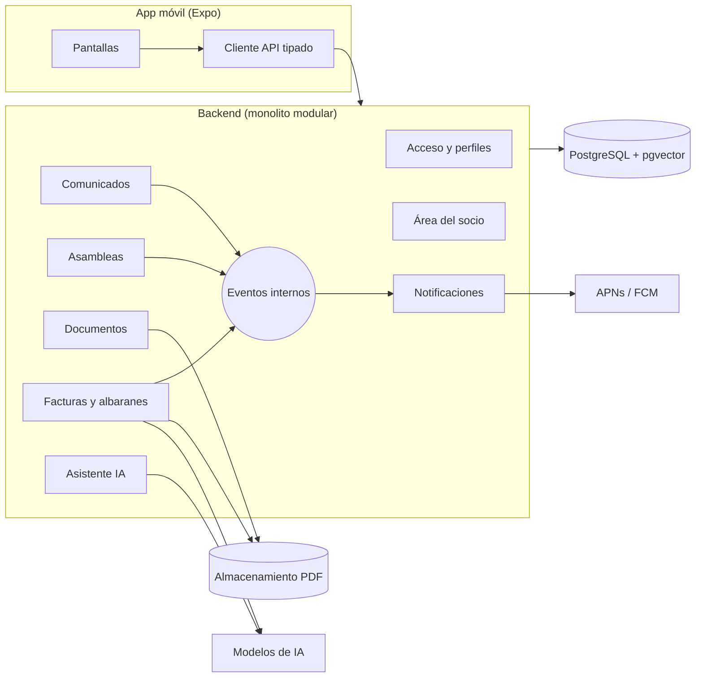

# 02 · Stack y arquitectura

**Fecha**: 2026-10-04 · **Estado**: Aceptado

Las decisiones de fondo están razonadas en los ADR. Este documento es la foto del resultado.

## Stack

| Capa | Elección |
|---|---|
| App móvil | Expo + React Native + TypeScript, Expo Router |
| Datos en cliente | TanStack Query; tokens en almacenamiento seguro del dispositivo |
| Capacidades nativas | Módulos de Expo: cámara, notificaciones push, biometría, almacenamiento seguro |
| Contratos | Paquete compartido con esquemas Zod (validan en servidor y tipan en la app) |
| Backend | Node + TypeScript, monolito modular con Clean Architecture y eventos internos |
| API | REST documentada con OpenAPI, autenticación con JWT |
| Persistencia | PostgreSQL con Prisma; pgvector para el RAG |
| Ficheros | Almacenamiento de objetos compatible con S3, con URL firmadas y caducidad (ADR-005); RustFS en desarrollo |
| Tests | Vitest en dominio y backend; React Native Testing Library en la app; Maestro para E2E |
| Entrega | GitHub Actions, EAS Build (binarios iOS y Android), Railway (backend) |
| Observabilidad | Sentry en app y backend |

## Estructura del monorepo (pnpm)

```
/
├── apps/
│   ├── mobile/        App Expo (iOS y Android)
│   └── api/           Backend
├── packages/
│   └── contracts/     Esquemas Zod y tipos compartidos
└── Documentacion/     Esta carpeta
```

## Vista general



## Módulos del backend

Cada módulo sigue las capas de Clean Architecture (dominio, aplicación, infraestructura) y solo expone a los demás una interfaz pública.

| Módulo | Responsabilidad |
|---|---|
| Acceso y perfiles | Usuarios, sesiones, membresías, perfiles y resolución de permisos |
| Comunicados | Publicación y lectura de comunicados |
| Asambleas | Convocatorias, orden del día, votaciones, quórum y mayorías |
| Documentos | Repositorio documental e indexación para RAG |
| Facturas y albaranes | Terceros (proveedores y clientes), compras y ventas, conciliación, vencimientos, reclamaciones, extracción con visión |
| Área del socio | Datos del socio y aportaciones al capital |
| Asistente IA | RAG y tool calling con los permisos del usuario |
| Notificaciones | Consume eventos de los demás módulos y envía push |

## Reglas transversales

1. **El backend manda**: cada caso de uso comprueba el permiso y deniega por defecto. La app solo oculta lo que el servidor dice que no está permitido.
2. **Aislamiento doble**: por cooperativa y, en el área del socio, por socio. Vale también para el RAG y las herramientas del asistente.
3. **Configuración inyectada**: URL del API, cooperativa y tema no van incrustados en el código de la app. Así el módulo podría embeberse en otra app nativa sin reescribirlo.
4. **Comunicación entre módulos por eventos internos** cuando no hace falta respuesta inmediata (por ejemplo, `DiscrepanciaDetectada` o `FacturaVencida` hacia Notificaciones).
5. **Dominio sin dependencias**: las reglas de negocio no importan Prisma, Express ni ningún SDK.
