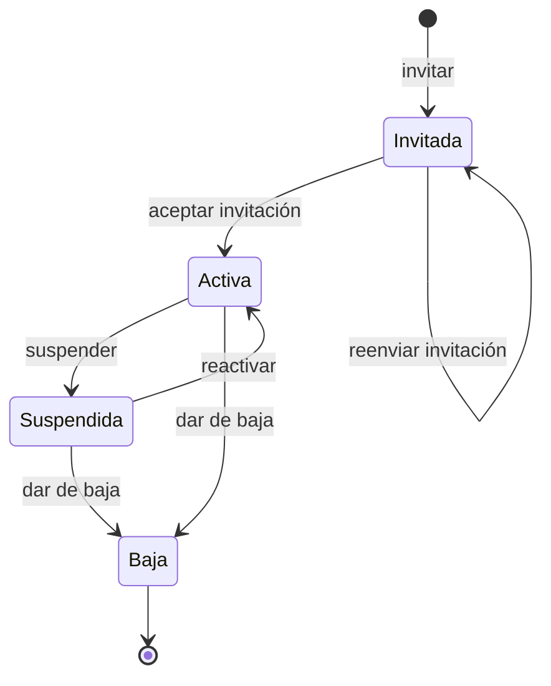
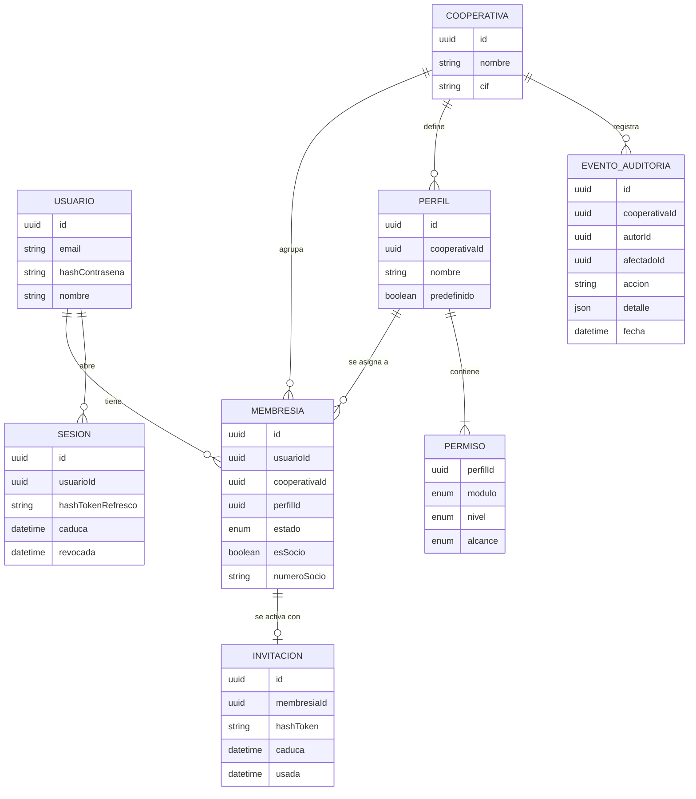

# Requisitos · 01 · Acceso y perfiles

**Fecha**: 2026-10-04 · **Estado**: Aceptado

Módulo base del que dependen todos los demás: identifica al usuario, determina en qué cooperativa está trabajando y resuelve a qué módulos y datos puede acceder.

Decisiones de arquitectura relacionadas: [ADR-003](../adr/ADR-003-multi-cooperativa.md) y [ADR-004](../adr/ADR-004-control-de-acceso-por-perfiles.md).

## 1. Glosario

| Término | Definición | En código |
|---|---|---|
| Usuario | Persona con credenciales en la plataforma. Único por email | `User` |
| Cooperativa | Entidad cliente. Sus datos están aislados de las demás | `Cooperative` |
| Membresía | Vínculo entre un usuario y una cooperativa. Lleva el perfil, el estado y la condición de socio | `Membership` |
| Perfil | Conjunto de permisos con nombre, definido dentro de una cooperativa | `Profile` |
| Permiso | Módulo + nivel + alcance | `Permission` |
| Nivel | Sin acceso, consulta o gestión. Gestión incluye consulta | `AccessLevel` |
| Alcance | Propias (solo los datos del usuario) o todas (los de la cooperativa) | `Scope` |
| Condición de socio | Indica si el miembro es socio de la cooperativa. Independiente del perfil | `isPartner` |
| Cooperativa activa | Aquella sobre la que el usuario opera en un momento dado | — |
| Invitación | Enlace de un solo uso para que un usuario nuevo active su acceso | `Invitation` |

## 2. Actores

- **Usuario no autenticado**: tiene una invitación o unas credenciales.
- **Miembro**: usuario autenticado con membresía activa en la cooperativa activa.
- **Administrador**: miembro cuyo perfil tiene gestión sobre el módulo «Usuarios y perfiles».

## 3. Matriz de perfiles predefinidos

Cada cooperativa nace con estos cuatro perfiles.

| Módulo | Socio | Consejo rector | Gestor | Administrador |
|---|---|---|---|---|
| Comunicados | Consulta | Gestión | Consulta | Gestión |
| Asambleas | Consulta | Gestión | Sin acceso | Gestión |
| Documentos | Consulta | Gestión | Consulta | Gestión |
| Facturas y albaranes | Sin acceso | Consulta | Gestión | Gestión |
| Área del socio | Consulta · propias | Consulta · todas | Gestión · todas | Gestión · todas |
| Asistente IA | Consulta | Consulta | Consulta | Consulta |
| Usuarios y perfiles | Sin acceso | Sin acceso | Sin acceso | Gestión |

El derecho a votar no aparece en la matriz: depende de la condición de socio (RN-ACC-06).

## 4. Historias de usuario

### Imprescindibles (Must)

#### HU-ACC-01 · Activar el acceso desde una invitación

Como persona invitada, quiero establecer mi contraseña desde el enlace recibido, para empezar a usar la app.

- **Dado** una invitación válida y no caducada, **cuando** abro el enlace y defino una contraseña que cumple la política, **entonces** mi membresía pasa a activa y quedo con la sesión iniciada.
- **Dado** una invitación caducada o ya usada, **cuando** abro el enlace, **entonces** veo un mensaje indicando que debo pedir una nueva y no se crea ningún acceso.
- **Dado** que ya tengo cuenta por pertenecer a otra cooperativa, **cuando** acepto la invitación, **entonces** se añade la nueva membresía a mi usuario sin pedirme otra contraseña.

#### HU-ACC-02 · Iniciar sesión

Como usuario, quiero entrar con mi email y contraseña, para acceder a mis cooperativas.

- **Dado** unas credenciales correctas y al menos una membresía activa, **cuando** inicio sesión, **entonces** recibo una sesión válida y accedo a la app.
- **Dado** unas credenciales incorrectas, **cuando** inicio sesión, **entonces** veo un error genérico que no revela si el email existe.
- **Dado** cinco intentos fallidos en quince minutos, **cuando** lo intento de nuevo, **entonces** el acceso queda bloqueado temporalmente aunque la contraseña sea correcta.
- **Dado** unas credenciales correctas pero ninguna membresía activa, **cuando** inicio sesión, **entonces** veo que no tengo acceso a ninguna cooperativa.

#### HU-ACC-03 · Mantener y cerrar la sesión

Como usuario, quiero no tener que identificarme cada vez que abro la app y poder cerrar sesión cuando quiera.

- **Dado** una sesión con el token de acceso caducado y el de refresco vigente, **cuando** la app hace una petición, **entonces** la sesión se renueva sin intervención mía.
- **Dado** un token de refresco ya utilizado, **cuando** alguien intenta usarlo de nuevo, **entonces** se revoca toda la sesión y hay que volver a identificarse.
- **Dado** una sesión iniciada, **cuando** cierro sesión, **entonces** los tokens se revocan en el servidor y se borran del dispositivo.

#### HU-ACC-04 · Desbloqueo biométrico

Como usuario, quiero desbloquear la app con Face ID o huella, para entrar rápido sin exponer mis datos.

- **Dado** que he activado la biometría, **cuando** abro la app con una sesión vigente, **entonces** se me pide biometría antes de mostrar ningún dato.
- **Dado** que la biometría falla o la cancelo, **cuando** se agotan los intentos, **entonces** puedo entrar con contraseña.
- **Dado** un dispositivo sin biometría configurada, **cuando** entro en ajustes, **entonces** la opción no se ofrece.

#### HU-ACC-05 · Elegir y cambiar de cooperativa

Como usuario con varias cooperativas, quiero elegir en cuál estoy trabajando, para ver solo sus datos.

- **Dado** una única membresía activa, **cuando** inicio sesión, **entonces** entro directamente en esa cooperativa.
- **Dado** varias membresías activas, **cuando** inicio sesión por primera vez, **entonces** veo un selector de cooperativa.
- **Dado** una cooperativa activa, **cuando** cambio a otra desde el menú, **entonces** todos los datos y la navegación se recargan con el perfil que tengo en la nueva, sin volver a identificarme.
- **Dado** que ya elegí cooperativa en un uso anterior, **cuando** vuelvo a abrir la app, **entonces** entro en la última usada.

#### HU-ACC-06 · Ver solo los módulos permitidos

Como miembro, quiero que la app me muestre únicamente los módulos a los que tengo acceso, para no encontrarme con pantallas que no puedo usar.

- **Dado** mi perfil en la cooperativa activa, **cuando** la app carga, **entonces** la navegación incluye solo los módulos con nivel consulta o gestión.
- **Dado** un módulo con nivel consulta, **cuando** entro en él, **entonces** no aparecen las acciones de crear, editar o eliminar.
- **Dado** que mi perfil cambia mientras uso la app, **cuando** hago la siguiente petición, **entonces** la navegación se actualiza con los permisos nuevos.

#### HU-ACC-07 · Denegar por defecto en el servidor

Como responsable de la cooperativa, quiero que el servidor rechace cualquier acceso no permitido, para que los datos estén protegidos aunque alguien manipule la app.

- **Dado** un miembro sin acceso a un módulo, **cuando** llama directamente a su API, **entonces** recibe 403 y no se ejecuta ninguna lógica.
- **Dado** un miembro con alcance «propias», **cuando** pide un recurso de otro socio de su cooperativa, **entonces** recibe 404.
- **Dado** un usuario sin membresía en una cooperativa, **cuando** pide cualquier recurso de ella, **entonces** recibe 404.
- **Dado** una petición sin sesión válida, **cuando** llega a un endpoint protegido, **entonces** recibe 401.

#### HU-ACC-08 · Invitar a un usuario

Como administrador, quiero invitar a una persona asignándole un perfil, para darle acceso a la cooperativa.

- **Dado** un email sin membresía en mi cooperativa, **cuando** lo invito indicando perfil y si es socio, **entonces** se crea una membresía en estado invitada y se envía la invitación.
- **Dado** un email que ya tiene membresía en mi cooperativa, **cuando** intento invitarlo, **entonces** se me informa y no se duplica.
- **Dado** una invitación pendiente, **cuando** la reenvío, **entonces** la anterior queda invalidada y se emite una nueva.

#### HU-ACC-09 · Cambiar el perfil de un miembro

Como administrador, quiero cambiar el perfil de un miembro, para ajustar a qué módulos accede.

- **Dado** un miembro activo, **cuando** le asigno otro perfil, **entonces** sus permisos cambian en su siguiente petición, sin que cierre sesión.
- **Dado** mi propia membresía, **cuando** intento cambiar mi perfil, **entonces** la operación se rechaza (así la cooperativa nunca se queda sin administrador).
- **Dado** un miembro de otra cooperativa, **cuando** intento modificarlo, **entonces** recibo 404.

#### HU-ACC-10 · Suspender, reactivar y dar de baja a un miembro

Como administrador, quiero suspender el acceso de un miembro de forma reversible o darlo de baja definitivamente, para controlar quién accede a la cooperativa.

- **Dado** un miembro activo, **cuando** lo suspendo, **entonces** pierde el acceso a esta cooperativa en su siguiente petición y conserva el de sus otras cooperativas.
- **Dado** un miembro suspendido, **cuando** lo reactivo, **entonces** recupera el acceso con el perfil que tenía.
- **Dado** un miembro activo o suspendido, **cuando** lo doy de baja y confirmo la acción, **entonces** pierde el acceso de forma definitiva, deja de aparecer en el listado de miembros activos y conserva el acceso a sus otras cooperativas.
- **Dado** un miembro dado de baja, **cuando** consulto sus registros históricos (votos, comunicados publicados, movimientos de capital, notas), **entonces** siguen existiendo con su autoría.
- **Dado** un miembro dado de baja, **cuando** se le quiere volver a dar acceso, **entonces** hay que enviarle una invitación nueva, que crea una membresía nueva.
- **Dado** mi propia membresía, **cuando** intento suspenderme o darme de baja, **entonces** la operación se rechaza.

### Deseables (Should)

#### HU-ACC-11 · Recuperar la contraseña

Como usuario, quiero restablecer mi contraseña si la olvido.

- **Dado** cualquier email, **cuando** solicito la recuperación, **entonces** veo siempre el mismo mensaje, exista o no la cuenta.
- **Dado** un enlace de recuperación válido, **cuando** establezco una contraseña nueva, **entonces** se revocan todas mis sesiones abiertas.

#### HU-ACC-12 · Registro de cambios de acceso

Como administrador, quiero ver quién cambió qué acceso y cuándo, para poder auditarlo.

- **Dado** una invitación, un cambio de perfil, una suspensión o una reactivación, **cuando** se completa, **entonces** queda registrado con autor, afectado, valores anterior y nuevo, y fecha.
- **Dado** el registro, **cuando** lo consulto, **entonces** solo veo los eventos de mi cooperativa.

### Opcionales (Could)

#### HU-ACC-13 · Perfiles a medida

Como administrador, quiero crear perfiles propios eligiendo nivel y alcance por módulo, para adaptarlos a mi cooperativa.

- **Dado** la matriz de módulos, **cuando** guardo un perfil nuevo, **entonces** queda disponible para asignarlo.
- **Dado** un perfil predefinido, **cuando** intento editarlo o borrarlo, **entonces** la operación se rechaza.
- **Dado** un perfil a medida con miembros asignados, **cuando** intento borrarlo, **entonces** se me pide reasignarlos antes.

### Fuera de alcance (Won't)

- Registro libre sin invitación.
- Inicio de sesión con terceros (Apple, Google) y segundo factor.
- Alta y baja de cooperativas desde la app.
- Más de un perfil por miembro dentro de la misma cooperativa.
- Borrado físico de usuarios y de sus datos (la baja es un estado; el derecho de supresión se trataría como proceso aparte).

## 5. Reglas de negocio

| Id | Regla |
|---|---|
| RN-ACC-01 | El email identifica a un usuario de forma única en toda la plataforma. |
| RN-ACC-02 | Un usuario tiene como máximo una membresía por cooperativa. |
| RN-ACC-03 | Toda membresía tiene exactamente un perfil de su misma cooperativa. |
| RN-ACC-04 | Un permiso combina módulo, nivel y alcance. Gestión incluye consulta. La ausencia de permiso equivale a sin acceso. |
| RN-ACC-05 | El alcance «propias» solo tiene sentido en el Área del socio, que es el único módulo con datos por socio. En los demás el alcance es siempre «todas». |
| RN-ACC-06 | La condición de socio es independiente del perfil. Para votar hacen falta membresía activa y condición de socio. |
| RN-ACC-07 | Toda cooperativa tiene siempre al menos un administrador activo. |
| RN-ACC-08 | Un administrador no puede modificar ni suspender su propia membresía. |
| RN-ACC-09 | Una membresía invitada, suspendida o de baja no concede ningún acceso. El efecto es inmediato. |
| RN-ACC-10 | Una invitación es de un solo uso y caduca a los 7 días. |
| RN-ACC-11 | Cinco intentos fallidos de inicio de sesión en 15 minutos bloquean el acceso durante 15 minutos. |
| RN-ACC-12 | Cambiar o restablecer la contraseña revoca todas las sesiones del usuario. |
| RN-ACC-13 | Los perfiles predefinidos no se pueden editar ni borrar. |
| RN-ACC-14 | La baja es definitiva y no borra datos: la membresía queda en estado baja y sus registros conservan la autoría. Volver a entrar exige una invitación y una membresía nueva. |
| RN-ACC-15 | Una membresía de baja no cuenta para el censo de nuevas votaciones ni recibe notificaciones. |

### Estados de la membresía



## 6. Requisitos no funcionales

| Id | Requisito |
|---|---|
| RNF-ACC-01 | Las contraseñas se almacenan con Argon2id. Mínimo 10 caracteres. |
| RNF-ACC-02 | Token de acceso JWT de 15 minutos. Token de refresco rotatorio de 30 días con detección de reutilización. |
| RNF-ACC-03 | Los tokens se guardan en el almacenamiento seguro del dispositivo, nunca en almacenamiento plano. |
| RNF-ACC-04 | Los permisos se resuelven en el servidor en cada petición y no se incluyen en el token. |
| RNF-ACC-05 | Las respuestas de inicio de sesión, invitación y recuperación no permiten deducir si un email existe. |
| RNF-ACC-06 | Un recurso de otra cooperativa o fuera del alcance responde 404; un módulo sin permiso responde 403. |
| RNF-ACC-07 | La resolución de permisos añade menos de 50 ms al percentil 95 de cada petición. |
| RNF-ACC-08 | Los registros no contienen contraseñas, tokens ni datos personales más allá del identificador de usuario. |
| RNF-ACC-09 | Los endpoints de autenticación tienen límite de peticiones por IP y por email. |

## 7. Modelo de dominio



## 8. API

Autenticación (sin cooperativa):

| Método | Ruta | Uso |
|---|---|---|
| POST | `/auth/login` | Iniciar sesión |
| POST | `/auth/refresh` | Renovar la sesión |
| POST | `/auth/logout` | Cerrar sesión |
| POST | `/auth/invitations/accept` | Activar el acceso desde una invitación |
| POST | `/auth/password/forgot` | Solicitar recuperación |
| POST | `/auth/password/reset` | Establecer nueva contraseña |
| GET | `/me` | Datos del usuario y sus membresías activas |

Contrato de autenticación (esquemas en `packages/contracts/src/auth.ts`):

- El login, la renovación y la activación de un usuario nuevo devuelven `accessToken` (JWT de 15 minutos con `sub` y `sid`, sin permisos), `accessTokenExpiresIn` y `refreshToken`. El token de refresco tiene la forma `<idSesión>.<secreto>`; en base de datos solo se guarda el SHA-256 del secreto. Cada renovación lo rota y amplía la sesión 30 días.
- Al aceptar una invitación, un usuario que ya tenía cuenta no recibe sesión (`tokens: null`): el enlace por sí solo no abre una cuenta existente, así que la app le lleva al inicio de sesión.
- Errores con cuerpo `{ error, message? }`: `400 invalid_request`, `400 password_required`, `400 weak_password`, `401 invalid_credentials`, `401 invalid_refresh_token` (desconocido, caducado, revocado o reutilizado), `403 no_active_membership`, `410 invitation_not_usable` (también si el token no existe), `429 login_locked` con cabecera `Retry-After`.
- Los intentos fallidos cuentan por email exista o no, y un inicio de sesión correcto los pone a cero.

Dentro de una cooperativa:

| Método | Ruta | Uso | Permiso |
|---|---|---|---|
| GET | `/cooperativas/{id}/me/permisos` | Permisos efectivos y condición de socio | Membresía activa |
| GET | `/cooperativas/{id}/perfiles` | Listar perfiles | Usuarios y perfiles · gestión |
| GET | `/cooperativas/{id}/miembros` | Listar miembros | Usuarios y perfiles · gestión |
| POST | `/cooperativas/{id}/miembros` | Invitar | Usuarios y perfiles · gestión |
| PATCH | `/cooperativas/{id}/miembros/{miembroId}` | Cambiar perfil, suspender o reactivar | Usuarios y perfiles · gestión |
| POST | `/cooperativas/{id}/miembros/{miembroId}/baja` | Dar de baja (definitivo) | Usuarios y perfiles · gestión |
| POST | `/cooperativas/{id}/miembros/{miembroId}/invitacion` | Reenviar invitación | Usuarios y perfiles · gestión |
| GET | `/cooperativas/{id}/auditoria` | Registro de cambios de acceso | Usuarios y perfiles · gestión |

Respuesta de `/cooperativas/{id}/me/permisos`, con la que la app construye la navegación:

```json
{
  "cooperativeId": "…",
  "profileName": "Socio",
  "isPartner": true,
  "permissions": [
    { "module": "comunicados", "level": "consulta", "scope": "todas" },
    { "module": "area-socio", "level": "consulta", "scope": "propias" }
  ]
}
```

Las claves JSON van en inglés, como el resto de identificadores; los valores (módulos, niveles, alcances) son los del dominio. Esquemas en `packages/contracts/src/access.ts`; `GET /me` devuelve `id`, `email`, `name` y `memberships` (solo las activas, con `cooperativeId`, `cooperativeName`, `profileName` e `isPartner`).

Contexto de cada petición:

- Las rutas protegidas exigen `Authorization: Bearer <accessToken>`. Además de la firma, se comprueba que la sesión (`sid`) siga abierta, así que un cierre de sesión o una reutilización detectada cortan el acceso al momento. Sin sesión válida: `401 unauthenticated`.
- En `/cooperativas/{id}/...` se carga la membresía activa del usuario con su perfil y permisos en cada petición. Sin membresía activa, cooperativa inexistente o id mal formado: `404 not_found`. Sin permiso para el módulo: `403 forbidden`, antes de ejecutar ninguna lógica.
- Los endpoints `/auth` tienen límite de peticiones por IP (100 cada 15 minutos) y el login, además, por email (20 cada 15 minutos): `429 too_many_requests` (RNF-ACC-09). El contador vive en memoria, válido mientras el API corra en una sola instancia.

## 9. Pantallas de la app

1. Inicio de sesión.
2. Activación desde invitación.
3. Recuperación de contraseña.
4. Selector de cooperativa.
5. Inicio, con la navegación según permisos.
6. Ajustes: biometría, cambio de cooperativa, cerrar sesión.
7. Miembros (administrador): listado, invitar, cambiar perfil, suspender, reactivar y dar de baja con confirmación.

## 10. Estrategia de pruebas

- **Dominio con TDD**: resolución de permisos (nivel y alcance), transiciones de estado de la membresía (incluida la baja como estado final), regla del último administrador, caducidad y un solo uso de la invitación, bloqueo por intentos.
- **Matriz de permisos**: prueba parametrizada que recorre los 4 perfiles por los 7 módulos y comprueba la respuesta esperada de cada endpoint.
- **Aislamiento entre cooperativas**: cada endpoint se llama con un usuario de otra cooperativa y debe responder 404.
- **Integración**: flujo completo de invitación, activación, inicio de sesión, renovación y cierre.
- **E2E en la app**: inicio de sesión, cambio de cooperativa y comprobación de que la navegación cambia con el perfil.

## 11. Decisiones

| # | Decisión | Estado | Afecta a |
|---|---|---|---|
| 1 | Alta solo por invitación del administrador; no hay registro libre | Cerrada (2026-10-04) | HU-ACC-01, HU-ACC-08 |
| 2 | Un único perfil por miembro y cooperativa | Cerrada (2026-10-04) | RN-ACC-03, matriz |
| 3 | Email y contraseña como único método de acceso | Cerrada (2026-10-04) | HU-ACC-02 |
| 4 | Identificadores de código en inglés, documentación en español | Cerrada (2026-10-04) | Glosario, CLAUDE.md |
| 5 | Baja de membresía con acción en la pantalla de miembros | Cerrada (2026-10-04) | HU-ACC-10, RN-ACC-14, RN-ACC-15 |
