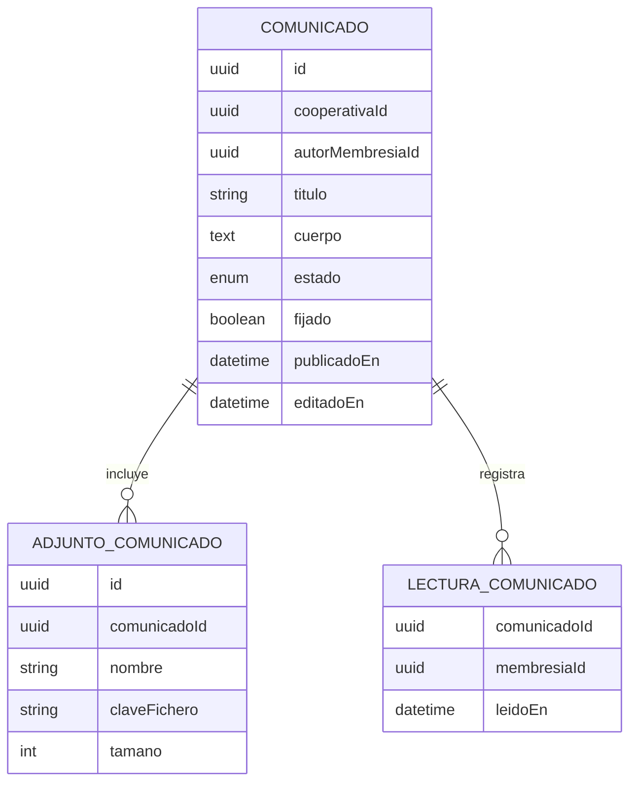

# Requisitos · 02 · Comunicados

**Fecha**: 2026-10-04 · **Estado**: Borrador para validar

Canal oficial de la cooperativa hacia sus miembros. Sustituye a la carta y al tablón.

Permisos según [01-acceso-y-perfiles.md](01-acceso-y-perfiles.md): módulo `comunicados`, niveles consulta y gestión, alcance siempre «todas».

## 1. Historias de usuario

### Imprescindibles (Must)

#### HU-COM-01 · Publicar un comunicado

Como miembro con gestión, quiero redactar y publicar un comunicado, para informar a toda la cooperativa.

- **Dado** un título y un cuerpo válidos, **cuando** lo guardo sin publicar, **entonces** queda como borrador visible solo para quienes tienen gestión.
- **Dado** un borrador, **cuando** lo publico, **entonces** pasa a publicado, aparece en el listado de todos los miembros y se emite el evento `ComunicadoPublicado`.
- **Dado** un comunicado sin título o sin cuerpo, **cuando** intento publicarlo, **entonces** se me indica qué falta y no se publica.

#### HU-COM-02 · Consultar los comunicados

Como miembro, quiero ver los comunicados de mi cooperativa, para estar al día.

- **Dado** comunicados publicados, **cuando** abro el módulo, **entonces** los veo ordenados del más reciente al más antiguo, con los fijados primero.
- **Dado** comunicados que no he abierto, **cuando** veo el listado, **entonces** aparecen marcados como no leídos.
- **Dado** más de 20 comunicados, **cuando** llego al final del listado, **entonces** se cargan los siguientes.

#### HU-COM-03 · Leer un comunicado

Como miembro, quiero abrir un comunicado y ver sus adjuntos.

- **Dado** un comunicado publicado, **cuando** lo abro, **entonces** veo título, cuerpo, autor, fecha y adjuntos, y queda marcado como leído para mí.
- **Dado** un adjunto, **cuando** lo abro, **entonces** se descarga mediante una URL firmada de corta duración.
- **Dado** un comunicado retirado o en borrador, **cuando** intento abrirlo sin gestión, **entonces** recibo 404.

#### HU-COM-04 · Recibir el aviso

Como miembro, quiero recibir una notificación cuando se publique un comunicado.

- **Dado** que tengo las notificaciones activas, **cuando** se publica un comunicado, **entonces** recibo un push con su título.
- **Dado** el push, **cuando** lo pulso, **entonces** la app abre ese comunicado en la cooperativa correspondiente, cambiando de cooperativa activa si hace falta.

#### HU-COM-05 · Editar o retirar un comunicado

Como miembro con gestión, quiero corregir o retirar un comunicado publicado.

- **Dado** un comunicado publicado, **cuando** lo edito, **entonces** se muestra como editado con la fecha de la última modificación y no se reenvía el push.
- **Dado** un comunicado publicado, **cuando** lo retiro, **entonces** deja de ser visible para quienes solo tienen consulta.

### Deseables (Should)

#### HU-COM-06 · Fijar un comunicado

- **Dado** un comunicado publicado, **cuando** lo marco como fijado, **entonces** aparece en la parte superior del listado hasta que lo desmarque.

#### HU-COM-07 · Ver cuántos lo han leído

- **Dado** un comunicado publicado, **cuando** lo consulto con gestión, **entonces** veo cuántos miembros lo han leído sobre el total de miembros activos.

### Opcionales (Could)

- Dirigir un comunicado solo a determinados perfiles.
- Programar la publicación para una fecha.

### Fuera de alcance (Won't)

- Comentarios o respuestas de los miembros.
- Texto enriquecido más allá de párrafos y enlaces.

## 2. Reglas de negocio

| Id | Regla |
|---|---|
| RN-COM-01 | Un comunicado pertenece a una única cooperativa. |
| RN-COM-02 | Estados: borrador, publicado, retirado. Un comunicado publicado no se borra, se retira. |
| RN-COM-03 | Solo los comunicados publicados son visibles con nivel consulta. |
| RN-COM-04 | Título de 1 a 120 caracteres. Cuerpo de 1 a 5000 caracteres. |
| RN-COM-05 | Hasta 3 adjuntos en PDF, de 10 MB como máximo cada uno. |
| RN-COM-06 | La lectura se registra una vez por miembro y comunicado. |
| RN-COM-07 | El push se envía una sola vez, al publicar, y solo a membresías activas. |

## 3. Requisitos no funcionales

| Id | Requisito |
|---|---|
| RNF-COM-01 | El listado responde en menos de 500 ms al percentil 95 con 1000 comunicados. |
| RNF-COM-02 | El cuerpo se trata como texto plano al mostrarlo; no se interpreta HTML. |
| RNF-COM-03 | Los adjuntos se sirven con URL firmadas que caducan a los 5 minutos. |

## 4. Modelo

## 5. Eventos

| Evento | Cuándo | Consumidor |
|---|---|---|
| `ComunicadoPublicado` | Al pasar de borrador a publicado | Notificaciones |

## 6. API

| Método | Ruta | Uso | Nivel |
|---|---|---|---|
| GET | `/cooperativas/{id}/comunicados` | Listado paginado | Consulta |
| GET | `/cooperativas/{id}/comunicados/{comunicadoId}` | Detalle; registra la lectura | Consulta |
| POST | `/cooperativas/{id}/comunicados` | Crear borrador | Gestión |
| PATCH | `/cooperativas/{id}/comunicados/{comunicadoId}` | Editar, fijar | Gestión |
| POST | `/cooperativas/{id}/comunicados/{comunicadoId}/publicar` | Publicar | Gestión |
| POST | `/cooperativas/{id}/comunicados/{comunicadoId}/retirar` | Retirar | Gestión |
| POST | `/cooperativas/{id}/comunicados/{comunicadoId}/adjuntos` | Subir adjunto | Gestión |

## 7. Pantallas

1. Listado de comunicados.
2. Detalle del comunicado.
3. Editor (gestión): borrador, adjuntos, publicar.

## 8. Estrategia de pruebas

- **Dominio**: transiciones de estado, validaciones de longitud y adjuntos, lectura única.
- **Permisos**: borradores y retirados invisibles con consulta; acciones de gestión rechazadas con 403.
- **Aislamiento**: comunicado de otra cooperativa responde 404.
- **Integración**: publicar emite `ComunicadoPublicado` una sola vez.
