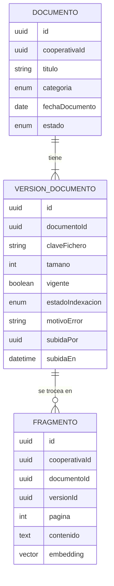

# Requisitos · 03 · Documentos

**Fecha**: 2026-10-04 · **Estado**: Borrador para validar

Repositorio de los documentos societarios de la cooperativa. Además de consultarse directamente, es la base de conocimiento del asistente de IA ([07-asistente-ia.md](07-asistente-ia.md)).

Permisos: módulo `documentos`, niveles consulta y gestión, alcance siempre «todas».

## 1. Glosario

| Término | Definición |
|---|---|
| Documento | Fichero PDF con título, categoría y fecha, publicado para los miembros |
| Categoría | Estatutos, reglamento interno, actas, cuentas anuales u otros |
| Versión | Cada fichero subido para un mismo documento. Solo una es la vigente |
| Indexación | Proceso que extrae el texto, lo trocea y calcula sus embeddings para el RAG |
| Fragmento | Trozo de texto indexado, con su página de origen |

## 2. Historias de usuario

### Imprescindibles (Must)

#### HU-DOC-01 · Subir un documento

Como miembro con gestión, quiero subir un PDF indicando título, categoría y fecha, para ponerlo a disposición de los miembros.

- **Dado** un PDF válido, **cuando** lo subo, **entonces** queda publicado y se emite `DocumentoPublicado` para su indexación.
- **Dado** un fichero que no es PDF o supera 20 MB, **cuando** lo subo, **entonces** se rechaza indicando el motivo.

#### HU-DOC-02 · Consultar los documentos

Como miembro, quiero ver los documentos por categoría y buscarlos por título.

- **Dado** documentos publicados, **cuando** abro el módulo, **entonces** los veo agrupados por categoría y ordenados por fecha descendente.
- **Dado** un texto de búsqueda, **cuando** lo escribo, **entonces** el listado se filtra por coincidencia en el título.

#### HU-DOC-03 · Abrir un documento

Como miembro, quiero ver o descargar un documento.

- **Dado** un documento publicado, **cuando** lo abro, **entonces** se muestra su versión vigente mediante una URL firmada de corta duración.
- **Dado** un documento retirado, **cuando** intento abrirlo sin gestión, **entonces** recibo 404.

#### HU-DOC-04 · Publicar una nueva versión

Como miembro con gestión, quiero sustituir un documento por su versión actualizada, para que siempre se consulte la vigente.

- **Dado** un documento publicado, **cuando** subo una versión nueva, **entonces** pasa a ser la vigente, la anterior queda en el historial y solo la nueva se indexa.
- **Dado** el historial, **cuando** lo consulto con gestión, **entonces** veo todas las versiones con fecha y autor.

#### HU-DOC-05 · Retirar un documento

Como miembro con gestión, quiero retirar un documento que ya no debe estar disponible.

- **Dado** un documento publicado, **cuando** lo retiro, **entonces** deja de ser visible con nivel consulta y sus fragmentos se eliminan del índice.

#### HU-DOC-06 · Conocer el estado de indexación

Como miembro con gestión, quiero saber si un documento ya está disponible para el asistente.

- **Dado** un documento recién subido, **cuando** veo su detalle, **entonces** aparece como pendiente, indexado o con error.
- **Dado** un error de indexación, **cuando** pulso reintentar, **entonces** el proceso se lanza de nuevo.
- **Dado** un PDF sin texto extraíble, **cuando** se intenta indexar, **entonces** queda marcado como no indexable y se indica el motivo.

### Deseables (Should)

#### HU-DOC-07 · Buscar por contenido

- **Dado** una consulta en lenguaje natural, **cuando** busco, **entonces** obtengo los documentos cuyos fragmentos son más relevantes, con la página donde aparecen.

### Opcionales (Could)

- Restringir un documento a determinados perfiles (por ejemplo, actas del consejo rector).
- Reconocimiento de texto para PDF escaneados.

### Fuera de alcance (Won't)

- Otros formatos distintos de PDF.
- Edición del documento dentro de la app.
- Firma electrónica.

## 3. Reglas de negocio

| Id | Regla |
|---|---|
| RN-DOC-01 | Un documento pertenece a una única cooperativa. |
| RN-DOC-02 | Solo se admiten PDF de hasta 20 MB. |
| RN-DOC-03 | Un documento tiene exactamente una versión vigente. |
| RN-DOC-04 | Solo se indexa la versión vigente de los documentos publicados. |
| RN-DOC-05 | Al retirar un documento o sustituir su versión, los fragmentos anteriores se eliminan del índice. |
| RN-DOC-06 | Todo fragmento lleva `cooperativaId`, `documentoId` y número de página. |
| RN-DOC-07 | Un documento no indexado sigue siendo consultable; simplemente el asistente no lo conoce. |

## 4. Indexación

1. Extracción del texto del PDF, página a página.
2. Troceado en fragmentos de unas 800 unidades de texto con solapamiento, respetando párrafos.
3. Cálculo del embedding de cada fragmento.
4. Guardado en PostgreSQL con pgvector, junto a `cooperativaId`, `documentoId` y página.

La indexación es asíncrona respecto a la subida: el documento se puede consultar de inmediato aunque el índice tarde.

## 5. Requisitos no funcionales

| Id | Requisito |
|---|---|
| RNF-DOC-01 | Un documento de 50 páginas queda indexado en menos de 60 segundos. |
| RNF-DOC-02 | Los ficheros se sirven con URL firmadas que caducan a los 5 minutos. |
| RNF-DOC-03 | La búsqueda sobre el índice filtra siempre por `cooperativaId` antes de ordenar por similitud. |
| RNF-DOC-04 | Los ficheros se almacenan fuera de la base de datos, con claves no adivinables. |

## 6. Modelo

## 7. Eventos

| Evento | Cuándo | Consumidor |
|---|---|---|
| `DocumentoPublicado` | Al subir un documento o una versión nueva | Indexación |
| `DocumentoRetirado` | Al retirar un documento | Indexación (borra fragmentos) |

## 8. API

| Método | Ruta | Uso | Nivel |
|---|---|---|---|
| GET | `/cooperativas/{id}/documentos` | Listado con filtro por categoría y título | Consulta |
| GET | `/cooperativas/{id}/documentos/{documentoId}` | Detalle y URL firmada de la versión vigente | Consulta |
| GET | `/cooperativas/{id}/documentos/buscar` | Búsqueda por contenido | Consulta |
| POST | `/cooperativas/{id}/documentos` | Subir documento | Gestión |
| POST | `/cooperativas/{id}/documentos/{documentoId}/versiones` | Subir versión nueva | Gestión |
| GET | `/cooperativas/{id}/documentos/{documentoId}/versiones` | Historial | Gestión |
| POST | `/cooperativas/{id}/documentos/{documentoId}/retirar` | Retirar | Gestión |
| POST | `/cooperativas/{id}/documentos/{documentoId}/reindexar` | Reintentar indexación | Gestión |

Contrato (esquemas en `packages/contracts/src/documents.ts`):

- Categorías: `estatutos`, `reglamento`, `actas`, `cuentas`, `otros`. Título de 1 a 150 caracteres; fecha del documento como día (AAAA-MM-DD).
- El listado acepta `?categoria=` y `?q=` (coincidencia en el título sin distinguir mayúsculas) y ordena por fecha del documento descendente. La app agrupa por categoría.
- Subir un documento o una versión es `multipart/form-data` con el PDF en el campo `fichero`; al subir el documento, además, `title`, `category` y `documentDate`. El tipo se comprueba por contenido.
- El detalle trae la URL firmada de la versión vigente (5 minutos). El estado de indexación y su motivo solo se devuelven con gestión.
- Una sola versión vigente también lo garantiza la base de datos (índice único parcial), incluso con subidas simultáneas.
- Errores: `400 invalid_document`, `400 file_rejected` con `details.reason` (`not_pdf`, `too_large`, `empty`), `404 not_found` y `409 invalid_document_transition`.
- Eventos: `DocumentoPublicado` (`cooperativeId`, `documentId`, `versionId`) y `DocumentoRetirado` (`cooperativeId`, `documentId`), emitidos después de guardar. El propio módulo los consume para indexar.
- Indexación (ADR-006): cola en proceso, una versión cada vez; la subida no la espera. Al arrancar, el API vuelve a encolar las versiones pendientes. Fragmentos de hasta 800 caracteres más 150 de solapamiento, sin mezclar páginas. Embeddings con `bge-m3` (1024 dimensiones) en Ollama. Medido: 50 páginas en 16 s en local.
- `GET /documentos/buscar?q=` (de 3 a 300 caracteres) devuelve hasta 10 fragmentos con `documentId`, `title`, `category`, `page`, `excerpt` y `score`. Busca solo en documentos publicados de la cooperativa y filtra antes de ordenar. Si el servicio de embeddings no responde: `503 search_unavailable`.
- `POST /documentos/{documentoId}/reindexar` responde `202` y deja la versión vigente como pendiente.

## 9. Pantallas

1. Listado por categorías con buscador.
2. Visor del documento.
3. Subida y gestión de versiones (gestión), con estado de indexación.

## 10. Estrategia de pruebas

- **Dominio**: una sola versión vigente, transiciones de estado, validación de formato y tamaño.
- **Indexación**: troceado determinista sobre un PDF de ejemplo; borrado de fragmentos al retirar o versionar.
- **Aislamiento**: la búsqueda nunca devuelve fragmentos de otra cooperativa, aunque el texto coincida exactamente.
- **Permisos**: subida, versiones y retirada rechazadas con 403 sin gestión.
