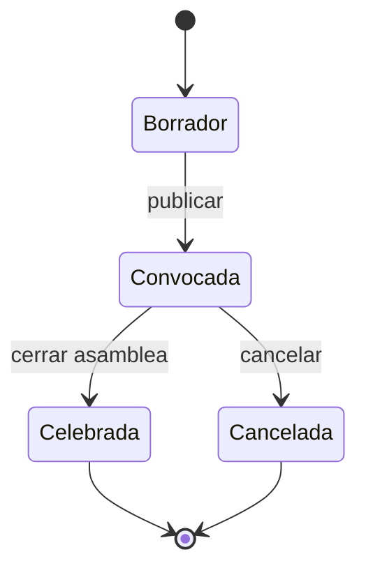
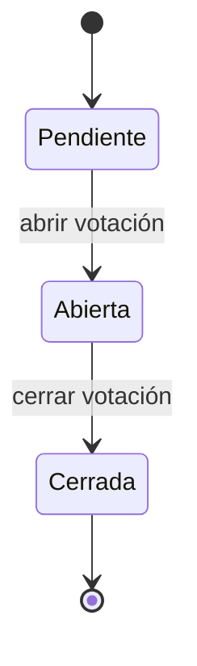
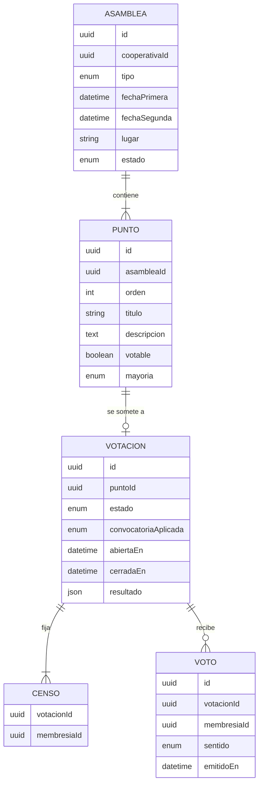

# Requisitos · 04 · Asambleas

**Fecha**: 2026-10-04 · **Estado**: Borrador para validar

Convocatoria de asambleas, consulta del orden del día y votación de cada punto. Es el núcleo de reglas de negocio del proyecto: un socio un voto, quórum y mayorías.

Permisos: módulo `asambleas`, niveles consulta y gestión, alcance siempre «todas». Votar no es un permiso de perfil: exige membresía activa y condición de socio (RN-ACC-06).

> **Naturaleza de la votación.** La votación es consultiva o de apoyo a la asamblea presencial. El voto telemático con plena validez legal exige garantías de identificación y custodia que quedan fuera del alcance del TFM.

## 1. Glosario

| Término | Definición |
|---|---|
| Asamblea | Reunión de los socios: ordinaria o extraordinaria |
| Convocatoria | Publicación de la asamblea con fecha, lugar, orden del día y documentación |
| Punto del orden del día | Asunto a tratar. Puede ser informativo o sometido a votación |
| Votación | Periodo durante el que los socios votan un punto |
| Censo | Socios con derecho a voto en el momento de abrir la votación |
| Quórum | Mínimo de socios del censo que deben participar para que la votación sea válida |
| Mayoría simple | Más votos a favor que en contra |
| Mayoría reforzada | Votos a favor iguales o superiores a una fracción de los emitidos (por defecto, dos tercios) |

## 2. Historias de usuario

### Imprescindibles (Must)

#### HU-ASA-01 · Convocar una asamblea

Como miembro con gestión, quiero crear la convocatoria con fecha, lugar, tipo y orden del día, para que los socios la conozcan con antelación.

- **Dado** una fecha posterior a hoy y al menos un punto, **cuando** publico la convocatoria, **entonces** pasa a convocada, es visible para los miembros y se emite `AsambleaConvocada`.
- **Dado** una fecha con menos antelación de la configurada, **cuando** intento publicar, **entonces** se rechaza indicando la antelación mínima.
- **Dado** una convocatoria en borrador, **cuando** la edito, **entonces** puedo añadir, quitar y ordenar puntos.

#### HU-ASA-02 · Configurar los puntos

Como miembro con gestión, quiero indicar en cada punto si se vota y con qué mayoría.

- **Dado** un punto, **cuando** lo marco como votable, **entonces** debo elegir mayoría simple o reforzada.
- **Dado** un punto, **cuando** adjunto documentación, **entonces** los miembros la ven junto al punto.

#### HU-ASA-03 · Consultar las asambleas

Como miembro, quiero ver las asambleas próximas y pasadas con su orden del día.

- **Dado** asambleas convocadas, **cuando** abro el módulo, **entonces** veo primero las próximas y después las celebradas.
- **Dado** una asamblea, **cuando** la abro, **entonces** veo fecha, lugar, tipo, orden del día, documentación y el estado de cada votación.

#### HU-ASA-04 · Abrir y cerrar una votación

Como miembro con gestión, quiero abrir la votación de un punto y cerrarla, para controlar cuándo se vota.

- **Dado** un punto votable de una asamblea convocada, **cuando** abro la votación, **entonces** se fija el censo en ese instante y se emite `VotacionAbierta`.
- **Dado** una votación abierta, **cuando** la cierro, **entonces** se calcula el resultado y ya no se admiten votos.

#### HU-ASA-05 · Votar

Como socio, quiero votar a favor, en contra o abstenerme en cada punto abierto.

- **Dado** que estoy en el censo y no he votado, **cuando** emito mi voto, **entonces** queda registrado y veo una confirmación.
- **Dado** que ya he votado, **cuando** intento votar de nuevo, **entonces** se rechaza y se me muestra el voto emitido.
- **Dado** que no soy socio o no estaba en el censo al abrir, **cuando** intento votar, **entonces** se rechaza con 403.
- **Dado** una votación cerrada, **cuando** intento votar, **entonces** se rechaza.

#### HU-ASA-06 · Ver el resultado

Como miembro, quiero ver el resultado de cada votación cerrada.

- **Dado** una votación cerrada, **cuando** la consulto, **entonces** veo votos a favor, en contra y abstenciones, participación sobre el censo, si se alcanzó el quórum y si el punto queda aprobado.
- **Dado** una votación abierta, **cuando** la consulto sin gestión, **entonces** solo veo la participación, no el sentido de los votos.

### Deseables (Should)

#### HU-ASA-07 · Segunda convocatoria

- **Dado** una asamblea con segunda convocatoria configurada, **cuando** el quórum de la primera no se alcanza, **entonces** se aplica el quórum de la segunda.

#### HU-ASA-08 · Recordatorio

- **Dado** una votación abierta en la que no he votado, **cuando** falten 24 horas para su cierre programado, **entonces** recibo un push recordatorio.

### Opcionales (Could)

- Delegación de voto en otro socio, con límite de representaciones.
- Voto secreto: se registra que el socio votó, pero no el sentido asociado a su identidad.

### Fuera de alcance (Won't)

- Voto con validez legal plena.
- Voto ponderado por aportaciones.
- Videoconferencia o retransmisión.
- Redacción del acta dentro de la app (el acta se sube como documento).

## 3. Reglas de negocio

| Id | Regla |
|---|---|
| RN-ASA-01 | Un socio, un voto, con independencia de sus aportaciones. |
| RN-ASA-02 | El censo se fija al abrir la votación con las membresías activas con condición de socio. Cambios posteriores no lo alteran. |
| RN-ASA-03 | Cada socio del censo vota como máximo una vez por punto. El voto no se puede cambiar. |
| RN-ASA-04 | Participación = votos emitidos (a favor, en contra y abstenciones) / socios del censo. |
| RN-ASA-05 | Hay quórum si la participación es igual o superior al umbral. Por defecto: 50 % del censo en primera convocatoria; sin mínimo en segunda. Configurable por cooperativa. |
| RN-ASA-06 | Si no se alcanza el quórum, el resultado es «sin quórum» y el punto no se aprueba. |
| RN-ASA-07 | Mayoría simple: aprobado si votos a favor > votos en contra. Las abstenciones no cuentan. |
| RN-ASA-08 | Mayoría reforzada: aprobado si votos a favor ≥ 2/3 de los votos a favor más en contra. Fracción configurable por cooperativa. |
| RN-ASA-09 | Antelación mínima por defecto entre convocatoria y celebración: 15 días. Configurable por cooperativa. |
| RN-ASA-10 | Una asamblea celebrada o cancelada no admite cambios en su orden del día. |
| RN-ASA-11 | Mientras la votación está abierta, el sentido de los votos solo es visible con gestión. |

### Estados

## 4. Requisitos no funcionales

| Id | Requisito |
|---|---|
| RNF-ASA-01 | La unicidad del voto se garantiza en base de datos (restricción única por votación y membresía), no solo en código. |
| RNF-ASA-02 | El cálculo del resultado es una función pura del dominio, sin acceso a infraestructura. |
| RNF-ASA-03 | Cada voto queda registrado con fecha y hora del servidor. |

## 5. Modelo

## 6. Eventos

| Evento | Cuándo | Consumidor |
|---|---|---|
| `AsambleaConvocada` | Al publicar la convocatoria | Notificaciones |
| `VotacionAbierta` | Al abrir la votación de un punto | Notificaciones |
| `VotacionCerrada` | Al cerrar la votación | Notificaciones |

## 7. API

| Método | Ruta | Uso | Requisito |
|---|---|---|---|
| GET | `/cooperativas/{id}/asambleas` | Listado | Consulta |
| GET | `/cooperativas/{id}/asambleas/{asambleaId}` | Detalle con puntos y estado | Consulta |
| POST | `/cooperativas/{id}/asambleas` | Crear borrador | Gestión |
| PATCH | `/cooperativas/{id}/asambleas/{asambleaId}` | Editar borrador y puntos | Gestión |
| POST | `/cooperativas/{id}/asambleas/{asambleaId}/convocar` | Publicar | Gestión |
| POST | `/cooperativas/{id}/asambleas/{asambleaId}/cancelar` | Cancelar | Gestión |
| POST | `/cooperativas/{id}/puntos/{puntoId}/votacion/abrir` | Abrir votación | Gestión |
| POST | `/cooperativas/{id}/puntos/{puntoId}/votacion/cerrar` | Cerrar votación | Gestión |
| POST | `/cooperativas/{id}/puntos/{puntoId}/votacion/votos` | Votar | Socio en el censo |
| GET | `/cooperativas/{id}/puntos/{puntoId}/votacion` | Estado y resultado | Consulta |
| POST | `/cooperativas/{id}/asambleas/{asambleaId}/cerrar` | Pasar a celebrada (sin votaciones abiertas) | Gestión |
| POST | `/cooperativas/{id}/puntos/{puntoId}/documentos` | Adjuntar documentación a un punto (PDF, 10 MB) | Gestión |

Contrato (esquemas en `packages/contracts/src/assemblies.ts`):

- Crear y editar envían el borrador completo: `type`, `firstCallAt`, `secondCallAt`, `place` y `points` en su orden. Cada punto lleva `id` para conservarse; los que faltan se eliminan con su documentación. Solo en borrador (RN-ASA-10). La documentación se puede añadir también con la asamblea convocada.
- La votación «pendiente» no existe en base de datos: nace al abrirse, con el censo y las reglas en vigor (quórum, fracción reforzada, segunda convocatoria) copiados en ese instante.
- Cada votación devuelve `status`, `censusSize`, `votesCast`, `tally` (nulo mientras está abierta sin gestión), `result`, `myVote` y `canVote`.
- Votar no exige permiso del módulo, solo estar en el censo (RN-ACC-06). El voto tiene una clave única por votación y miembro y una clave foránea al censo.
- Errores: `400 invalid_assembly`, `400 insufficient_notice` con `details.minNoticeDays`, `403 not_in_census`, `404 not_found` (también borradores sin gestión), `409 already_voted` con `details.choice`, `409 voting_not_open`, `409 invalid_assembly_transition` y `409 invalid_voting_transition`.
- Ajustes por cooperativa en la tabla `AssemblySettings`; sin fila valen los valores por defecto. No tienen pantalla en el MVP.

## 8. Pantallas

1. Listado de asambleas.
2. Detalle con orden del día y documentación.
3. Votación de un punto, con confirmación.
4. Resultado.
5. Editor de convocatoria y control de votaciones (gestión).

## 9. Estrategia de pruebas

TDD sobre el cálculo del resultado con tablas de casos:

| Censo | A favor | En contra | Abst. | Mayoría | Convocatoria | Esperado |
|---|---|---|---|---|---|---|
| 10 | 4 | 1 | 0 | Simple | Primera | Aprobado (50 % de participación) |
| 10 | 3 | 1 | 0 | Simple | Primera | Sin quórum |
| 10 | 3 | 1 | 0 | Simple | Segunda | Aprobado |
| 10 | 3 | 3 | 2 | Simple | Primera | Rechazado (empate) |
| 9 | 4 | 2 | 0 | Reforzada | Segunda | Aprobado (4/6 = 2/3) |
| 9 | 3 | 2 | 1 | Reforzada | Segunda | Rechazado (3/5 < 2/3) |
| 10 | 0 | 0 | 6 | Simple | Primera | Rechazado (sin votos a favor) |

Además:

- Voto duplicado rechazado también en carreras concurrentes.
- Socio dado de alta tras abrir la votación no puede votar.
- Gestor sin condición de socio no puede votar.
- Sentido de los votos oculto con nivel consulta mientras la votación está abierta.
