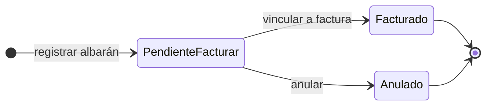
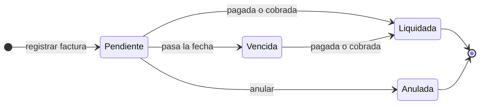
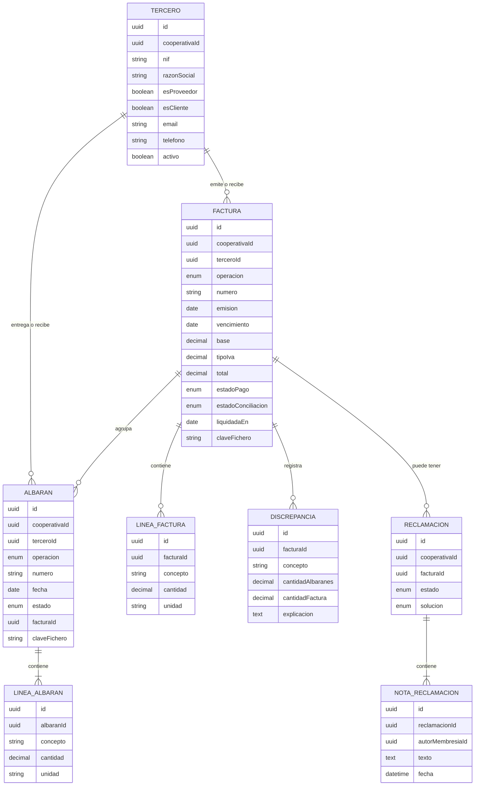

# Requisitos · 05 · Facturas y albaranes

**Fecha**: 2026-10-04 · **Estado**: Aceptado en lo esencial; detalles para validar

Control de los albaranes y facturas de la cooperativa con sus **proveedores** (compras) y sus **clientes** (ventas): registro, conciliación entre albaranes y facturas, vencimientos de pagos y cobros, y captura desde la cámara mediante un modelo de visión.

Permisos: módulo `facturas`, alcance siempre «todas». Los socios no acceden por defecto: es información de gestión de la cooperativa. El consejo rector consulta y el gestor y el administrador gestionan.

> **Frontera del módulo.** La app **controla y consulta, no emite**. Las facturas de venta se emiten fuera (ERP o programa de facturación) y aquí se registran, igual que las recibidas de proveedores. La emisión con validez fiscal (series, numeración legal, Verifactu) queda fuera de alcance.
>
> **Los terceros no usan la app.** Proveedores y clientes son datos de la cooperativa, no usuarios.

## 1. Glosario

| Término | Definición |
|---|---|
| Tercero | Empresa o persona con la que la cooperativa compra o vende. Puede ser proveedor, cliente o ambos |
| Operación | Compra (con un proveedor) o venta (a un cliente) |
| Albarán de compra | Entrega recibida de un proveedor |
| Albarán de venta | Entrega realizada a un cliente |
| Factura recibida | Factura de un proveedor. Genera un pago pendiente |
| Factura emitida | Factura a un cliente, emitida fuera de la app. Genera un cobro pendiente |
| Conciliación | Comparación entre lo que dicen los albaranes y lo que factura la factura |
| Discrepancia | Diferencia entre albaranes y factura que supera la tolerancia |
| Tolerancia | Diferencia admitida sin marcar discrepancia. Configurable por cooperativa |
| Reclamación | Seguimiento interno de una discrepancia o un problema con un tercero |
| Extracción | Lectura de los datos de una foto o PDF mediante un modelo de visión |

## 2. Historias de usuario

### Imprescindibles (Must)

#### HU-FAC-01 · Gestionar terceros

Como gestor, quiero dar de alta proveedores y clientes con su NIF y datos de contacto, para asociarles albaranes y facturas.

- **Dado** un NIF válido no registrado en mi cooperativa, **cuando** guardo el tercero indicando si es proveedor, cliente o ambos, **entonces** queda disponible para operar.
- **Dado** un NIF ya registrado en mi cooperativa, **cuando** intento darlo de alta, **entonces** se me ofrece el existente y no se duplica.
- **Dado** un tercero con documentos, **cuando** intento borrarlo, **entonces** solo puedo desactivarlo.

#### HU-FAC-02 · Registrar un albarán

Como gestor, quiero registrar un albarán de compra o de venta con su tercero, fecha y líneas.

- **Dado** un tercero activo del tipo adecuado (proveedor para compra, cliente para venta) y al menos una línea con concepto, cantidad y unidad, **cuando** guardo el albarán, **entonces** queda pendiente de facturar y se emite `AlbaranRegistrado`.
- **Dado** un número de albarán ya registrado para ese tercero, **cuando** intento guardarlo, **entonces** se rechaza por duplicado.
- **Dado** una línea con cantidad cero o negativa, **cuando** intento guardar, **entonces** se rechaza.

#### HU-FAC-03 · Registrar una factura

Como gestor, quiero registrar una factura recibida o emitida, vinculándola a sus albaranes y adjuntando el PDF.

- **Dado** número, fechas de emisión y vencimiento, base, tipo de IVA, total, PDF y albaranes pendientes del mismo tercero y operación, **cuando** la guardo, **entonces** queda pendiente, los albaranes pasan a facturados y se ejecuta la conciliación.
- **Dado** un albarán de otro tercero, de otra operación o ya facturado, **cuando** intento vincularlo, **entonces** se rechaza.
- **Dado** un total que no coincide con base más IVA, **cuando** intento guardar, **entonces** se rechaza indicando la diferencia.
- **Dado** una factura sin albaranes (por ejemplo, un servicio), **cuando** la guardo, **entonces** se acepta y queda como «sin albaranes», sin conciliar.

#### HU-FAC-04 · Conciliar automáticamente

Como gestor, quiero que el sistema compare la factura con sus albaranes y me avise de las diferencias.

- **Dado** una factura cuyas cantidades por concepto coinciden con las de sus albaranes dentro de la tolerancia, **cuando** se concilia, **entonces** queda conciliada.
- **Dado** una diferencia superior a la tolerancia en algún concepto, **cuando** se concilia, **entonces** queda con discrepancia, se registra el detalle por concepto y se emite `DiscrepanciaDetectada`.
- **Dado** una discrepancia, **cuando** la consulto, **entonces** veo una explicación en lenguaje llano generada por IA junto al detalle numérico, que es el que manda.

#### HU-FAC-05 · Capturar con la cámara

Como gestor, quiero fotografiar un albarán o una factura en papel, o elegir un PDF, para no teclear sus datos.

- **Dado** una foto o un PDF, **cuando** lo envío, **entonces** el sistema propone tipo de documento, operación, tercero y datos, marcando los campos de baja confianza.
- **Dado** un NIF extraído que coincide con un tercero de mi cooperativa, **cuando** veo la propuesta, **entonces** el tercero aparece preseleccionado; si no existe, se me ofrece darlo de alta con los datos extraídos.
- **Dado** la propuesta, **cuando** la reviso y confirmo, **entonces** se guarda como un registro normal, con el fichero original adjunto.
- **Dado** que el modelo no consigue extraer datos, **cuando** termina, **entonces** se me indica y puedo rellenar el formulario a mano.

#### HU-FAC-06 · Consultar albaranes y facturas

Como miembro con acceso al módulo, quiero ver albaranes y facturas filtrando por operación, tercero, estado y fechas.

- **Dado** el módulo, **cuando** lo abro, **entonces** veo compras y ventas por separado, cada una con sus albaranes y facturas.
- **Dado** una factura, **cuando** la abro, **entonces** veo tercero, importes, vencimiento, estado, conciliación, albaranes vinculados y el PDF.
- **Dado** un tercero, **cuando** abro su ficha, **entonces** veo sus albaranes, sus facturas y el saldo pendiente.

#### HU-FAC-07 · Controlar pagos y cobros

Como gestor, quiero saber qué facturas están pendientes de pago o de cobro y cuáles han vencido.

- **Dado** una factura pendiente cuya fecha de vencimiento ha pasado, **cuando** se ejecuta el proceso diario, **entonces** pasa a vencida y se emite `FacturaVencida`.
- **Dado** una factura pendiente que vence en 3 días, **cuando** se ejecuta el proceso diario, **entonces** se emite `FacturaProximaAVencer`.
- **Dado** una factura recibida pendiente o vencida, **cuando** la marco como pagada con su fecha, **entonces** pasa a pagada. En una factura emitida la acción es «cobrada».
- **Dado** el resumen, **cuando** lo consulto, **entonces** veo el total pendiente de pagar y de cobrar, y lo vencido de cada uno.

### Deseables (Should)

#### HU-FAC-08 · Seguimiento de reclamaciones

- **Dado** una discrepancia o un problema con un tercero, **cuando** abro una reclamación, **entonces** queda abierta con notas internas y fecha.
- **Dado** una reclamación abierta, **cuando** registro la solución (abono, nueva factura, aceptada), **entonces** queda resuelta y la factura muestra el historial.

#### HU-FAC-09 · Albaranes sin facturar

- **Dado** albaranes pendientes de facturar con más de 30 días, **cuando** consulto el panel, **entonces** aparecen destacados por tercero.

### Opcionales (Could)

- Importación masiva de terceros o documentos desde CSV.
- Exportación a CSV de lo filtrado.
- Dar acceso de consulta a los socios con un perfil a medida.

### Fuera de alcance (Won't)

- Emisión de facturas con validez fiscal.
- Pagos reales o conexión bancaria.
- Contabilidad, libros de IVA y modelos tributarios.
- Acceso de proveedores o clientes a la app.
- Facturas rectificativas como tipo propio (se registra la nueva y se anula la anterior).
- Pedidos y presupuestos.

## 3. Reglas de negocio

| Id | Regla |
|---|---|
| RN-FAC-01 | Terceros, albaranes y facturas pertenecen a una única cooperativa. |
| RN-FAC-02 | El NIF de un tercero es único dentro de cada cooperativa. El mismo NIF puede existir en otras cooperativas como tercero distinto. |
| RN-FAC-03 | Un albarán de compra solo admite proveedores; uno de venta, solo clientes. |
| RN-FAC-04 | El número de albarán es único por tercero. El número de factura es único por tercero en las recibidas y por cooperativa en las emitidas. |
| RN-FAC-05 | Un albarán solo se puede facturar una vez. |
| RN-FAC-06 | Una factura solo agrupa albaranes pendientes del mismo tercero y la misma operación. |
| RN-FAC-07 | Total = base + IVA, con redondeo a 2 decimales y tolerancia de 0,01 €. |
| RN-FAC-08 | Las cantidades se comparan por concepto y unidad. Hay discrepancia si la diferencia relativa supera la tolerancia (por defecto 1 %) o si un concepto aparece solo en un lado. |
| RN-FAC-09 | Una factura pendiente pasa a vencida cuando su fecha de vencimiento es anterior a hoy. |
| RN-FAC-10 | Una factura pagada o cobrada no vuelve a pendiente ni a vencida. |
| RN-FAC-11 | Ningún dato extraído por IA se guarda sin confirmación humana. |
| RN-FAC-12 | El resultado de la conciliación lo decide la regla numérica. La IA solo redacta la explicación. |
| RN-FAC-13 | Importes en euros con decimales exactos; nunca en coma flotante. |
| RN-FAC-14 | Un tercero con documentos no se borra; se desactiva y deja de ofrecerse para nuevos registros. |

### Estados

El estado de conciliación (sin albaranes, conciliada, con discrepancia) es independiente del estado de pago o cobro.

**Líneas de factura.** Para conciliar por concepto y unidad (RN-FAC-08), la factura lleva sus líneas (concepto, cantidad, unidad). Son obligatorias si agrupa albaranes y opcionales si no (un servicio). Los conceptos se comparan sin distinguir mayúsculas, tildes ni espacios sobrantes.

**Representación de importes (RN-FAC-13).** En el dominio, céntimos, milésimas de cantidad y centésimas de punto de IVA como enteros (`bigint`); en base de datos, `Decimal`; en la API, cadenas decimales (`"1234.56"`). El IVA se redondea a céntimos, mitad hacia arriba.

**Anular una factura** devuelve sus albaranes a «pendiente de facturar», para que la factura que la sustituye pueda agruparlos.

## 4. Extracción con visión

1. La app envía la imagen o el PDF al backend, nunca directamente al proveedor de IA.
2. El backend pide al modelo una salida estructurada validada con el mismo esquema Zod del registro manual.
3. La operación se deduce del NIF: si el emisor es la propia cooperativa, es una venta; si es un tercero, es una compra.
4. El tercero se busca por NIF **solo dentro de la cooperativa activa**.
5. Se devuelve la propuesta con un nivel de confianza por campo.

**Datos personales.** La mayoría de terceros son empresas, pero puede haber autónomos con NIF y domicilio personal. La memoria debe justificar el proveedor de IA elegido, su política de retención y el envío de lo mínimo necesario.

## 5. Requisitos no funcionales

| Id | Requisito |
|---|---|
| RNF-FAC-01 | La extracción responde en menos de 15 segundos al percentil 95. |
| RNF-FAC-02 | Los PDF se almacenan con claves no adivinables y se sirven con URL firmadas de 5 minutos. |
| RNF-FAC-03 | Las imágenes se reducen en el dispositivo antes de enviarlas (lado mayor de 2000 px como máximo). |
| RNF-FAC-04 | El proceso diario de vencimientos es idempotente: ejecutarlo dos veces no emite eventos duplicados. |
| RNF-FAC-05 | Las claves del proveedor de IA residen solo en el backend. |
| RNF-FAC-06 | El NIF se valida con su dígito de control antes de guardar. |

## 6. Modelo

## 7. Eventos

| Evento | Cuándo | Consumidor |
|---|---|---|
| `AlbaranRegistrado` | Al registrar un albarán | Auditoría |
| `FacturaRegistrada` | Al registrar una factura | Auditoría |
| `DiscrepanciaDetectada` | Al conciliar con diferencias | Notificaciones (a quienes gestionan el módulo) |
| `FacturaProximaAVencer` | 3 días antes del vencimiento | Notificaciones (a quienes gestionan el módulo) |
| `FacturaVencida` | Al pasar a vencida | Notificaciones (a quienes gestionan el módulo) |

## 8. API

| Método | Ruta | Uso | Nivel |
|---|---|---|---|
| GET | `/cooperativas/{id}/terceros` | Listado con filtro por tipo | Consulta |
| GET | `/cooperativas/{id}/terceros/{terceroId}` | Ficha con documentos y saldo | Consulta |
| POST | `/cooperativas/{id}/terceros` | Alta | Gestión |
| PATCH | `/cooperativas/{id}/terceros/{terceroId}` | Editar o desactivar | Gestión |
| GET | `/cooperativas/{id}/albaranes` | Listado filtrable | Consulta |
| GET | `/cooperativas/{id}/albaranes/{albaranId}` | Detalle | Consulta |
| POST | `/cooperativas/{id}/albaranes` | Registrar | Gestión |
| GET | `/cooperativas/{id}/facturas` | Listado filtrable | Consulta |
| GET | `/cooperativas/{id}/facturas/resumen` | Pendiente y vencido de pagos y cobros | Consulta |
| GET | `/cooperativas/{id}/facturas/{facturaId}` | Detalle con conciliación | Consulta |
| POST | `/cooperativas/{id}/facturas` | Registrar y conciliar | Gestión |
| POST | `/cooperativas/{id}/facturas/{facturaId}/liquidar` | Marcar pagada o cobrada | Gestión |
| POST | `/cooperativas/{id}/extracciones` | Extraer datos de imagen o PDF | Gestión |
| GET | `/cooperativas/{id}/reclamaciones` | Listado | Consulta |
| POST | `/cooperativas/{id}/reclamaciones` | Abrir | Gestión |
| POST | `/cooperativas/{id}/reclamaciones/{reclamacionId}/notas` | Añadir nota | Gestión |
| POST | `/cooperativas/{id}/reclamaciones/{reclamacionId}/resolver` | Resolver | Gestión |
| POST | `/cooperativas/{id}/albaranes/{albaranId}/anular` | Anular un albarán pendiente de facturar | Gestión |
| POST | `/cooperativas/{id}/facturas/{facturaId}/anular` | Anular una factura pendiente o vencida (sus albaranes vuelven a pendientes) | Gestión |

Contrato (esquemas en `packages/contracts/src/invoicing.ts`):

- Importes y cantidades viajan como cadenas decimales (`"1210.00"`, `"1250.5"`), nunca como números.
- Registrar un albarán o una factura es `multipart/form-data`: el registro como JSON en el campo `datos` y, opcionalmente, el original (PDF, JPEG o PNG, 10 MB como máximo) en `fichero`. El tipo se comprueba por contenido. Así, la captura con cámara guarda el original junto al registro confirmado (RN-FAC-11).
- La factura lleva `lines` (obligatorias si agrupa albaranes) y `deliveryNoteIds`. Se registra, agrupa y concilia en una transacción que bloquea los albaranes: dos facturas simultáneas no pueden facturar el mismo albarán.
- `GET /terceros/{id}` es la ficha: datos, albaranes, facturas y saldo pendiente de pagar y de cobrar.
- `GET /facturas/resumen` devuelve, para pagos (`toPay`) y cobros (`toCollect`), lo pendiente (incluye lo vencido) y lo vencido, con importe y número de facturas; además, facturas con discrepancia abiertas y albaranes pendientes de facturar con más de 30 días (HU-FAC-09).
- Proceso diario de vencimientos (HU-FAC-07): el API lo ejecuta al arrancar y cada hora, y también existe como script (`jobs:due-dates`) para un cron. Marca vencidas las pendientes con vencimiento anterior a hoy (hora de España) y avisa de las que vencen en los próximos 3 días; con una ventana en lugar de un día exacto, un día sin ejecutar no pierde avisos. Cada aviso se registra en `InvoiceReminder` y solo se emite si se registró ahora: repetirlo, incluso a la vez, no duplica nada (RNF-FAC-04).
- Errores: `400 invalid_document`, `400 invalid_third_party`, `400 invalid_amount`, `400 total_mismatch` con `details.expected` y `details.difference`, `404 not_found`, `409 third_party_exists` con `details.thirdPartyId`, `409 duplicate_number` y `409 invalid_invoice_transition`.

## 9. Pantallas

1. Resumen: pendiente y vencido de pagos y cobros, discrepancias abiertas.
2. Compras y ventas, cada una con albaranes y facturas, y filtros.
3. Detalle de albarán.
4. Detalle de factura, con albaranes, conciliación y PDF.
5. Terceros: listado y ficha.
6. Captura con cámara y revisión de la propuesta.
7. Formularios de registro manual.
8. Reclamaciones (si hay margen).

## 10. Estrategia de pruebas

- **Dominio con TDD**: tipo de tercero según operación, cuadre de totales, unicidad de facturación, agrupación por tercero y operación, conciliación con tolerancia, estados, vencimiento por fecha, validación de NIF.
- **Extracción**: tests con fotos y PDF de ejemplo y el proveedor de IA simulado; deducción de la operación por NIF; nunca se persiste sin confirmar.
- **Permisos y aislamiento**: un socio sin acceso recibe 403; el consejo rector consulta pero no registra; un tercero de otra cooperativa responde 404 aunque el NIF coincida; la extracción nunca resuelve terceros de otra cooperativa.
- **Proceso diario**: idempotencia de vencimientos y avisos.
