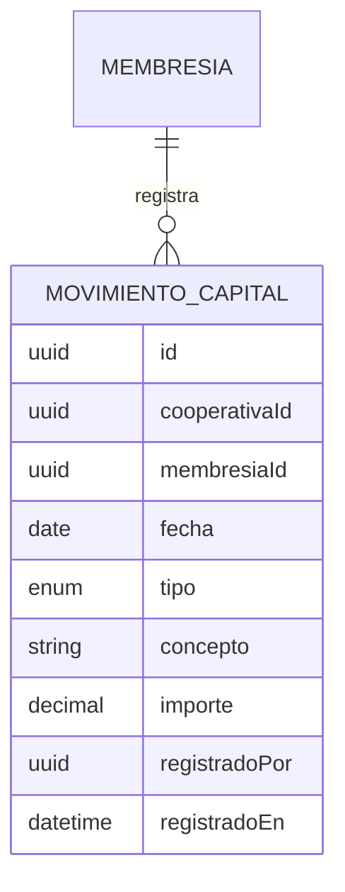

# Requisitos · 06 · Área del socio

**Fecha**: 2026-10-04 · **Estado**: Borrador para validar

Ficha del socio y sus aportaciones al capital social. En el MVP es **solo consulta** para el socio; los datos los carga la cooperativa.

Permisos: módulo `area-socio`. El socio consulta lo suyo; el consejo rector consulta todo; gestor y administrador gestionan todo.

## 1. Historias de usuario

### Imprescindibles (Must)

#### HU-SOC-01 · Ver mi ficha

Como socio, quiero ver mis datos en la cooperativa.

- **Dado** mi membresía, **cuando** abro el área del socio, **entonces** veo número de socio, fecha de alta, perfil y datos de contacto.

#### HU-SOC-02 · Ver mis aportaciones

Como socio, quiero ver cuánto he aportado al capital social y el detalle de cada movimiento.

- **Dado** mis movimientos de capital, **cuando** los consulto, **entonces** veo el capital total y la lista de movimientos con fecha, tipo, concepto e importe.
- **Dado** que no tengo movimientos, **cuando** consulto, **entonces** veo capital cero y un mensaje explicativo.

#### HU-SOC-03 · Registrar movimientos de capital

Como gestor, quiero registrar las aportaciones y reembolsos de un socio.

- **Dado** un socio de mi cooperativa, **cuando** registro un movimiento con fecha, tipo, concepto e importe positivo, **entonces** se añade a su historial y su capital se recalcula.
- **Dado** un reembolso mayor que el capital disponible del socio, **cuando** intento registrarlo, **entonces** se rechaza.

### Deseables (Should)

#### HU-SOC-04 · Consultar el capital de todos los socios

- **Dado** permiso de consulta con alcance «todas», **cuando** abro el listado, **entonces** veo el capital de cada socio y el total de la cooperativa.

### Opcionales (Could)

- Exportar el extracto de aportaciones a PDF.
- Que el socio solicite la actualización de sus datos de contacto.

### Fuera de alcance (Won't)

- Edición de sus datos por parte del socio.
- Cálculo de intereses o retornos cooperativos.
- Proceso de alta o baja como socio.

## 2. Reglas de negocio

| Id | Regla |
|---|---|
| RN-SOC-01 | Los movimientos de capital son inmutables. Un error se corrige con un movimiento de signo contrario. |
| RN-SOC-02 | Tipos: aportación obligatoria, aportación voluntaria, reembolso, corrección. |
| RN-SOC-03 | Capital del socio = suma de aportaciones − reembolsos ± correcciones. Nunca negativo. |
| RN-SOC-04 | Importes en euros con decimales exactos. |
| RN-SOC-05 | Las aportaciones no influyen en el derecho de voto (RN-ASA-01). |

## 3. Modelo

El número de socio, la fecha de alta y la condición de socio viven en la membresía (ver [01-acceso-y-perfiles.md](01-acceso-y-perfiles.md)).

## 4. API

| Método | Ruta | Uso | Nivel |
|---|---|---|---|
| GET | `/cooperativas/{id}/socios/yo` | Mi ficha y capital | Consulta propias |
| GET | `/cooperativas/{id}/socios/yo/movimientos` | Mis movimientos | Consulta propias |
| GET | `/cooperativas/{id}/socios` | Listado con capital | Consulta todas |
| GET | `/cooperativas/{id}/socios/{membresiaId}/movimientos` | Movimientos de un socio | Consulta todas |
| POST | `/cooperativas/{id}/socios/{membresiaId}/movimientos` | Registrar movimiento | Gestión |

## 5. Pantallas

1. Mi ficha con capital total.
2. Movimientos de capital.
3. Listado de socios y registro de movimientos (gestión).

## 6. Estrategia de pruebas

- **Dominio**: cálculo del capital, rechazo de reembolsos que dejan capital negativo, inmutabilidad.
- **Permisos**: un socio no ve la ficha de otro (404); el consejo rector consulta pero no registra (403).
