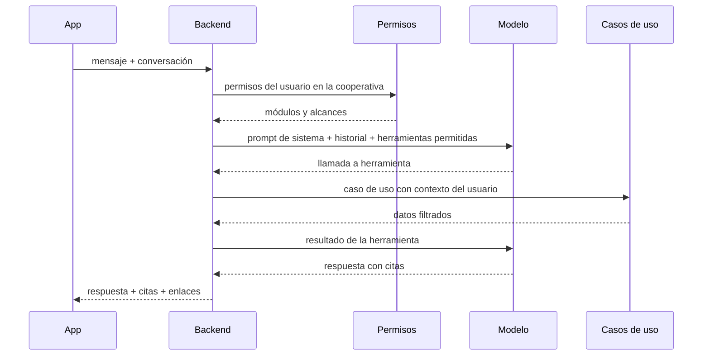
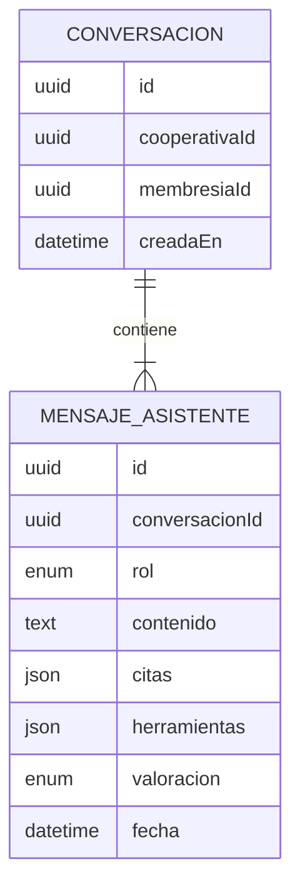

# Requisitos · 07 · Asistente IA

**Fecha**: 2026-10-04 · **Estado**: Borrador para validar

Asistente conversacional que responde dudas del usuario sobre su cooperativa combinando dos fuentes:

- **RAG** sobre los documentos de la cooperativa ([03-documentos.md](03-documentos.md)): estatutos, reglamento, actas, cuentas.
- **Tool calling** sobre los datos de la cooperativa a los que el usuario tiene acceso: asambleas, comunicados, aportaciones y, para quien gestiona, albaranes, facturas y terceros.

Permisos: módulo `asistente`, nivel consulta para todos los perfiles predefinidos. **El asistente hereda los permisos del usuario**: no puede contar nada que el usuario no podría ver en la app (ADR-004).

## 1. Historias de usuario

### Imprescindibles (Must)

#### HU-IA-01 · Preguntar sobre los documentos

Como miembro, quiero preguntar en lenguaje natural sobre los estatutos, el reglamento o las actas.

- **Dado** una pregunta cuya respuesta está en los documentos indexados de mi cooperativa, **cuando** la envío, **entonces** recibo una respuesta en español con citas al documento y la página.
- **Dado** una pregunta cuya respuesta no está en los documentos, **cuando** la envío, **entonces** el asistente dice que no lo encuentra en la documentación, sin inventar.
- **Dado** una cita, **cuando** la pulso, **entonces** se abre el documento en la página citada.

#### HU-IA-02 · Preguntar sobre mis datos

Como miembro, quiero preguntar por las asambleas, mis aportaciones o, si gestiono, las facturas y albaranes.

- **Dado** un gestor que pregunta «¿qué facturas de proveedores vencen esta semana?», **cuando** la envía, **entonces** el asistente consulta las facturas y responde con los datos reales y enlaces a cada una.
- **Dado** la pregunta «¿cuándo es la próxima asamblea y qué se vota?», **cuando** la envío, **entonces** responde con la fecha y los puntos votables.
- **Dado** que la herramienta no devuelve resultados, **cuando** responde, **entonces** lo indica claramente.

#### HU-IA-03 · Respetar mis permisos

Como responsable de la cooperativa, quiero que el asistente no revele información a quien no tiene acceso.

- **Dado** un socio con alcance «propias», **cuando** pregunta por las aportaciones de otro socio, **entonces** el asistente responde que no puede acceder a esa información.
- **Dado** un socio sin acceso a facturas, **cuando** pregunta cuánto se debe a un proveedor, **entonces** el asistente responde que no tiene acceso a esa información.
- **Dado** un perfil sin acceso a un módulo, **cuando** pregunta por ese módulo, **entonces** la herramienta correspondiente no está disponible y el asistente lo indica.
- **Dado** documentos de otra cooperativa con texto similar, **cuando** pregunto, **entonces** nunca se recuperan ni se citan.

#### HU-IA-04 · Conversación con contexto

Como miembro, quiero hacer preguntas de seguimiento sin repetir el contexto.

- **Dado** una conversación abierta, **cuando** hago una pregunta de seguimiento («¿y la anterior?»), **entonces** el asistente usa los turnos previos.
- **Dado** que cambio de cooperativa activa, **cuando** vuelvo al asistente, **entonces** empieza una conversación nueva.

### Deseables (Should)

#### HU-IA-05 · Valorar las respuestas

- **Dado** una respuesta, **cuando** la marco como útil o no útil, **entonces** queda registrada para evaluar la calidad.

#### HU-IA-06 · Preguntas sugeridas

- **Dado** una conversación vacía, **cuando** abro el asistente, **entonces** veo preguntas sugeridas según los módulos a los que tengo acceso.

### Opcionales (Could)

- Respuesta en streaming.
- Resumen automático de un acta.

### Fuera de alcance (Won't)

- Acciones con efectos (registrar, votar, pagar) desde el asistente. Solo consulta.
- Asesoramiento legal o fiscal.
- Entrada por voz.

## 2. Reglas de negocio

| Id | Regla |
|---|---|
| RN-IA-01 | Las herramientas disponibles en cada petición se calculan a partir de los permisos del usuario en la cooperativa activa. |
| RN-IA-02 | Cada herramienta reutiliza los casos de uso de su módulo, con el mismo contexto de usuario y cooperativa. No accede a la base de datos por su cuenta. |
| RN-IA-03 | Todas las herramientas son de solo lectura. |
| RN-IA-04 | La búsqueda RAG filtra siempre por `cooperativaId` antes de ordenar por similitud. |
| RN-IA-05 | Las respuestas basadas en documentos incluyen al menos una cita. Sin fragmentos relevantes, el asistente lo dice. |
| RN-IA-06 | El contenido recuperado de documentos se trata como datos, no como instrucciones. |
| RN-IA-07 | Las conversaciones se guardan por usuario y cooperativa, y solo las ve su autor. |
| RN-IA-08 | Límite de 30 mensajes por usuario y hora. |

## 3. Herramientas

| Herramienta | Módulo requerido | Devuelve |
|---|---|---|
| `buscar_documentos(consulta)` | Documentos · consulta | Fragmentos con documento y página |
| `listar_facturas(operacion?, estado?, tercero?, desde?, hasta?)` | Facturas · consulta | Facturas recibidas o emitidas |
| `listar_albaranes(operacion?, estado?, tercero?, desde?, hasta?)` | Facturas · consulta | Albaranes de compra o venta |
| `resumen_pagos_cobros()` | Facturas · consulta | Pendiente y vencido de pagos y cobros |
| `buscar_tercero(texto)` | Facturas · consulta | Proveedores y clientes por nombre o NIF |
| `proximas_asambleas()` | Asambleas · consulta | Asambleas convocadas y puntos votables |
| `resultado_votacion(asamblea?)` | Asambleas · consulta | Resultados de votaciones cerradas |
| `mis_aportaciones()` | Área del socio · consulta | Capital y últimos movimientos del usuario |
| `ultimos_comunicados(n?)` | Comunicados · consulta | Comunicados publicados recientes |

## 4. Flujo

## 5. Requisitos no funcionales

| Id | Requisito |
|---|---|
| RNF-IA-01 | Primera respuesta en menos de 8 segundos al percentil 95. |
| RNF-IA-02 | El proveedor de modelo queda detrás de una interfaz (puerto) para poder cambiarlo. |
| RNF-IA-03 | Las claves del proveedor residen solo en el backend. |
| RNF-IA-04 | Se registran latencia, tokens y herramientas usadas por petición, sin el contenido personal. |
| RNF-IA-05 | Existe un conjunto de evaluación con al menos 20 preguntas y respuestas esperadas, ejecutable en CI. |

## 6. Seguridad específica

- **Inyección de instrucciones**: un documento subido puede contener texto dirigido al modelo. Se mitiga delimitando el contenido recuperado, indicándolo en el prompt de sistema y, sobre todo, con RN-IA-02 y RN-IA-03: aunque el modelo se desvíe, solo puede llamar a herramientas de lectura que ya filtran por permisos.
- **Fuga entre cooperativas**: el filtro por cooperativa está en la consulta, no en el prompt.
- **Alucinaciones**: respuestas ancladas a citas y a datos de herramientas; si no hay base, se dice.

## 7. Modelo

## 8. API

| Método | Ruta | Uso |
|---|---|---|
| POST | `/cooperativas/{id}/asistente/conversaciones` | Crear conversación |
| GET | `/cooperativas/{id}/asistente/conversaciones` | Mis conversaciones |
| POST | `/cooperativas/{id}/asistente/conversaciones/{conversacionId}/mensajes` | Enviar mensaje |
| POST | `/cooperativas/{id}/asistente/mensajes/{mensajeId}/valoracion` | Valorar respuesta |

## 9. Pantallas

1. Chat con preguntas sugeridas, citas pulsables y enlaces a facturas, asambleas y documentos.
2. Historial de conversaciones.

## 10. Estrategia de pruebas

- **Unitarias**: selección de herramientas según permisos para los 4 perfiles.
- **Integración con modelo simulado**: cada herramienta invoca su caso de uso con el contexto correcto.
- **Aislamiento**: dos cooperativas con documentos casi idénticos; ninguna pregunta recupera fragmentos de la otra.
- **Evaluación**: conjunto de preguntas con respuesta esperada (fidelidad y presencia de cita), con LangSmith o un script propio.
- **Inyección**: documento de prueba con instrucciones maliciosas; el asistente no las sigue ni amplía su acceso.
