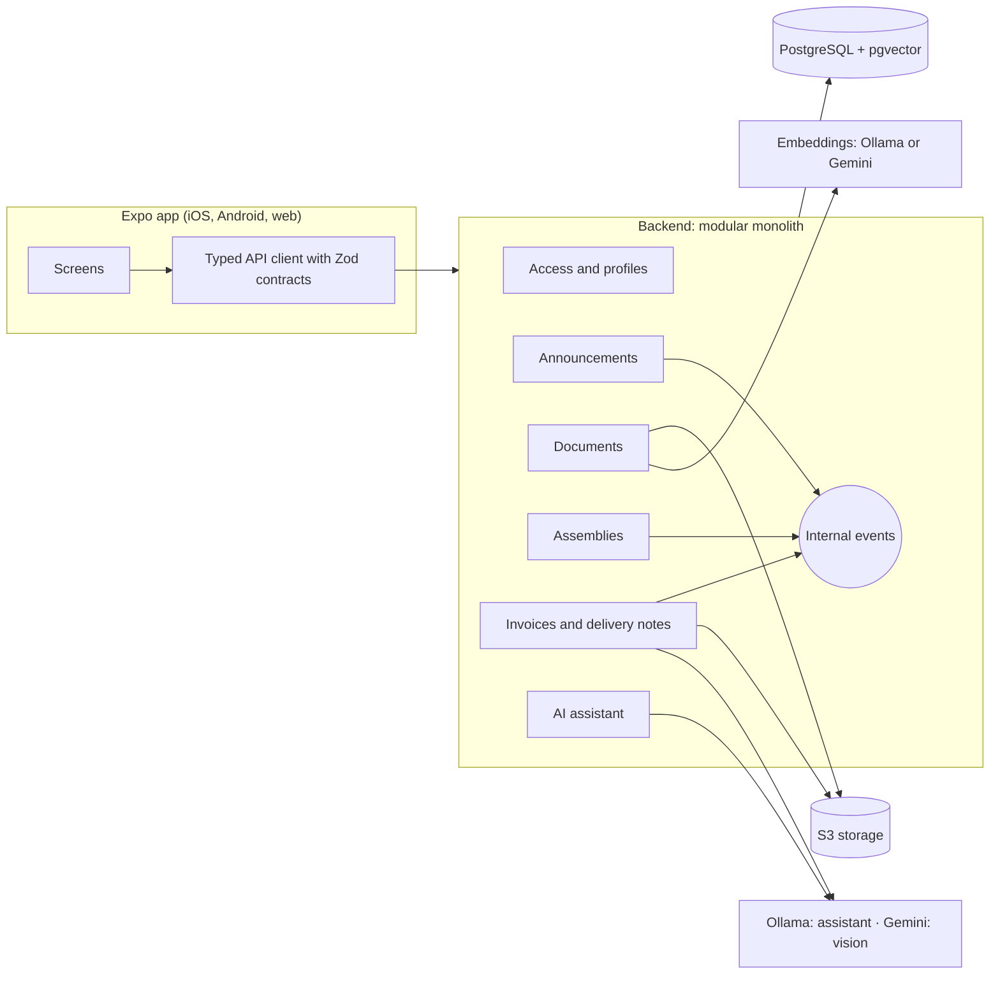

# multiCooperativa

[Versión en español](README.md) · English version

Final project (TFM) of the Master's in AI-Driven Development (BIG school). Multi-cooperative mobile app for iOS and Android (Expo) with a Node + TypeScript backend, built to connect each cooperative with its members and to control delivery notes and invoices, with an AI assistant that respects each user's permissions.

Delivery: 26/10/2026 · Feature freeze: 22/10/2026.

## Deliverables

| Deliverable   | Link                                                                                                                                                                                 |
| ------------- | ------------------------------------------------------------------------------------------------------------------------------------------------------------------------------------ |
| Demo (web)    | https://cooperativa.chaparro2001.com/                                                                                                                                                |
| API           | https://api-cooperativa.chaparro2001.com                                                                                                                                             |
| Slides        | [docs/slides/multicooperativa-tfm.pptx](docs/slides/multicooperativa-tfm.pptx) ([PDF](docs/slides/multicooperativa-tfm.pdf), [video script, in Spanish](docs/slides/guion-video.md)) |
| Demo video    | <!-- TODO: video URL -->                                                                                                                                                             |
| Documentation | [docs/README.md](docs/README.md)                                                                                                                                                     |

## Contents

1. [Project overview](#1-project-overview)
2. [Tech stack](#2-tech-stack)
3. [Local setup and run](#3-local-setup-and-run)
4. [Project structure](#4-project-structure)
5. [Main features](#5-main-features)
6. [Limitations and future work](#6-limitations-and-future-work)
7. [Test users and password](#7-test-users-and-password)
8. [Demo deployment](#8-demo-deployment)
9. [Architecture](#9-architecture)
10. [Decisions (ADRs)](#10-decisions-adrs)
11. [Quality](#11-quality)
12. [AI-assisted development](#12-ai-assisted-development)
13. [Relation to the master's program](#13-relation-to-the-masters-program)

## 1. Project overview

### Problem

The member of a cooperative participates little and is poorly informed:

- Calls to meetings arrive by letter or notice board.
- Bylaws, regulations and minutes are not at hand.
- Delivery notes and invoices with suppliers and customers live on paper, and mismatches between them, overdue payments and pending collections are detected late or never.

### Solution

A standard application, valid for any type of cooperative (agricultural, housing, worker, consumer), with no sector-specific functionality. One user can belong to several cooperatives with a different profile in each, and the data of each cooperative is isolated from the others.

### The 4 profiles

| Profile         | Who they are                                   | What they need                                                                 |
| --------------- | ---------------------------------------------- | ------------------------------------------------------------------------------ |
| Member          | Member of the cooperative                      | To be informed, vote and read documents                                        |
| Governing board | Governing body                                 | To publish announcements, call assemblies and oversee payments and collections |
| Manager         | Administrative staff (may not be a member)     | To register and reconcile delivery notes and invoices, control due dates       |
| Administrator   | Person in charge of the cooperative in the app | To grant access to users and assign profiles                                   |

Permissions are defined by module, level and scope (ADR-004). The backend decides; the app only hides.

### AI differentiators

- **Invoice and delivery note extraction with vision**: the document is photographed or uploaded and Gemini extracts the data. The result is validated with a Zod schema and **never saved without human confirmation**.
- **Discrepancy explanation**: when a delivery note and an invoice do not match, the AI explains in natural language where the difference is.
- **Semantic search over documents** (RAG): documents are chunked, embedded and indexed in pgvector, always filtered by cooperative.
- **Conversational assistant** with source citations and read-only tools that reuse the use cases with the user's permissions: it cannot see anything the user cannot see.

## 2. Tech stack

| Layer            | Choice                                                                                                                                                                                 |
| ---------------- | -------------------------------------------------------------------------------------------------------------------------------------------------------------------------------------- |
| Mobile app       | Expo + React Native + TypeScript, Expo Router                                                                                                                                          |
| Client data      | TanStack Query; tokens in the device's secure storage                                                                                                                                  |
| User-facing text | i18next + react-i18next + expo-localization; `es` default (ADR-008)                                                                                                                    |
| Contracts        | Shared package with Zod schemas (validate on the server and type the app)                                                                                                              |
| Backend          | Node + TypeScript, modular monolith with Clean Architecture and internal events                                                                                                        |
| API              | REST, JWT authentication, stable error codes                                                                                                                                           |
| Persistence      | PostgreSQL + Prisma; pgvector for RAG                                                                                                                                                  |
| Language model   | Assistant: local Ollama model on the home server, `qwen3:4b-instruct` by default and `qwen3:8b` selectable (ADR-013, ADR-015); vision and explanations: Gemini (ADR-009); behind ports |
| Embeddings       | Local `bge-m3` with Ollama (ADR-006); Gemini embeddings in the hosted demo (ADR-010)                                                                                                   |
| Files            | S3-compatible storage with expiring signed URLs (ADR-005); RustFS locally                                                                                                              |
| Tests            | Vitest and React Native Testing Library                                                                                                                                                |
| Quality          | ESLint, Prettier, Husky (pre-commit), custom module-boundaries rule                                                                                                                    |
| Delivery         | GitHub Actions; demo with the API on a home server (Cloudflare Tunnel) and GitHub Pages (web)                                                                                          |

## 3. Local setup and run

### Requirements

- Node 24 (`.nvmrc` file: `nvm use`).
- pnpm.
- Docker (PostgreSQL with pgvector, S3 storage with RustFS, and Ollama).

### Steps

```bash
pnpm install                 # installs and generates the Prisma client
pnpm db:up                   # PostgreSQL + pgvector, S3 (RustFS) and Ollama with Docker Compose
pnpm ai:pull                 # downloads the bge-m3 embeddings model into Ollama (once)

cp apps/api/.env.example apps/api/.env
cp apps/mobile/.env.example apps/mobile/.env

pnpm --filter @multicooperativa/api db:migrate        # applies the migrations
pnpm --filter @multicooperativa/api db:seed           # sample cooperatives and users

pnpm --filter @multicooperativa/api dev               # API at http://localhost:3000
pnpm --filter @multicooperativa/mobile start          # Expo app
```

Optional, with the API running, to load sample documents and announcements through the API (they are indexed with the configured embeddings provider):

```bash
API_URL=http://localhost:3000 pnpm --filter @multicooperativa/api db:seed:content
```

### Gemini key (optional)

To enable the assistant (with the default provider), invoice extraction and discrepancy explanation, set `GEMINI_API_KEY` in `apps/api/.env` (free key from Google AI Studio, no card). Optional: `GEMINI_MODEL` and `ASSISTANT_MESSAGE_LIMIT_PER_HOUR` (default 30).

**Model per cooperative (ADR-014)**: with the local provider, each cooperative's administrator chooses the assistant's model in Settings among `ASSISTANT_OLLAMA_MODELS` (only models installed in Ollama are offered; the app never downloads one).

**Assistant on a local model (ADR-013)**: with `ASSISTANT_LLM_PROVIDER=ollama` the assistant answers with an Ollama model (`ASSISTANT_OLLAMA_MODEL`, default `qwen3:8b`; `pnpm ai:pull:chat` downloads it), uses no Gemini quota and sends no question to the cloud. This is what the home-server demo uses, with `qwen3:4b-instruct` as the default model (user-reported as acceptably fast on that CPU; not measured with the evaluation set, ADR-015) and `qwen3:8b` selectable per cooperative in Settings (ADR-014). Gemini stays for invoice extraction (vision) and discrepancy explanations. With the local model a question takes about 7 s on average on a 12-core CPU (p90 26 s) and it passes 19 of the 22 evaluation questions (benchmark of `qwen3:8b` on the development Mac; `qwen3:4b-instruct` passed 18 of 22 in 5.0 s on average).

Without the Gemini key (and with the `gemini` provider) the assistant answers 503 and **the rest of the app works normally**. The AI features that use Gemini (invoice extraction, discrepancy explanation) are not available either. Local embeddings are served by Ollama, not Gemini.

### Tests and checks

```bash
pnpm lint                    # ESLint (includes the boundaries between modules)
pnpm format:check            # Prettier (pnpm format to apply)
pnpm typecheck
pnpm test                    # unit tests, no database
pnpm test:integration        # against the multicooperativa_test DB and the test bucket (needs pnpm db:up)
pnpm --filter @multicooperativa/api ai:eval          # assistant evaluation (add --offline without a key)
```

## 4. Project structure

```
apps/
  mobile/              Expo app (iOS, Android and web)
  api/                 Node + TypeScript backend
    src/modules/       One directory per business module
    prisma/            Schema and migrations
packages/
  contracts/           Zod schemas and types shared by app and backend
docs/                  Vision, stack, plan, deployment, ADRs, requirements and sample data
tools/eslint/          Custom module-boundaries rule
.github/workflows/     CI, GitHub Pages deploy and due-dates cron
docker-compose.yml     PostgreSQL + pgvector, RustFS and Ollama for development
deploy/home-server/     Docker stack of the home server (API, PostgreSQL, RustFS, Ollama, cloudflared)
render.yaml            Render blueprint (optional cloud alternative)
CLAUDE.md              Working contract with the AI agent
```

Backend modules (`apps/api/src/modules/`): `access`, `announcements`, `documents`, `assemblies`, `invoicing`, `assistant`.

### Clean Architecture layers per module

```
modules/<module>/
  domain/           Pure business rules: no Prisma, HTTP or external SDKs
  application/      Use cases; receive the context (user, cooperative, permissions) and deny by default
  infrastructure/   Adapters: Prisma, HTTP, Gemini, S3, Ollama
  index.ts          The module's only public interface
```

Modules talk to each other only through their `index.ts` or internal events, never through another module's tables. A custom ESLint rule enforces it.

## 5. Main features

The status of each task is in [docs/03-implementation-plan.md](docs/03-implementation-plan.md); the specifications are in [docs/requirements/](docs/requirements/).

- **Access and profiles**: login with lockout after failed attempts, rotating refresh token, logout, invitation acceptance, cooperative selector, permission-based navigation and biometrics on native. Member management: list, invite, change profile, suspend and reactivate. Endpoint for the user's effective permissions.
- **Announcements**: publication by the board, list and detail, read marker and the `AnnouncementPublished` event.
- **Documents with semantic search**: repository with versions, signed URLs, text extraction, chunking, embeddings and pgvector filtered by cooperative.
- **Assemblies**: call to meeting with agenda and census, voting with a unique constraint in the database, quorum and majority calculation, results and voting control for the board.
- **Invoices and delivery notes**: third parties (suppliers and customers), purchase and sales delivery notes and invoices with exact decimal amounts, reconciliation with tolerance, statuses, payments and collections summary, idempotent due-dates process (hourly), camera capture and review, **AI extraction** (Gemini vision, validated with Zod and confirmed by a person) and **AI discrepancy explanation**.
- **AI assistant**: chat with citations and links to resources, RAG over documents, read-only tools filtered by permissions (`search_documents`, `list_invoices`, `list_delivery_notes`, `payments_and_collections_summary`, `find_third_party`, `upcoming_assemblies`, `voting_result`, `latest_announcements`), conversations, hourly usage limit, an evaluation set of 20 questions and, for each cooperative's administrator, the choice of the local model in Settings (US-AI-07, ADR-014).

## 6. Limitations and future work

The following is **not implemented** in the delivery:

- **Member area** (capital movements and read access). This is why the assistant's `my_contributions` tool does not exist either.
- **Push notifications** (notifications module, device tokens, navigation from the notification).
- **Sentry** in app and backend.
- **E2E tests with Maestro**.
- **Invoice claims**.
- **Native binaries with EAS Build**: the demo is the web export; the native app runs with Expo locally.
- Email invitations: there is no email provider, `POST .../members` answers 503 in production.
- The web build has no biometrics or camera capture (the file chooser is used) and keeps the session in `sessionStorage`.

The remaining limitations of the hosted demo are in [docs/04-deployment.md](docs/04-deployment.md).

## 7. Test users and password

Data defined in the seed (`apps/api/src/dev/demo-seed.ts`) and described in [docs/sample-data.md](docs/sample-data.md).

**Password**:

- Local: `demo-cooperativa-2026` (seed default, or `SEED_PASSWORD` if defined).
- Hosted demo: <!-- TODO: contraseña demo -->

### Cooperativa Agrícola San Isidro (tax ID F12345674)

| Email                     | Name         | Profile         | Status    |
| ------------------------- | ------------ | --------------- | --------- |
| admin@sanisidro.test      | Ana Torres   | Administrator   | Active    |
| consejo@sanisidro.test    | Carlos Ruiz  | Governing board | Active    |
| gestor@sanisidro.test     | Elena Gómez  | Manager         | Active    |
| socio@sanisidro.test      | Javier López | Member          | Active    |
| lucia@demo.test           | Lucía Martín | Member          | Active    |
| suspendido@sanisidro.test | Pedro Sanz   | Member          | Suspended |
| invitada@sanisidro.test   | Marta Díaz   | Member          | Invited   |

### Cooperativa Olivarera La Esperanza (tax ID F76543214)

| Email                   | Name          | Profile         | Status |
| ----------------------- | ------------- | --------------- | ------ |
| admin@laesperanza.test  | Rosa Navarro  | Administrator   | Active |
| lucia@demo.test         | Lucía Martín  | Governing board | Active |
| gestor@laesperanza.test | Miguel Ortega | Manager         | Active |
| socio@laesperanza.test  | Isabel Romero | Member          | Active |

`lucia@demo.test` belongs to both cooperatives with a different profile in each (cooperative selector). Managers are not members, so they cannot vote. The `.test` domain is reserved and never receives real email.

## 8. Demo deployment

Summary of [docs/04-deployment.md](docs/04-deployment.md). Cost: 0 EUR, no credit card: the API runs on a home server (ADR-012) because Render and Railway ask for a card.

| Piece         | Service                                                                                                |
| ------------- | ------------------------------------------------------------------------------------------------------ |
| Web app       | GitHub Pages at `cooperativa.chaparro2001.com` (Expo web export, Actions)                              |
| API           | Docker container on a home server, exposed with Cloudflare Tunnel (`api-cooperativa.chaparro2001.com`) |
| Database      | PostgreSQL 17 with pgvector (container)                                                                |
| Files         | RustFS, S3-compatible (container)                                                                      |
| Embeddings    | Ollama with bge-m3 (container, ADR-006)                                                                |
| Assistant     | Ollama with `qwen3:4b-instruct` (default) or `qwen3:8b` on the server (ADR-013, ADR-015)               |
| Vision        | Gemini API (free key): invoice extraction and explanations                                             |
| Scheduled job | GitHub Actions cron every hour (due dates)                                                             |

Warnings:

- **Availability**: the API only answers while the home server is on and online. There is no cold start.
- **Gemini quota**: the assistant no longer uses it on the home server (local model); invoice extraction does.
- **Data use on the Gemini free tier**: Google may use the content to improve its products. **Do not upload real invoices, delivery notes or third-party documents**; use the sample data.
- It is a demo, not a system of record: data may be lost.

## 9. Architecture



Cross-cutting rules: the backend is the permissions authority (deny by default), double isolation by cooperative (also in RAG and in the assistant's tools), dependency-free domain, exact decimal amounts and AI services always behind ports. More detail in [docs/02-stack-and-architecture.md](docs/02-stack-and-architecture.md).

## 10. Decisions (ADRs)

ADRs are immutable: a decision that changes produces a new ADR.

- [ADR-001](docs/adr/ADR-001-hybrid-app-with-expo.md): hybrid app with Expo that generates the native apps.
- [ADR-002](docs/adr/ADR-002-modular-monolith.md): backend as a modular monolith with Clean Architecture.
- [ADR-003](docs/adr/ADR-003-multi-cooperative.md): multi-cooperative with a shared database.
- [ADR-004](docs/adr/ADR-004-profile-based-access-control.md): profile-based access control with permissions by module, level and scope.
- [ADR-005](docs/adr/ADR-005-s3-file-storage.md): S3-compatible file storage behind a port.
- [ADR-006](docs/adr/ADR-006-local-model-embeddings.md): embeddings with a local model served by Ollama.
- [ADR-007](docs/adr/ADR-007-claude-for-vision-and-drafting.md): Claude for vision and drafting (superseded by ADR-009).
- [ADR-008](docs/adr/ADR-008-english-codebase-and-localized-ui.md): English codebase and docs, UI localized with i18n.
- [ADR-009](docs/adr/ADR-009-gemini-language-and-vision-model.md): Gemini as language and vision model.
- [ADR-010](docs/adr/ADR-010-gemini-embeddings-for-the-hosted-demo.md): Gemini embeddings for the hosted demo.
- [ADR-013](docs/adr/ADR-013-local-language-model-for-the-assistant.md): local language model (Ollama) for the assistant on the home server; Gemini stays for vision.
- [ADR-014](docs/adr/ADR-014-per-cooperative-assistant-model.md): per-cooperative choice of the assistant's local model, from an operator allowlist.
- [ADR-011](docs/adr/ADR-011-bilingual-root-readme.md): bilingual root README for the thesis delivery (bounded exception to ADR-008).

## 11. Quality

- **Unit tests** (`pnpm test`): 649 tests in 68 files, all green as of 2026-10-21.
- **Integration tests** (`pnpm test:integration`): against real PostgreSQL and S3 storage, including the isolation test between cooperatives. 364 tests in 20 files, all green (2026-10-21).
- **CI** (GitHub Actions, on every push and pull request): format check, lint, typecheck, tests, migrations on a Postgres with pgvector, and integration tests. There are also workflows for the GitHub Pages deploy and the due-dates cron.
- **Local quality gate**: Husky runs lint, typecheck and tests on pre-commit.
- **Module boundaries**: custom ESLint rule (`tools/eslint/module-boundaries.js`, with its own tests) that forbids importing a backend module through any path other than its `index.ts` (ADR-002).
- **Security**: deny by default in every use case, 404 for resources of another cooperative and 403 for modules without permission, Argon2id for passwords, JWT with rotating refresh, lockout after failed attempts, parameterized profiles x modules matrix tests, isolation tests, environment-configurable CORS and secrets outside the repository (only `.env.example`).
- **AI**: evaluation set of 20 questions for the assistant (`ai:eval`).

## 12. AI-assisted development

The project was built with Spec Driven Development using Claude Code:

- **Specification first**: vision, stack, plan by milestones and per-module requirements (user stories with Given/When/Then criteria, business rules and non-functional requirements) were written before the code. See [docs/](docs/).
- **`CLAUDE.md` as the contract with the agent**: non-negotiable rules (permissions in the backend, isolation, pure domain, exact amounts, AI with human confirmation, secrets), way of working and commands.
- **TDD in the domain**: test first from the specification's criteria.
- **Traceability**: specification identifiers (`US-ACC-02`, `BR-INV-06`, `NFR-AI-05`) appear in test names and commit messages, using Conventional Commits.
- **Shared authorship**: every commit except the initial one carries the agent's `Co-Authored-By` trailer (verifiable with `git log`).

## 13. Relation to the master's program

| Master's topic                      | Evidence in the project                                                                                                                                      |
| ----------------------------------- | ------------------------------------------------------------------------------------------------------------------------------------------------------------ |
| Spec Driven Development             | `docs/requirements/`, plan by milestones with ticked tasks, specification IDs in tests and commits                                                           |
| ADRs and Docs as Code               | `docs/adr/` (11 immutable ADRs), documentation versioned with the code, Mermaid diagrams                                                                     |
| Clean Architecture with TypeScript  | `domain/application/infrastructure` layers per module, ports and adapters, ESLint module-boundaries rule                                                     |
| Testing, TDD and quality gate       | Vitest, domain tests first, integration tests, Husky on pre-commit                                                                                           |
| CI/CD with GitHub Actions           | `ci.yml` (format, lint, typecheck, tests, migrations, integration), Pages deploy and cron                                                                    |
| OWASP and security                  | Deny by default, Argon2id, JWT rotation, isolation tests, CORS, secrets management                                                                           |
| RAG, embeddings and LLM integration | pgvector filtered by cooperative, embeddings behind a port (Ollama or Gemini), function calling, citations, evaluation                                       |
| Responsible AI                      | Human confirmation before persisting extracted data, read-only tools with the user's permissions, data minimization and a data-use warning for the free tier |
