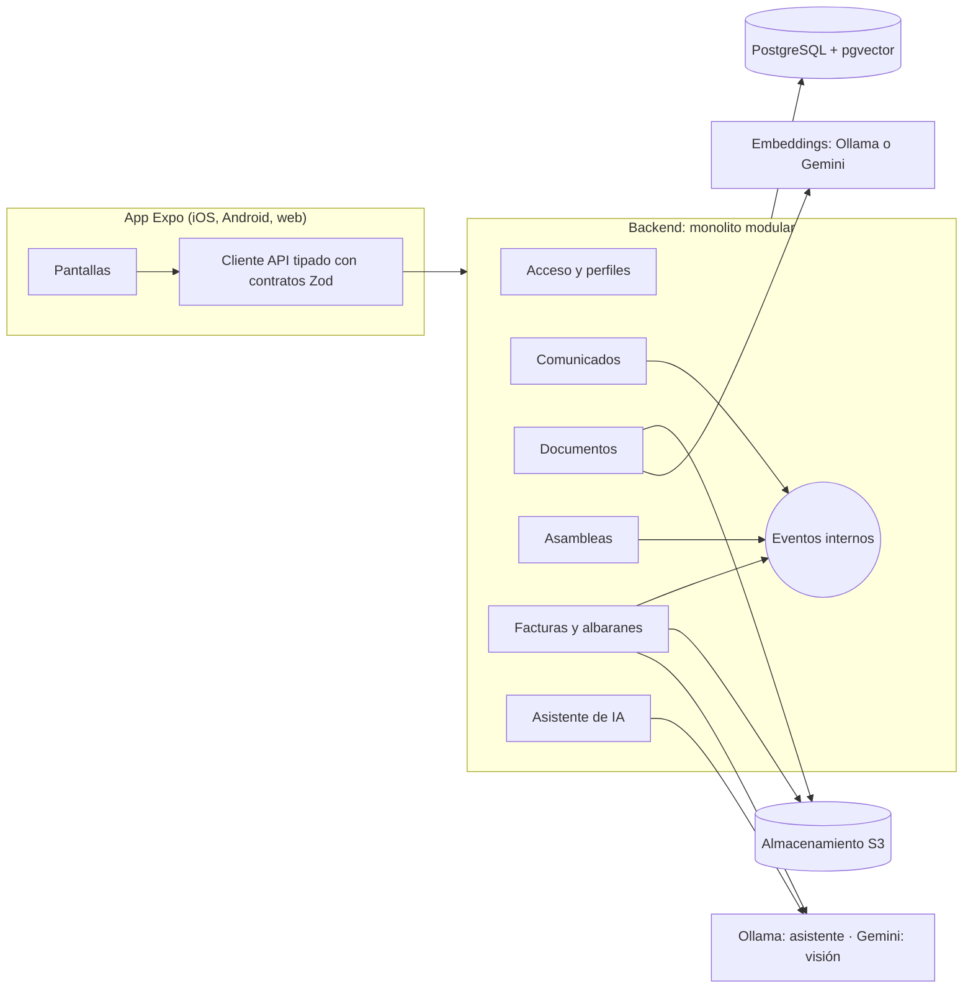

# multiCooperativa

[English version](README.en.md) · Versión en español

Trabajo Fin de Máster del Máster en Desarrollo con IA (BIG school). Aplicación móvil multi-cooperativa para iOS y Android (Expo) con backend Node + TypeScript, pensada para conectar a cada cooperativa con sus socios y para controlar albaranes y facturas con un asistente de IA que respeta los permisos de cada usuario.

Entrega: 26/10/2026 · Cierre de funcionalidad: 22/10/2026.

## Entregables

| Entregable            | Enlace                                                                                                                                                                      |
| --------------------- | --------------------------------------------------------------------------------------------------------------------------------------------------------------------------- |
| Demo (web)            | https://cooperativa.chaparro2001.com/                                                                                                                                       |
| API                   | https://api-cooperativa.chaparro2001.com                                                                                                                                    |
| Presentación (slides) | [docs/slides/multicooperativa-tfm.pptx](docs/slides/multicooperativa-tfm.pptx) ([PDF](docs/slides/multicooperativa-tfm.pdf), [guion del vídeo](docs/slides/guion-video.md)) |
| Vídeo de la demo      | <!-- TODO: URL del vídeo -->                                                                                                                                                |
| Documentación         | [docs/README.md](docs/README.md)                                                                                                                                            |

## Índice

1. [Descripción general](#1-descripción-general-del-proyecto)
2. [Stack tecnológico](#2-stack-tecnológico)
3. [Instalación y ejecución local](#3-instalación-y-ejecución-local)
4. [Estructura del proyecto](#4-estructura-del-proyecto)
5. [Funcionalidades principales](#5-funcionalidades-principales)
6. [Limitaciones y trabajo futuro](#6-limitaciones-y-trabajo-futuro)
7. [Usuarios y contraseña de prueba](#7-usuarios-y-contraseña-de-prueba)
8. [Despliegue de la demo](#8-despliegue-de-la-demo)
9. [Arquitectura](#9-arquitectura)
10. [Decisiones (ADRs)](#10-decisiones-adrs)
11. [Calidad](#11-calidad)
12. [Desarrollo asistido por IA](#12-desarrollo-asistido-por-ia)
13. [Relación con el máster](#13-relación-con-el-máster)

## 1. Descripción general del proyecto

### Problema

El socio de una cooperativa participa poco y está mal informado:

- Las convocatorias llegan por carta o tablón de anuncios.
- Estatutos, reglamentos y actas no están a mano.
- Los albaranes y facturas con proveedores y clientes viven en papel, y los descuadres entre ellos, los impagos y los cobros pendientes se detectan tarde o nunca.

### Solución

Una aplicación estándar, válida para cualquier tipo de cooperativa (agrícola, vivienda, trabajo, consumo), sin funcionalidad sectorial. Un mismo usuario puede pertenecer a varias cooperativas con un perfil distinto en cada una, y los datos de cada cooperativa están aislados de las demás.

### Los 4 perfiles

| Perfil         | Quién es                                     | Qué necesita                                                       |
| -------------- | -------------------------------------------- | ------------------------------------------------------------------ |
| Socio          | Socio de la cooperativa                      | Informarse, votar y leer documentos                                |
| Consejo rector | Órgano de gobierno                           | Publicar comunicados, convocar asambleas y vigilar pagos y cobros  |
| Gestor         | Personal administrativo (puede no ser socio) | Registrar y conciliar albaranes y facturas, controlar vencimientos |
| Administrador  | Responsable de la cooperativa en la app      | Dar acceso a los usuarios y asignar perfiles                       |

Los permisos se definen por módulo, nivel y alcance (ADR-004). El backend decide; la app solo oculta.

### Diferenciadores de IA

- **Extracción de facturas y albaranes con visión**: se fotografía o sube el documento y Gemini extrae los datos. El resultado se valida con un esquema Zod y **nunca se guarda sin confirmación humana**.
- **Explicación de discrepancias**: cuando un albarán y una factura no cuadran, la IA explica en lenguaje natural dónde está la diferencia.
- **Búsqueda semántica en documentos** (RAG): los documentos se trocean, se vectorizan y se indexan en pgvector, siempre filtrados por cooperativa.
- **Asistente conversacional** con citas a las fuentes y herramientas de solo lectura que reutilizan los casos de uso con los permisos del usuario: no puede ver nada que el usuario no pueda ver.

## 2. Stack tecnológico

| Capa               | Elección                                                                                                                                                                                       |
| ------------------ | ---------------------------------------------------------------------------------------------------------------------------------------------------------------------------------------------- |
| App móvil          | Expo + React Native + TypeScript, Expo Router                                                                                                                                                  |
| Datos del cliente  | TanStack Query; tokens en el almacenamiento seguro del dispositivo                                                                                                                             |
| Textos de usuario  | i18next + react-i18next + expo-localization; `es` por defecto (ADR-008)                                                                                                                        |
| Contratos          | Paquete compartido con esquemas Zod (validan en servidor y tipan la app)                                                                                                                       |
| Backend            | Node + TypeScript, monolito modular con Clean Architecture y eventos internos                                                                                                                  |
| API                | REST, autenticación JWT, códigos de error estables                                                                                                                                             |
| Persistencia       | PostgreSQL + Prisma; pgvector para RAG                                                                                                                                                         |
| Modelo de lenguaje | Asistente: modelo local de Ollama en el servidor propio, `qwen3:4b-instruct` por defecto y `qwen3:8b` seleccionable (ADR-013, ADR-015); visión y explicaciones: Gemini (ADR-009); tras puertos |
| Embeddings         | `bge-m3` local con Ollama (ADR-006); Gemini embeddings en la demo alojada (ADR-010)                                                                                                            |
| Ficheros           | Almacenamiento compatible S3 con URLs firmadas que caducan (ADR-005); RustFS en local                                                                                                          |
| Tests              | Vitest y React Native Testing Library                                                                                                                                                          |
| Calidad            | ESLint, Prettier, Husky (pre-commit), regla propia de límites entre módulos                                                                                                                    |
| Entrega            | GitHub Actions; demo con la API en un servidor propio (Cloudflare Tunnel) y GitHub Pages (web)                                                                                                 |

## 3. Instalación y ejecución local

### Requisitos

- Node 24 (fichero `.nvmrc`: `nvm use`).
- pnpm.
- Docker (PostgreSQL con pgvector, almacenamiento S3 con RustFS y Ollama).

### Pasos

```bash
pnpm install                 # instala y genera el cliente de Prisma
pnpm db:up                   # PostgreSQL + pgvector, S3 (RustFS) y Ollama con Docker Compose
pnpm ai:pull                 # descarga el modelo de embeddings bge-m3 en Ollama (una vez)

cp apps/api/.env.example apps/api/.env
cp apps/mobile/.env.example apps/mobile/.env

pnpm --filter @multicooperativa/api db:migrate        # aplica las migraciones
pnpm --filter @multicooperativa/api db:seed           # cooperativas y usuarios de prueba

pnpm --filter @multicooperativa/api dev               # API en http://localhost:3000
pnpm --filter @multicooperativa/mobile start          # app Expo
```

Opcional, con la API arrancada, para cargar documentos y comunicados de ejemplo a través de la API (se indexan con el proveedor de embeddings configurado):

```bash
API_URL=http://localhost:3000 pnpm --filter @multicooperativa/api db:seed:content
```

### Clave de Gemini (opcional)

Para activar el asistente (con el proveedor por defecto), la extracción de facturas y la explicación de discrepancias, define `GEMINI_API_KEY` en `apps/api/.env` (clave gratuita de Google AI Studio, sin tarjeta). Opcionales: `GEMINI_MODEL` y `ASSISTANT_MESSAGE_LIMIT_PER_HOUR` (por defecto 30).

**Modelo por cooperativa (ADR-014)**: con el proveedor local, el administrador de cada cooperativa elige el modelo del asistente en Ajustes entre los de `ASSISTANT_OLLAMA_MODELS` (solo se ofrecen los instalados en Ollama; la app nunca descarga ninguno).

**Asistente con modelo local (ADR-013)**: con `ASSISTANT_LLM_PROVIDER=ollama` el asistente responde con un modelo de Ollama (`ASSISTANT_OLLAMA_MODEL`, por defecto `qwen3:8b`; `pnpm ai:pull:chat` lo descarga) y no usa la cuota de Gemini ni envía las preguntas a la nube. Es lo que usa el servidor propio de la demo, con `qwen3:4b-instruct` como modelo por defecto (según el usuario responde con rapidez aceptable en esa CPU; no medido con el conjunto de evaluación, ADR-015) y `qwen3:8b` seleccionable por cooperativa en Ajustes (ADR-014). Gemini se queda para la extracción de facturas (visión) y las explicaciones de discrepancias. Con el modelo local, una pregunta tarda unos 7 s de media en una CPU de 12 núcleos (p90 26 s) y supera 19 de las 22 preguntas del conjunto de evaluación (benchmark de `qwen3:8b` en el Mac de desarrollo; `qwen3:4b-instruct` superó 18 de 22 con 5,0 s de media).

Sin la clave de Gemini (y con el proveedor `gemini`), el asistente responde 503 y **el resto de la aplicación funciona con normalidad**. Las funciones de IA que usan Gemini (extracción de facturas, explicación de discrepancias) tampoco están disponibles. Los embeddings en local los sirve Ollama, no Gemini.

### Tests y comprobaciones

```bash
pnpm lint                    # ESLint (incluye los límites entre módulos)
pnpm format:check            # Prettier (pnpm format para aplicar)
pnpm typecheck
pnpm test                    # tests unitarios, sin base de datos
pnpm test:integration        # contra la BD multicooperativa_test y el bucket de pruebas (requiere pnpm db:up)
pnpm --filter @multicooperativa/api ai:eval          # evaluación del asistente (añade --offline si no hay clave)
```

## 4. Estructura del proyecto

```
apps/
  mobile/              App Expo (iOS, Android y web)
  api/                 Backend Node + TypeScript
    src/modules/       Un directorio por módulo de negocio
    prisma/            Esquema y migraciones
packages/
  contracts/           Esquemas Zod y tipos compartidos entre app y backend
docs/                  Visión, stack, plan, despliegue, ADRs, requisitos y datos de ejemplo
tools/eslint/          Regla propia de límites entre módulos
.github/workflows/     CI, despliegue de GitHub Pages y cron de vencimientos
docker-compose.yml     PostgreSQL + pgvector, RustFS y Ollama para desarrollo
deploy/home-server/     Stack Docker del servidor propio (API, PostgreSQL, RustFS, Ollama, cloudflared)
render.yaml            Blueprint de Render (alternativa en la nube, opcional)
CLAUDE.md              Contrato de trabajo con el agente de IA
```

Módulos del backend (`apps/api/src/modules/`): `access`, `announcements`, `documents`, `assemblies`, `invoicing`, `assistant`.

### Capas de Clean Architecture por módulo

```
modules/<modulo>/
  domain/           Reglas de negocio puras: sin Prisma, HTTP ni SDK externos
  application/      Casos de uso; reciben el contexto (usuario, cooperativa, permisos) y deniegan por defecto
  infrastructure/   Adaptadores: Prisma, HTTP, Gemini, S3, Ollama
  index.ts          Única interfaz pública del módulo
```

Los módulos solo se comunican a través de su `index.ts` o de eventos internos, nunca por las tablas de otro módulo. Una regla de ESLint propia lo hace cumplir.

## 5. Funcionalidades principales

El estado de cada tarea está en [docs/03-implementation-plan.md](docs/03-implementation-plan.md); las especificaciones, en [docs/requirements/](docs/requirements/).

- **Acceso y perfiles**: login con bloqueo por intentos fallidos, refresh token rotatorio, cierre de sesión, aceptación de invitaciones, selector de cooperativa, navegación según permisos y biometría en nativo. Gestión de miembros: listar, invitar, cambiar perfil, suspender y reactivar. Endpoint de permisos efectivos del usuario.
- **Comunicados**: publicación por el consejo, listado y detalle, marca de leído y evento `AnnouncementPublished`.
- **Documentos con búsqueda semántica**: repositorio con versiones, URLs firmadas, extracción de texto, troceado, embeddings y pgvector filtrado por cooperativa.
- **Asambleas**: convocatoria con orden del día y censo, votación con restricción única en base de datos, cálculo de quórum y mayorías, resultados y control de votación para el consejo.
- **Facturas y albaranes**: terceros (proveedores y clientes), albaranes y facturas de compra y venta con importes en decimal exacto, conciliación con tolerancia, estados, resumen de pagos y cobros, proceso idempotente de vencimientos (cada hora), captura con cámara y revisión, **extracción con IA** (Gemini visión, validada con Zod y confirmada por una persona) y **explicación de discrepancias con IA**.
- **Área del socio**: mis datos (número de socio, fecha de alta, perfil, contacto), mi capital y mis movimientos, de solo lectura para el socio (US-MEM-01, US-MEM-02); el consejo rector, el gestor y el administrador consultan el capital de todos los socios con el total de la cooperativa (US-MEM-04) y el gestor y el administrador registran aportaciones, reembolsos y correcciones (US-MEM-03). Importes en decimal exacto, movimientos inmutables, capital nunca negativo y doble aislamiento (por cooperativa y, con alcance propio, por socio).
- **Asistente de IA**: chat con citas y enlaces a los recursos, RAG sobre los documentos, herramientas de solo lectura filtradas por permisos (`search_documents`, `list_invoices`, `list_delivery_notes`, `payments_and_collections_summary`, `find_third_party`, `upcoming_assemblies`, `voting_result`, `latest_announcements`, `my_contributions`), conversaciones, límite de uso por hora, conjunto de evaluación de 23 preguntas y, para el administrador de cada cooperativa, la elección del modelo local en Ajustes (US-AI-07, ADR-014).
- **Apariencia por cooperativa**: el administrador elige en Ajustes el color principal (se rechaza si el texto blanco no alcanza un contraste WCAG AA de 4,5:1) y el logo (PNG o JPEG de hasta 1 MB, verificado por su contenido; el SVG se rechaza); todos los miembros ven la aplicación con ese color y el logo en el inicio (US-ACC-14, ADR-018).

## 6. Limitaciones y trabajo futuro

Lo siguiente **no está implementado** en la entrega:

- **Notificaciones push** (módulo de notificaciones, tokens de dispositivo, navegación desde la notificación).
- **Sentry** en app y backend.
- **Tests E2E con Maestro**.
- **Reclamaciones** de facturas.
- **Binarios nativos con EAS Build**: la demo es el export web; la app nativa se ejecuta con Expo en local.
- Invitaciones por correo: no hay proveedor de email, `POST .../members` responde 503 en producción.
- En la versión web no hay biometría ni captura con cámara (se usa el selector de ficheros) y la sesión se guarda en `sessionStorage`.

El resto de limitaciones de la demo alojada están en [docs/04-deployment.md](docs/04-deployment.md).

## 7. Usuarios y contraseña de prueba

Datos definidos en el seed (`apps/api/src/dev/demo-seed.ts`) y descritos en [docs/sample-data.md](docs/sample-data.md).

**Contraseña**:

- Local: `demo-cooperativa-2026` (valor por defecto del seed, o el de `SEED_PASSWORD` si está definido).
- Demo alojada: <!-- TODO: contraseña demo -->

### Cooperativa Agrícola San Isidro (CIF F12345674)

| Email                     | Nombre       | Perfil         | Estado     |
| ------------------------- | ------------ | -------------- | ---------- |
| admin@sanisidro.test      | Ana Torres   | Administrador  | Activo     |
| consejo@sanisidro.test    | Carlos Ruiz  | Consejo rector | Activo     |
| gestor@sanisidro.test     | Elena Gómez  | Gestor         | Activo     |
| socio@sanisidro.test      | Javier López | Socio          | Activo     |
| lucia@demo.test           | Lucía Martín | Socio          | Activo     |
| suspendido@sanisidro.test | Pedro Sanz   | Socio          | Suspendido |
| invitada@sanisidro.test   | Marta Díaz   | Socio          | Invitada   |

### Cooperativa Olivarera La Esperanza (CIF F76543214)

| Email                   | Nombre        | Perfil         | Estado |
| ----------------------- | ------------- | -------------- | ------ |
| admin@laesperanza.test  | Rosa Navarro  | Administrador  | Activo |
| lucia@demo.test         | Lucía Martín  | Consejo rector | Activo |
| gestor@laesperanza.test | Miguel Ortega | Gestor         | Activo |
| socio@laesperanza.test  | Isabel Romero | Socio          | Activo |

`lucia@demo.test` pertenece a las dos cooperativas con un perfil distinto en cada una (selector de cooperativa). Los gestores no son socios, por lo que no pueden votar. El dominio `.test` está reservado y nunca recibe correo real.

## 8. Despliegue de la demo

Resumen de [docs/04-deployment.md](docs/04-deployment.md). Coste de 0 EUR y sin tarjeta de crédito: la API corre en un servidor doméstico (ADR-012), porque Render y Railway piden tarjeta.

| Pieza            | Servicio                                                                                                                                                                   |
| ---------------- | -------------------------------------------------------------------------------------------------------------------------------------------------------------------------- |
| App web          | GitHub Pages en `cooperativa.chaparro2001.com` (export web de Expo, Actions)                                                                                               |
| API              | Contenedor Docker en un servidor propio, expuesto con Cloudflare Tunnel (`api-cooperativa.chaparro2001.com`; enlaces de ficheros por `files-cooperativa.chaparro2001.com`) |
| Base de datos    | PostgreSQL 17 con pgvector (contenedor)                                                                                                                                    |
| Ficheros         | RustFS, compatible con S3 (contenedor)                                                                                                                                     |
| Embeddings       | Ollama con bge-m3 (contenedor, ADR-006)                                                                                                                                    |
| Asistente        | Ollama con `qwen3:4b-instruct` (por defecto) o `qwen3:8b` en el servidor (ADR-013, ADR-015)                                                                                |
| Visión           | Gemini API (clave gratuita): extracción de facturas y explicaciones                                                                                                        |
| Tarea programada | Cron de GitHub Actions cada hora (vencimientos)                                                                                                                            |

Avisos:

- **Disponibilidad**: la API solo responde mientras el servidor doméstico está encendido y con conexión. No hay arranque en frío.
- **Cuota de Gemini**: el asistente ya no la consume en el servidor propio (modelo local); la extracción de facturas sí.
- **Uso de datos en la capa gratuita de Gemini**: Google puede usar el contenido para mejorar sus productos. **No subas facturas, albaranes ni documentos reales de terceros**; usa los datos de ejemplo.
- Es una demo, no un sistema de registro: los datos pueden perderse.

## 9. Arquitectura



Reglas transversales: el backend es la autoridad de permisos (deniega por defecto), doble aislamiento por cooperativa (también en el RAG y en las herramientas del asistente), dominio sin dependencias, importes en decimal exacto y servicios de IA siempre detrás de puertos. Más detalle en [docs/02-stack-and-architecture.md](docs/02-stack-and-architecture.md).

## 10. Decisiones (ADRs)

Los ADR son inmutables: una decisión que cambia produce un ADR nuevo.

- [ADR-001](docs/adr/ADR-001-hybrid-app-with-expo.md): app híbrida con Expo que genera las apps nativas.
- [ADR-002](docs/adr/ADR-002-modular-monolith.md): backend como monolito modular con Clean Architecture.
- [ADR-003](docs/adr/ADR-003-multi-cooperative.md): multi-cooperativa con base de datos compartida.
- [ADR-004](docs/adr/ADR-004-profile-based-access-control.md): control de acceso por perfiles con permisos por módulo, nivel y alcance.
- [ADR-005](docs/adr/ADR-005-s3-file-storage.md): almacenamiento de ficheros compatible S3 tras un puerto.
- [ADR-006](docs/adr/ADR-006-local-model-embeddings.md): embeddings con un modelo local servido por Ollama.
- [ADR-007](docs/adr/ADR-007-claude-for-vision-and-drafting.md): Claude para visión y redacción (sustituido por ADR-009).
- [ADR-008](docs/adr/ADR-008-english-codebase-and-localized-ui.md): código y documentación en inglés, interfaz localizada con i18n.
- [ADR-009](docs/adr/ADR-009-gemini-language-and-vision-model.md): Gemini como modelo de lenguaje y visión.
- [ADR-010](docs/adr/ADR-010-gemini-embeddings-for-the-hosted-demo.md): embeddings de Gemini para la demo alojada.
- [ADR-011](docs/adr/ADR-011-bilingual-root-readme.md): README raíz bilingüe para la entrega del TFM (excepción acotada a ADR-008).
- [ADR-013](docs/adr/ADR-013-local-language-model-for-the-assistant.md): modelo de lenguaje local (Ollama) para el asistente en el servidor propio; Gemini sigue en visión.
- [ADR-014](docs/adr/ADR-014-per-cooperative-assistant-model.md): elección por cooperativa del modelo local del asistente, entre los permitidos por el operador.
- [ADR-018](docs/adr/ADR-018-per-cooperative-branding.md): color principal y logo por cooperativa, configurados por su administrador.

## 11. Calidad

- **Tests unitarios** (`pnpm test`): 649 tests en 68 ficheros, todos en verde a fecha 2026-10-21.
- **Tests de integración** (`pnpm test:integration`): contra PostgreSQL y almacenamiento S3 reales, incluido el test de aislamiento entre cooperativas. 364 tests en 20 ficheros, todos en verde (2026-10-21).
- **CI** (GitHub Actions, en cada push y pull request): comprobación de formato, lint, typecheck, tests, migraciones sobre un Postgres con pgvector y tests de integración. Hay además workflows de despliegue de GitHub Pages y de cron de vencimientos.
- **Puerta de calidad local**: Husky ejecuta lint, typecheck y tests en el pre-commit.
- **Límites entre módulos**: regla ESLint propia (`tools/eslint/module-boundaries.js`, con sus tests) que impide importar un módulo del backend por una ruta distinta de su `index.ts` (ADR-002).
- **Seguridad**: denegación por defecto en cada caso de uso, 404 para recursos de otra cooperativa y 403 para módulos sin permiso, Argon2id para contraseñas, JWT con refresh rotatorio, bloqueo por intentos fallidos, tests parametrizados de la matriz perfiles x módulos, tests de aislamiento, CORS configurable por entorno y secretos fuera del repositorio (solo `.env.example`).
- **IA**: conjunto de evaluación de 23 preguntas para el asistente (`ai:eval`).

## 12. Desarrollo asistido por IA

El proyecto se ha construido con Spec Driven Development usando Claude Code:

- **Especificación primero**: visión, stack, plan por hitos y requisitos por módulo (historias de usuario con criterios Dado/Cuando/Entonces, reglas de negocio y requisitos no funcionales) se escribieron antes del código. Ver [docs/](docs/).
- **`CLAUDE.md` como contrato con el agente**: reglas no negociables (permisos en el backend, aislamiento, dominio puro, importes exactos, IA con confirmación humana, secretos), forma de trabajar y comandos.
- **TDD en el dominio**: test primero a partir de los criterios de la especificación.
- **Trazabilidad**: los identificadores de la especificación (`US-ACC-02`, `BR-INV-06`, `NFR-AI-05`) aparecen en nombres de tests y mensajes de commit, con Conventional Commits.
- **Autoría compartida**: todos los commits salvo el inicial llevan el trailer `Co-Authored-By` del agente (se puede comprobar con `git log`).

## 13. Relación con el máster

| Tema del máster                      | Evidencia en el proyecto                                                                                                                                                         |
| ------------------------------------ | -------------------------------------------------------------------------------------------------------------------------------------------------------------------------------- |
| Spec Driven Development              | `docs/requirements/`, plan por hitos con tareas marcadas, IDs de especificación en tests y commits                                                                               |
| ADRs y Docs as Code                  | `docs/adr/` (11 ADR inmutables), documentación versionada junto al código, diagramas Mermaid                                                                                     |
| Clean Architecture con TypeScript    | Capas `domain/application/infrastructure` por módulo, puertos y adaptadores, regla ESLint de límites entre módulos                                                               |
| Testing, TDD y puerta de calidad     | Vitest, tests de dominio primero, tests de integración, Husky en pre-commit                                                                                                      |
| CI/CD con GitHub Actions             | `ci.yml` (formato, lint, typecheck, tests, migraciones, integración), despliegue de Pages y cron                                                                                 |
| OWASP y seguridad                    | Denegación por defecto, Argon2id, rotación de JWT, tests de aislamiento, CORS, gestión de secretos                                                                               |
| RAG, embeddings e integración de LLM | pgvector filtrado por cooperativa, embeddings tras un puerto (Ollama o Gemini), function calling, citas, evaluación                                                              |
| IA responsable                       | Confirmación humana antes de persistir datos extraídos, herramientas de solo lectura con permisos del usuario, minimización de datos y aviso de uso de datos en la capa gratuita |
