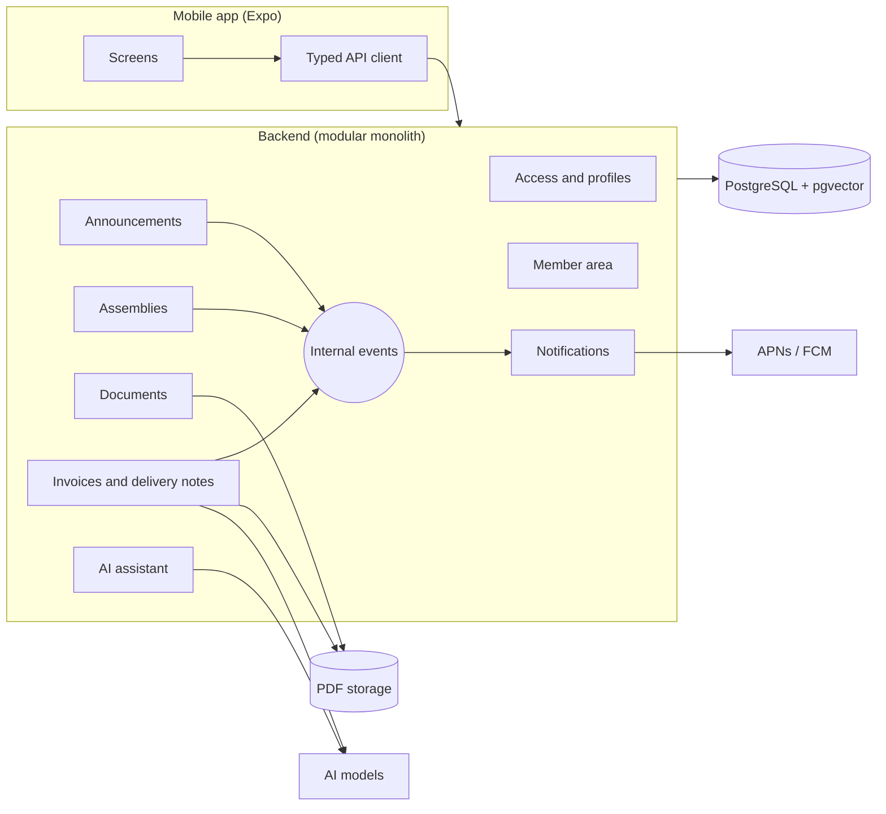

# 02 · Stack and architecture

**Date**: 2026-10-04 · **Status**: Accepted

The underlying decisions are reasoned in the ADRs. This document is the snapshot of the result.

## Stack

| Layer               | Choice                                                                                                                                                                                                                                                                             |
| ------------------- | ---------------------------------------------------------------------------------------------------------------------------------------------------------------------------------------------------------------------------------------------------------------------------------- |
| Mobile app          | Expo + React Native + TypeScript, Expo Router                                                                                                                                                                                                                                      |
| Client data         | TanStack Query; tokens in the device's secure storage                                                                                                                                                                                                                              |
| User-facing texts   | i18next + react-i18next + expo-localization; Spanish (`es`) default and fallback; catalogs in `apps/mobile/src/i18n/locales/` (ADR-008)                                                                                                                                            |
| Native capabilities | Expo modules: camera, push notifications, biometrics, secure storage                                                                                                                                                                                                               |
| Contracts           | Shared package with Zod schemas (validate on the server and type the app)                                                                                                                                                                                                          |
| Backend             | Node + TypeScript, modular monolith with Clean Architecture and internal events                                                                                                                                                                                                    |
| API                 | REST documented with OpenAPI, JWT authentication; stable error codes plus English developer messages (ADR-008)                                                                                                                                                                     |
| Persistence         | PostgreSQL with Prisma; pgvector for RAG                                                                                                                                                                                                                                           |
| Language model      | Gemini (free tier) behind ports: assistant with function calling, invoice vision extraction (ADR-009)                                                                                                                                                                              |
| Assistant chat      | Gemini (ADR-009) or, on the home server, a local Ollama model with tool calling (`qwen3:4b-instruct` by default on the hosted demo, ADR-015, with `qwen3:8b` selectable per cooperative, ADR-013/014), selected with `ASSISTANT_LLM_PROVIDER`; both behind the language-model port |
| Embeddings          | Local `bge-m3` model served by Ollama (ADR-006); Gemini embeddings in the hosted demo (ADR-010); behind a port                                                                                                                                                                     |
| Files               | S3-compatible object storage, with signed URLs that expire (ADR-005); RustFS in development                                                                                                                                                                                        |
| Tests               | Vitest in domain and backend; React Native Testing Library in the app; Maestro for E2E                                                                                                                                                                                             |
| Delivery            | GitHub Actions; hosted demo with the API on a home server behind Cloudflare Tunnel and GitHub Pages (web), see 04-deployment.md and ADR-012; EAS Build (binaries, optional)                                                                                                        |
| Observability       | Sentry in app and backend                                                                                                                                                                                                                                                          |

## Monorepo structure (pnpm)

```
/
├── apps/
│   ├── mobile/        Expo app (iOS and Android)
│   └── api/           Backend
├── packages/
│   └── contracts/     Zod schemas and shared types
└── docs/              This folder
```

## Overview



## Backend modules

Each module follows the Clean Architecture layers (domain, application, infrastructure) and only exposes a public interface to the others.

| Module                      | Responsibility                                                                                                     |
| --------------------------- | ------------------------------------------------------------------------------------------------------------------ |
| Access and profiles         | Users, sessions, memberships, profiles and permission resolution                                                   |
| Announcements               | Publication and reading of announcements                                                                           |
| Assemblies                  | Calls to meeting, agenda, votings, quorum and majorities                                                           |
| Documents                   | Document repository and indexing for RAG                                                                           |
| Invoices and delivery notes | Third parties (suppliers and customers), purchases and sales, reconciliation, due dates, claims, vision extraction |
| Member area                 | Member data and capital contributions                                                                              |
| AI assistant                | RAG and tool calling with the user's permissions                                                                   |
| Notifications               | Consumes events from the other modules and sends push                                                              |

## Cross-cutting rules

1. **The backend rules**: every use case checks the permission and denies by default. The app only hides what the server says is not allowed.
2. **Double isolation**: by cooperative and, in the member area, by member. It also applies to the RAG and the assistant's tools.
3. **Injected configuration**: API URL, cooperative and theme are not hardcoded in the app. This way the module could be embedded in another native app without rewriting it.
4. **Communication between modules through internal events** when an immediate response is not needed (for example, `DiscrepancyDetected` or `InvoiceOverdue` towards Notifications).
5. **Dependency-free domain**: business rules do not import Prisma, Express or any SDK.
6. **English everywhere except the UI**: code, identifiers, paths, enum values, API routes, docs and commit messages are in English; user-facing texts are localized (ADR-008).
