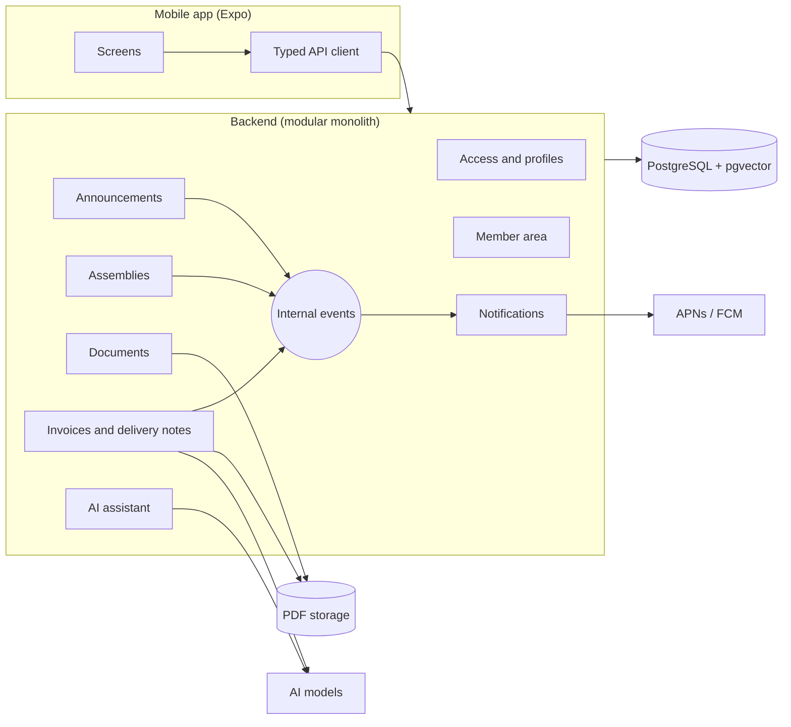

# 02 · Stack and architecture

**Date**: 2026-10-04 · **Status**: Accepted

The underlying decisions are reasoned in the ADRs. This document is the snapshot of the result.

## Stack

| Layer               | Choice                                                                                                                                                                                                                                                                                                                                                                                 |
| ------------------- | -------------------------------------------------------------------------------------------------------------------------------------------------------------------------------------------------------------------------------------------------------------------------------------------------------------------------------------------------------------------------------------- |
| Mobile app          | Expo + React Native + TypeScript, Expo Router, react-native-paper (ADR-020) wrapped by the design-system kit in `src/ui` (tokens in `theme.ts`, reference in `docs/design-system/`, ADR-024)                                                                                                                                                                                           |
| Client data         | TanStack Query; tokens in the device's secure storage                                                                                                                                                                                                                                                                                                                                  |
| User-facing texts   | i18next + react-i18next + expo-localization; Spanish (`es`) default and fallback; catalogs in `apps/mobile/src/i18n/locales/` (ADR-008)                                                                                                                                                                                                                                                |
| Native capabilities | Expo modules: camera, push notifications, biometrics, secure storage                                                                                                                                                                                                                                                                                                                   |
| Contracts           | Shared package with Zod schemas (validate on the server and type the app)                                                                                                                                                                                                                                                                                                              |
| Backend             | Node + TypeScript, modular monolith with Clean Architecture and internal events                                                                                                                                                                                                                                                                                                        |
| API                 | REST documented with OpenAPI, JWT authentication; stable error codes plus English developer messages (ADR-008)                                                                                                                                                                                                                                                                         |
| Persistence         | PostgreSQL with Prisma; pgvector for RAG (hybrid with full-text search, ADR-022)                                                                                                                                                                                                                                                                                                       |
| Language model      | Gemini (free tier) behind ports: assistant with function calling, invoice vision extraction (ADR-009)                                                                                                                                                                                                                                                                                  |
| Assistant chat      | Gemini (ADR-009) or, on the home server, a local Ollama model with tool calling (`qwen3:4b-instruct` by default on the hosted demo, ADR-015, with `qwen3:8b` selectable per cooperative, ADR-013/014), selected with `ASSISTANT_LLM_PROVIDER` (the stack default is `ollama`; the published demo runs `gemini`, `gemini-3.5-flash-lite`, ADR-026); both behind the language-model port |
| Embeddings          | Local `bge-m3` model served by Ollama (ADR-006); Gemini embeddings in the hosted demo (ADR-010); behind a port                                                                                                                                                                                                                                                                         |
| Files               | S3-compatible object storage, with signed URLs that expire (ADR-005); RustFS in development                                                                                                                                                                                                                                                                                            |
| Tests               | Vitest (unit and integration); Maestro E2E flows on the iOS simulator (local only, see below); React Native Testing Library planned, not delivered                                                                                                                                                                                                                                     |
| Delivery            | GitHub Actions; hosted demo with the API on a home server behind Cloudflare Tunnel and GitHub Pages (web), see 04-deployment.md and ADR-012; EAS Build (binaries, optional)                                                                                                                                                                                                            |
| Observability       | Sentry in app and backend                                                                                                                                                                                                                                                                                                                                                              |

## Monorepo structure (pnpm)

```
/
├── apps/
│   ├── mobile/        Expo app (iOS and Android)
│   └── api/           Backend
├── packages/
│   └── contracts/     Zod schemas and shared types
└── docs/              This folder
```

## Overview



## Backend modules

Each module follows the Clean Architecture layers (domain, application, infrastructure) and only exposes a public interface to the others.

| Module                      | Responsibility                                                                                                                                                                                                                                                                                    |
| --------------------------- | ------------------------------------------------------------------------------------------------------------------------------------------------------------------------------------------------------------------------------------------------------------------------------------------------- |
| Access and profiles         | Users, sessions, memberships, profiles and permission resolution                                                                                                                                                                                                                                  |
| Announcements               | Publication and reading of announcements                                                                                                                                                                                                                                                          |
| Assemblies                  | Calls to meeting, agenda, votings, quorum and majorities (the voting view carries `quorumRequired`, BR-ASM-05b)                                                                                                                                                                                   |
| Documents                   | Document repository and indexing for RAG                                                                                                                                                                                                                                                          |
| Invoices and delivery notes | Third parties (suppliers and customers), purchases and sales, reconciliation, due dates, claims, vision extraction                                                                                                                                                                                |
| Member area (`members`)     | Member data and capital contributions                                                                                                                                                                                                                                                             |
| AI assistant                | RAG and tool calling with the user's permissions                                                                                                                                                                                                                                                  |
| Branding (`branding`)       | Per-cooperative primary colour, set by its administrator and read by every member (also in each `/me` membership as `primaryColor`, for the cooperative selector) ([ADR-018](adr/ADR-018-per-cooperative-branding.md); the logo was removed by [ADR-021](adr/ADR-021-remove-cooperative-logo.md)) |
| Notifications               | Consumes events from the other modules and sends push                                                                                                                                                                                                                                             |

## Cross-cutting rules

1. **The backend rules**: every use case checks the permission and denies by default. The app only hides what the server says is not allowed.
2. **Double isolation**: by cooperative and, in the member area, by member. It also applies to the RAG and the assistant's tools.
3. **Injected configuration**: API URL, cooperative and theme are not hardcoded in the app (the theme of each cooperative comes from its branding, ADR-018, applied as a react-native-paper theme, ADR-020, and as the tokens of the design system, ADR-024). This way the module could be embedded in another native app without rewriting it.
4. **Communication between modules through internal events** when an immediate response is not needed (for example, `DiscrepancyDetected` or `InvoiceOverdue` towards Notifications).
5. **Dependency-free domain**: business rules do not import Prisma, Express or any SDK.
6. **English everywhere except the UI**: code, identifiers, paths, enum values, API routes, docs and commit messages are in English; user-facing texts are localized (ADR-008).
7. **Errors on the field they belong to**: every create/edit form validates its input in the app with the same Zod contracts the API enforces (`packages/contracts`) and marks each wrong field (red border, message under it, `aria-invalid`), scrolling to the first one before calling the API. The API helps the app do the same with what only it can know: a `400 invalid_request` carries `details.issues` (`[{ path, code }]`, field paths and Zod codes, never values) and business-rule errors carry `details.field` (the contract path of the input they are about, e.g. `nif`, `dueDate`, `lines.0.quantity`); both are optional and backward compatible. The app maps them to fields (`apps/mobile/src/forms/`) and keeps the general banner for errors that belong to no field.
8. **Lists that grow are paginated by keyset**: the assistant history, delivery notes, invoices, documents, members and a member's capital movements answer `{ items, nextCursor }` (`movements` in the statement, which also carries `member` and `capital`). The request takes `limit` (default 30, at most 100; the history keeps its 20) and `before`, the `nextCursor` of the previous page, which is opaque: the app only passes it back. Each list sorts by a unique, stable key that ends in the id (invoices and delivery notes `(date, number, id)` descending, documents `(documentDate desc, title, id)`, members `(name, id)`, movements `(date, recordedAt, id)` descending), the cursor holds that key and the next page is the rows after it, so a row added or removed between pages never repeats or skips others. A composite index starting with `cooperativeId` supports each sort (migration `list_pagination_indexes`; members sort by the user's name, which lives in another table, so they rely on the `(cooperativeId, status)` index and a bounded top-N sort). Filters travel with every page request. A cursor the server did not issue is `400 invalid_request` (`details.issues[0].path = before`). Totals and counters (invoice summary, home badges, the member's capital, the cooperative's total capital) are computed by the server over all the rows and never from a page. Code that needs everything (the assistant's read-only tools, the third-party sheet) calls the unpaginated use cases; the announcements list keeps its `offset` pagination.

## E2E tests (Maestro)

Four flows in `apps/mobile/.maestro/` (login and home tiles, cooperative switch, vote in an open assembly, invoices summary), run on the iOS simulator against a development build and the local API. They run locally only: CI would need macOS runners, so they are not part of the pipeline.

Requirements: Xcode with an iOS simulator, a JDK 17+ (`brew install openjdk@17`), and Maestro (`curl -fsSL "https://get.maestro.mobile.dev" | bash`, installs to `~/.maestro/bin`; add it to `PATH` and set `JAVA_HOME` if `java` is a stub).

```bash
pnpm db:up
pnpm --filter @multicooperativa/api db:deploy
pnpm --filter @multicooperativa/api db:seed            # demo users (docs/sample-data.md)
pnpm --filter @multicooperativa/api dev                # API at http://localhost:3000
# in apps/mobile, with a booted simulator (the first build takes 10-20 minutes):
EXPO_PUBLIC_API_URL=http://localhost:3000 npx expo run:ios
pnpm e2e                                               # maestro test apps/mobile/.maestro
```

- The flows open the dev client against Metro at `localhost:8081`, dismiss iOS system dialogs (open-in-app, save password) and sign in as the demo users.
- The vote flow prepares its state through the API (`scripts/prepare-voting.js`: an admin creates and convenes an assembly and opens its voting), so every run uses a fresh assembly and the flows are re-runnable without resetting the database.
- `expo run:ios` generates the git-ignored `ios/` folder and rewrites `apps/mobile/app.json` and `package.json` (bundle identifier `com.anonymous.multicooperativa`, `ios`/`android` scripts); do not commit those changes.
- Screenshots of each flow end state: `maestro test --test-output-dir <dir>`.
