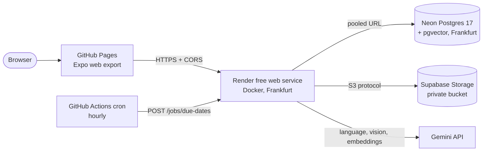

# Deployment of the hosted demo

A free demo that needs no credit card, for the thesis delivery. The architecture decision for embeddings is in [ADR-010](adr/ADR-010-gemini-embeddings-for-the-hosted-demo.md).

## Architecture



| Piece                        | Service                                  | Notes                                                                                      |
| ---------------------------- | ---------------------------------------- | ------------------------------------------------------------------------------------------ |
| Web app                      | GitHub Pages (Actions deploy)            | `https://chaparro2001.github.io/multiCooperativa/`; built by `.github/workflows/pages.yml` |
| API                          | Render free web service, Docker          | `render.yaml`; sleeps after 15 min idle (cold start about 1 min); about 512 MB RAM         |
| Database                     | Neon Free, Postgres 17, with `vector`    | Pooled URL for the API, direct URL for migrations                                          |
| Files                        | Supabase Storage through its S3 protocol | Private bucket `multicooperativa`; the API signs 5-minute URLs                             |
| Language, vision, embeddings | Gemini API (free key)                    | `EMBEDDINGS_PROVIDER=gemini` (ADR-010)                                                     |
| Scheduled job                | GitHub Actions cron                      | `.github/workflows/cron.yml`: wakes the API and runs the due-dates job each hour           |

The native apps are not part of this demo (no EAS build); the web export is the same code.

## Step by step

Order matters: Neon, Supabase, Gemini, Render, GitHub, seed. Create the accounts yourself and paste secrets only into the dashboards named below; none goes in the repository.

### 1. Neon (database)

1. Create a project (Postgres 17, region Frankfurt, `aws-eu-central-1`).
2. The `vector` extension is created by the first migration (`CREATE EXTENSION`), nothing to do by hand. If a migration complains about permissions, run `CREATE EXTENSION IF NOT EXISTS vector;` in the Neon SQL editor.
3. In **Connect**, copy two connection strings of the same database and role:
   - **Pooled** (host contains `-pooler`): this is `DATABASE_URL` in Render.
   - **Direct** (without `-pooler`): this is `DIRECT_URL` in Render, and the one you use to seed.

   Both must end with `?sslmode=require`.

### 2. Supabase Storage (files)

1. Create a project (region Central EU, Frankfurt).
2. **Storage > New bucket**: name `multicooperativa`, **private** (not public).
3. **Storage > S3 Connection**: enable it, copy the endpoint `https://<ref>.storage.supabase.co/storage/v1/s3` and the region, and create an access key: that gives `S3_ACCESS_KEY_ID` and `S3_SECRET_ACCESS_KEY`. The secret is shown once.

### 3. Gemini

Create a key in Google AI Studio (no card). It is `GEMINI_API_KEY`. The same key serves the assistant, document extraction and embeddings.

### 4. Render (API)

1. **New > Blueprint**, connect this GitHub repository, branch `main`. Render reads `render.yaml`.
2. It asks for the variables marked `sync: false`. Values:

| Variable                           | Value                                                        | Where it comes from                            |
| ---------------------------------- | ------------------------------------------------------------ | ---------------------------------------------- |
| `NODE_ENV`                         | `production`                                                 | in `render.yaml`                               |
| `DATABASE_URL`                     | Neon pooled URL                                              | Neon > Connect (pooled)                        |
| `DIRECT_URL`                       | Neon direct URL                                              | Neon > Connect (direct)                        |
| `JWT_SECRET`                       | generated by Render                                          | `generateValue: true`                          |
| `S3_ENDPOINT`                      | `https://<ref>.storage.supabase.co/storage/v1/s3`            | Supabase > Storage > S3 Connection             |
| `S3_REGION`                        | e.g. `eu-central-1`                                          | same page                                      |
| `S3_BUCKET`                        | `multicooperativa`                                           | in `render.yaml`                               |
| `S3_ACCESS_KEY_ID`                 | access key id                                                | Supabase S3 access keys                        |
| `S3_SECRET_ACCESS_KEY`             | secret                                                       | Supabase S3 access keys                        |
| `S3_FORCE_PATH_STYLE`              | `true`                                                       | in `render.yaml`                               |
| `GEMINI_API_KEY`                   | key                                                          | Google AI Studio                               |
| `GEMINI_MODEL`                     | `gemini-3.8-flash`                                           | in `render.yaml`                               |
| `EMBEDDINGS_PROVIDER`              | `gemini`                                                     | in `render.yaml`                               |
| `GEMINI_EMBEDDING_MODEL`           | `gemini-embedding-2`                                         | in `render.yaml`                               |
| `ASSISTANT_MESSAGE_LIMIT_PER_HOUR` | `30`                                                         | in `render.yaml`                               |
| `CORS_ORIGINS`                     | `https://chaparro2001.github.io`                             | in `render.yaml` (origin only, no path)        |
| `JOBS_TOKEN`                       | random string of 32+ characters, e.g. `openssl rand -hex 32` | you generate it; the same value goes to GitHub |

Render sets `PORT` itself. On every start the container runs `prisma migrate deploy` with `DIRECT_URL`, then starts the API (free plans have no pre-deploy command).

3. When the deploy is live, `https://<service>.onrender.com/health` answers `{"status":"ok"}`. That URL (no trailing slash) is `API_URL` below.

### 5. GitHub (web and cron)

In the repository: **Settings > Pages > Source: GitHub Actions**. Then **Settings > Secrets and variables > Actions**:

| Kind     | Name         | Value                                                        | Used by                                                               |
| -------- | ------------ | ------------------------------------------------------------ | --------------------------------------------------------------------- |
| Variable | `API_URL`    | Render URL, e.g. `https://multicooperativa-api.onrender.com` | `pages.yml` (becomes `EXPO_PUBLIC_API_URL` at build time), `cron.yml` |
| Secret   | `JOBS_TOKEN` | the same string as in Render                                 | `cron.yml`                                                            |

Run **Actions > Deploy web demo > Run workflow** (or push to `main`). The site is built with base path `/multiCooperativa` (`experiments.baseUrl` in `apps/mobile/app.json`), `index.html` is copied to `404.html` so that reloads of any path load the app, and it is deployed with `actions/deploy-pages`. `EXPO_PUBLIC_API_URL` is public by design: it ends up in the bundle.

If the repository name differs from `multiCooperativa`, change `baseUrl` in `apps/mobile/app.json` and the origin in `CORS_ORIGINS`.

### 6. Seed the demo data

From your machine, with the repository installed (`pnpm install`). Use the **direct** Neon URL and choose a password for the demo users (default `demo-cooperativa-2026` if `SEED_PASSWORD` is not set; the demo is public, so prefer your own):

```bash
# Users and cooperatives (additive, idempotent; needs the migrations, which the first Render start applies)
DATABASE_URL='<neon direct url>' SEED_PASSWORD='<password>' \
  pnpm --filter @multicooperativa/api db:seed --allow-production

# Sample documents and announcements, through the live API (wakes it; takes a minute if it was asleep)
API_URL='https://<service>.onrender.com' SEED_PASSWORD='<password>' \
  pnpm --filter @multicooperativa/api db:seed:content
```

- `db:seed` refuses a remote database and `NODE_ENV=production` unless `--allow-production` is given. It never deletes or updates anything. Never run `prisma migrate reset` against Neon: it wipes the database.
- `db:seed:content` uploads three PDFs and publishes two announcements as `admin@sanisidro.test`, so the files go to Supabase and are indexed with Gemini embeddings through the normal upload path, and it waits until indexing finishes. Re-running skips what exists.
- **Do not copy vectors from a local database.** Embeddings from Ollama (`bge-m3`) and from Gemini live in different spaces and are not comparable. If you change `EMBEDDINGS_PROVIDER` on an environment that already has documents, reindex them (`POST /cooperatives/{id}/documents/{documentId}/reindex`, or delete and re-upload).

Demo users (password: the one you set, or `demo-cooperativa-2026`): see [sample-data.md](sample-data.md). Handy ones: `admin@sanisidro.test` (administrator), `socio@sanisidro.test` (member), `gestor@sanisidro.test` (manager), `lucia@demo.test` (member of both cooperatives).

## Limitations

- **Cold starts.** Render's free instance sleeps after 15 minutes without traffic; the first request takes about a minute (the app shows its normal loading/error states meanwhile). The hourly cron wakes it once an hour but does not keep it awake. A keep-alive ping to `/health` is safe: `/health` does not touch the database, so it does not wake Neon.
- **Neon suspends** the compute after 5 minutes idle; the first query then takes a second or two more.
- **Supabase pauses** free projects after 7 days of inactivity: open the dashboard and restore the project before a demo if it has been idle. The hourly cron does not touch Supabase.
- **Memory.** About 512 MB: the Node heap is capped at 320 MB (`NODE_OPTIONS` in the Dockerfile); idle usage measured around 170 MB. Uploads (20 MB limit) are kept in memory while processed.
- **Gemini free tier**: rate limits apply, and Google may use free-tier content to improve its products. Do not upload real invoices, delivery notes or documents of third parties; use the sample data.
- **Scheduled workflows** are disabled by GitHub after 60 days without repository activity.
- **Web build**: the session is kept in `sessionStorage` (survives reloads, ends with the tab); native apps use the Keychain/Keystore. There is no biometric unlock or camera capture on the web (the file chooser is used), confirmations use the browser's dialogs, and opening a deep link directly on an inner page lands on the home screen (use the in-app navigation).
- Email invitations are not available (no email provider): `POST .../members` answers 503 in production.
- The data of a free Neon project can be deleted if the account is abandoned; this is a demo, not a system of record.

## Cost

0 EUR: Render Free, Neon Free, Supabase Free, GitHub Pages and Actions (public repository), Gemini free tier. No payment method is requested by any of them.

## Local equivalent

`docker build -f apps/api/Dockerfile -t multicooperativa-api .` from the repository root builds the same image Render builds. Run it with the variables above (for example against the Docker Compose database through `host.docker.internal`); `GET /health` must answer 200.
