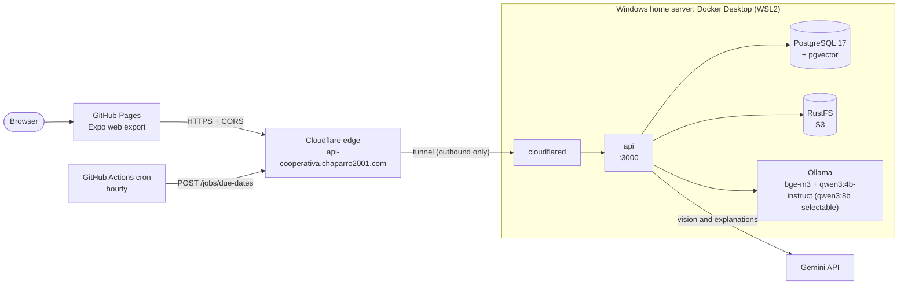

# Deployment of the hosted demo

A free demo that needs no credit card, for the thesis delivery. The API and its services run in Docker on a home Windows server and reach the internet only through a Cloudflare Tunnel. The decision is in [ADR-012](adr/ADR-012-home-server-with-cloudflare-tunnel.md): Render (blueprint and manual web service) and Railway asked for a credit card in October 2026.

## Architecture



| Piece          | Service                                                            | Notes                                                                                                                                         |
| -------------- | ------------------------------------------------------------------ | --------------------------------------------------------------------------------------------------------------------------------------------- |
| Web app        | GitHub Pages (Actions deploy)                                      | `https://chaparro2001.github.io/multiCooperativa/`; built by `.github/workflows/pages.yml`                                                    |
| API            | Container built from `apps/api/Dockerfile`                         | Public URL `https://api-cooperativa.chaparro2001.com` (Cloudflare Tunnel). No port is published on the host                                   |
| Database       | `pgvector/pgvector:pg17` container                                 | Named volume; not reachable from outside                                                                                                      |
| Files          | RustFS container (S3 protocol)                                     | Private bucket `multicooperativa`, created by a one-shot container; the API signs 5-minute URLs                                               |
| Embeddings     | Ollama container with `bge-m3`                                     | `EMBEDDINGS_PROVIDER=ollama` ([ADR-006](adr/ADR-006-local-model-embeddings.md))                                                               |
| Assistant chat | Ollama container with `qwen3:4b-instruct` (default) and `qwen3:8b` | `ASSISTANT_LLM_PROVIDER=ollama` ([ADR-013](adr/ADR-013-local-language-model-for-the-assistant.md))                                            |
| Vision         | Gemini API (free key)                                              | Invoice extraction and discrepancy explanations ([ADR-009](adr/ADR-009-gemini-language-and-vision-model.md))                                  |
| Tunnel         | `cloudflared` container                                            | Outbound connection to Cloudflare; the dashboard maps `api-cooperativa` to `http://api:3000` and `files-cooperativa` to `http://storage:9000` |
| Scheduled job  | GitHub Actions cron, plus the API's own hourly timer               | `.github/workflows/cron.yml` calls `/jobs/due-dates`; the timer also runs because the server does not sleep                                   |

The native apps are not part of this demo (no EAS build); the web export is the same code. The stack is defined in [`deploy/home-server/compose.yaml`](../deploy/home-server/compose.yaml); its variables are in [`deploy/home-server/env.server.example`](../deploy/home-server/env.server.example).

## Step by step (Windows)

Needs: Windows 10 (22H2) or 11, 16 GB of RAM or more (the local chat model needs it; see step 4 of the next section), about 15 GB of free disk, and an administrator account. Commands are for **PowerShell** (Start menu, type `PowerShell`; "Run as administrator" only where stated). Create the accounts yourself and paste secrets only into the places named below; none goes in the repository.

### 1. Install WSL2 and Docker Desktop

1. In an **administrator** PowerShell: `wsl --install`. Restart when asked.
2. Install [Docker Desktop for Windows](https://www.docker.com/products/docker-desktop/) and choose the **WSL 2** backend when asked. Restart if requested and accept the licence (personal and education use is free).
3. Docker Desktop > **Settings > General**: tick **Start Docker Desktop when you sign in to your computer**.
4. Give WSL2 enough memory. By default it takes half of the RAM (4 GB on an 8 GB machine), which is too little for this stack. What the containers use once the assistant has answered a question (measured with Docker on CPU, `ollama ps`): a chat model about 4.2 GB for `qwen3:4b-instruct` (the hosted-demo default, [ADR-015](adr/ADR-015-qwen3-4b-instruct-default-for-the-hosted-demo.md)) or about 6.7 GB for `qwen3:8b` (4-bit weights 5.2 GB plus the context cache), `bge-m3` about 1.2 GB, API about 0.4 GB, PostgreSQL about 0.1 GB, RustFS about 0.2 GB, `cloudflared` a few MB: about 9 GB in total with `qwen3:8b` loaded (about 7 GB with the default only). Ollama can hold both chat models loaded at once if cooperatives use both (`OLLAMA_MAX_LOADED_MODELS=2`), which is why 16 GB stays the recommendation, plus the WSL2 kernel and page cache. The limits in `compose.yaml` (Ollama 10 GB, API 1 GB, PostgreSQL and RustFS 512 MB each, `cloudflared` 128 MB) add up to about 12 GB. Create the file `%UserProfile%\.wslconfig` with Notepad:

   ```ini
   [wsl2]
   memory=16GB
   ```

   Then run `wsl --shutdown` and start Docker Desktop again. **16 GB is recommended for a host with 32 GB** (it leaves Windows 16 GB). With 12 to 16 GB of host RAM use `memory=8GB` and a single model (the default `qwen3:4b-instruct`, about 4.2 GB, one evaluation question fewer than `qwen3:8b` on the Mac, see ADR-013; set `ASSISTANT_OLLAMA_MODELS=qwen3:4b-instruct`); with less than 12 GB set `ASSISTANT_LLM_PROVIDER=gemini` in `.env.server` and keep `memory=6GB`. WSL2 only takes the memory it uses; the value is a ceiling.

5. Check: `docker run --rm hello-world` prints "Hello from Docker!".

### 2. Install Git and get the code

```powershell
winget install --id Git.Git -e
```

Close and reopen PowerShell, then:

```powershell
cd $HOME
git clone https://github.com/chaparro2001/multiCooperativa.git
cd multiCooperativa\deploy\home-server
```

(Use the real repository URL if it differs.) The repository is public, so no login is needed. To update later: `git pull` and repeat step 5's `up` command.

### 3. Create the Cloudflare Tunnel

The domain must already be on Cloudflare (its nameservers point to Cloudflare).

1. Open <https://one.dash.cloudflare.com> (Zero Trust). If it asks to choose a plan, pick **Free**.
2. **Networks > Tunnels > Create a tunnel > Cloudflared**. Name it `multicooperativa-home`.
3. On "Install and run connectors" choose **Docker** and copy **only the token**: the long string after `--token` (it starts with `eyJ`). Do not run the command it shows; Compose runs `cloudflared` for you. Keep the token secret: whoever has it can run your tunnel.
4. **Next**, then add a **Public hostname**:
   - Subdomain: `api-cooperativa`, Domain: `chaparro2001.com`, Path: empty.
   - Service type: `HTTP`, URL: `api:3000` (the name of the API container on the Docker network).
   - Save. Cloudflare creates the DNS record by itself.
5. Add a **second Public hostname** for the file links (the API hands the browser presigned storage URLs, and the browser cannot reach `storage:9000`):
   - Subdomain: `files-cooperativa`, Domain: `chaparro2001.com`, Path: empty.
   - Service type: `HTTP`, URL: `storage:9000`.
   - Under **Additional application settings > HTTP Settings**, set **HTTP Host Header** to `files-cooperativa.chaparro2001.com`. By default `cloudflared` forwards the original Host (the public hostname) and Cloudflare's reference does not state it explicitly, so setting it removes any doubt. It must never be `storage:9000`: the presigned URL signs the Host, and a different one answers `403 SignatureDoesNotMatch`.
   - Save. The API signs the links with `S3_PUBLIC_ENDPOINT` (default `https://files-cooperativa.chaparro2001.com`, overridable in `.env.server`).
6. Check that **SSL/TLS > Overview** of the domain is **Full** (or Full strict). The connection from `cloudflared` to the API is local and plain HTTP; the browser-facing HTTPS certificate is issued by Cloudflare for `api-cooperativa.chaparro2001.com` automatically.

Only these two hostnames are exposed. The storage one serves nothing without a valid presigned signature (the bucket is private, links expire in minutes). Do not add other public hostnames (database and Ollama must stay private).

### 4. Create `.env.server`

Still in `deploy\home-server`:

```powershell
Copy-Item env.server.example .env.server
```

Generate the secrets. This helper works in the Windows PowerShell that comes with Windows and in PowerShell 7:

```powershell
function New-Secret { $b = New-Object byte[] 32; [Security.Cryptography.RandomNumberGenerator]::Create().GetBytes($b); -join ($b | ForEach-Object { $_.ToString('x2') }) }
New-Secret   # run it once per secret below; every call prints a different 64-character value
```

Open the file with `notepad .env.server` and fill in:

| Variable                  | Secret | Value                                                                                                                                                                                                                                                                                                                                    |
| ------------------------- | :----: | ---------------------------------------------------------------------------------------------------------------------------------------------------------------------------------------------------------------------------------------------------------------------------------------------------------------------------------------- |
| `POSTGRES_PASSWORD`       |  yes   | `New-Secret`                                                                                                                                                                                                                                                                                                                             |
| `S3_SECRET_ACCESS_KEY`    |  yes   | `New-Secret`                                                                                                                                                                                                                                                                                                                             |
| `JWT_SECRET`              |  yes   | `New-Secret` (at least 32 characters)                                                                                                                                                                                                                                                                                                    |
| `JOBS_TOKEN`              |  yes   | `New-Secret` (at least 32 characters). Also goes to GitHub in step 9                                                                                                                                                                                                                                                                     |
| `TUNNEL_TOKEN`            |  yes   | The token copied in step 3                                                                                                                                                                                                                                                                                                               |
| `GEMINI_API_KEY`          |  yes   | Key from Google AI Studio (no card). Remove the leading `#`. Without it, reading scanned documents answers 503 (the assistant is local)                                                                                                                                                                                                  |
| `GEMINI_MODEL`            |   no   | `gemini-3.5-flash-lite` (extraction and explanations)                                                                                                                                                                                                                                                                                    |
| `ASSISTANT_LLM_PROVIDER`  |   no   | `ollama` (default in `compose.yaml`) or `gemini` to go back to the cloud model                                                                                                                                                                                                                                                           |
| `ASSISTANT_OLLAMA_MODEL`  |   no   | `qwen3:4b-instruct` (default model of every cooperative on the hosted demo, [ADR-015](adr/ADR-015-qwen3-4b-instruct-default-for-the-hosted-demo.md); the code default for development is `qwen3:8b`). Downloaded by `ollama-pull` the first time                                                                                         |
| `ASSISTANT_OLLAMA_MODELS` |   no   | `qwen3:4b-instruct,qwen3:8b` (default in `compose.yaml`; `qwen3:8b` is more precise on the Mac benchmark but noticeably slower on the server CPU): models each cooperative's administrator can choose in Settings. `ollama-pull` downloads all of them ([ADR-014](adr/ADR-014-per-cooperative-assistant-model.md))                       |
| `CORS_ORIGINS`            |   no   | `https://chaparro2001.github.io` (origin only, no path)                                                                                                                                                                                                                                                                                  |
| `WEB_APP_URL`             |   no   | `https://chaparro2001.github.io/multiCooperativa` (default in `compose.yaml`; public URL of the web app with its base path). The API builds the invitation links `${WEB_APP_URL}/invitation?token=…` from it; `compose.yaml` sets `INVITATION_DELIVERY=link` ([ADR-016](adr/ADR-016-invitation-links-delivered-by-the-administrator.md)) |
| `SEED_PASSWORD`           |  yes   | The password of the demo users; choose your own, the demo is public                                                                                                                                                                                                                                                                      |

Each cooperative's administrator picks the assistant's model among `ASSISTANT_OLLAMA_MODELS` in the app (Settings, "Asistente IA"). Only models that are in that list and installed are offered; the app never downloads one. Two models in use at once need about 6.7 + 4.2 GB of RAM plus the embeddings model (the `ollama` container limit is 12 GB, so keep WSL2 at `memory=16GB`); with less memory list a single model.

Values go after the `=` with no quotes and no spaces. `.env.server` is ignored by git. Back it up somewhere private (the secrets cannot be recovered).

### 5. Start the stack

```powershell
docker compose --env-file .env.server up -d --build
```

The first run builds the API image and downloads about 3 GB (including the `bge-m3` model of 1.2 GB): it can take 10 to 20 minutes. When it ends:

```powershell
docker compose --env-file .env.server ps
```

`api`, `postgres` and `ollama` should be `healthy`, `storage` and `cloudflared` `running`; `bucket-init` and `ollama-pull` show `exited (0)`, which is correct (they are one-shot jobs). The API applies the database migrations on every start. If something fails: `docker compose --env-file .env.server logs api`.

### 6. Seed the demo data

Both commands run inside the Compose network, from the same folder. They are additive and idempotent.

```powershell
# Users and cooperatives
docker compose --env-file .env.server run --rm --no-deps api pnpm --filter @multicooperativa/api db:seed --allow-production

# Sample documents and announcements, through the API (indexed with Ollama; takes a minute or two)
docker compose --env-file .env.server run --rm --no-deps -e API_URL=http://api:3000 api pnpm --filter @multicooperativa/api db:seed:content
```

`db:seed` needs `--allow-production` because the container runs with `NODE_ENV=production`. Never run `prisma migrate reset` here: it wipes the database. Demo users: see [sample-data.md](sample-data.md); handy ones are `admin@sanisidro.test`, `socio@sanisidro.test`, `gestor@sanisidro.test` and `lucia@demo.test`, with the password you set in `SEED_PASSWORD` (default `demo-cooperativa-2026` when empty).

### 7. Check the public URL

From the server: `curl.exe https://api-cooperativa.chaparro2001.com/health` must print `{"status":"ok"}`. Then **from your phone on mobile data (Wi-Fi off)** open `https://api-cooperativa.chaparro2001.com/health`: this proves it works from outside your home. If it shows a Cloudflare error (1033 or 502), check that `cloudflared` is running (`docker compose --env-file .env.server logs cloudflared`) and that the public hostname points to `http://api:3000`.

### 8. Windows hardening (so it keeps working until grading)

- **Never sleep.** Settings > System > Power: when plugged in, "Screen and sleep" > sleep **Never**. In an administrator PowerShell: `powercfg /hibernate off`. On a laptop also set "closing the lid" to **Do nothing** (Control Panel > Power Options).
- **Windows Update.** Settings > Windows Update > **Pause updates** (up to 5 weeks) and set **Active hours** to the whole day, so it does not reboot at a bad moment. Resume updates after grading.
- **Start after a reboot.** `cloudflared` and the rest start by themselves when Docker Desktop starts (`restart: unless-stopped`). Docker Desktop starts when a user **signs in** (step 1.3), so after a power cut someone must sign in. For an unattended machine enable automatic sign-in: `netplwiz`, untick "Users must enter a user name and password" (only if the machine is physically safe).
- **Router/UPS.** Nothing to open on the router. A UPS is optional.
- Backups are not needed for a demo; the data can be recreated with the seeds.

### 9. GitHub (web and cron)

In the repository: **Settings > Pages > Source: GitHub Actions**. Then **Settings > Secrets and variables > Actions**:

| Kind     | Name         | Value                                      | Used by                                                               |
| -------- | ------------ | ------------------------------------------ | --------------------------------------------------------------------- |
| Variable | `API_URL`    | `https://api-cooperativa.chaparro2001.com` | `pages.yml` (becomes `EXPO_PUBLIC_API_URL` at build time), `cron.yml` |
| Secret   | `JOBS_TOKEN` | the same string as in `.env.server`        | `cron.yml`                                                            |

Run **Actions > Deploy web demo > Run workflow** (or push to `main`). The site is built with base path `/multiCooperativa` (`experiments.baseUrl` in `apps/mobile/app.json`), `index.html` is copied to `404.html` so that reloads of any path load the app, and it is deployed with `actions/deploy-pages`. `EXPO_PUBLIC_API_URL` is public by design: it ends up in the bundle. Rerun the workflow whenever `API_URL` changes.

If the repository name differs from `multiCooperativa`, change `baseUrl` in `apps/mobile/app.json` and the origin in `CORS_ORIGINS`.

## Operating it

Always from `deploy\home-server`, with `--env-file .env.server`:

| Task                         | Command                                                                |
| ---------------------------- | ---------------------------------------------------------------------- |
| Status                       | `docker compose --env-file .env.server ps`                             |
| Logs of the API              | `docker compose --env-file .env.server logs -f api`                    |
| Stop everything (data stays) | `docker compose --env-file .env.server stop`                           |
| Start again                  | `docker compose --env-file .env.server start`                          |
| **Cut public access**        | `docker compose --env-file .env.server stop cloudflared`               |
| Restore public access        | `docker compose --env-file .env.server start cloudflared`              |
| Update to the latest code    | `git pull`, then `docker compose --env-file .env.server up -d --build` |
| Memory use                   | `docker stats --no-stream`                                             |

`docker compose down -v` deletes the volumes (all data): do not use it unless you want to start from scratch.

## Security notes

- Only the API and the file-link hostnames are published, through the tunnel (the latter reaches RustFS, which accepts only requests with a valid presigned signature). PostgreSQL, RustFS and Ollama have no published ports and are reachable only from the other containers; the API container itself publishes nothing on the host (a commented `127.0.0.1:3000` mapping in `compose.yaml` is for local debugging).
- Nothing is opened on the home router: `cloudflared` only makes an outbound connection.
- Secrets live in `.env.server` (git-ignored) and in the Cloudflare/GitHub dashboards. The API container does not receive the tunnel token.
- The API still enforces everything it enforces anywhere: JWT, per-cooperative isolation, login lockout, the assistant's per-user hourly limit (`ASSISTANT_MESSAGE_LIMIT_PER_HOUR`) and CORS limited to `CORS_ORIGINS`. `trust proxy` is set to one hop, matching the tunnel.
- Cloudflare terminates TLS, so it can see the traffic. Use only sample data.
- The cloud-hosted Gemini API receives the scanned documents and the discrepancy data it is asked to read or explain; its free tier may use content to improve Google's products. Do not upload real third-party documents. Embeddings and the assistant's questions and answers stay on the server (ADR-013).

## Limitations

- **Availability** depends on the home machine: power, internet, Windows restarts and someone signed in for Docker Desktop. There is no cold start.
- **Memory.** With both Ollama models loaded (`OLLAMA_KEEP_ALIVE=24h`) the stack uses about 9 GB, so WSL2 needs `memory=16GB` on the 32 GB host (see step 4 of the installation). The first question after a restart also loads the model from disk (several seconds).
- **Assistant speed.** The local model runs on the CPU: measured on a 12-core Mac with Docker, a typical question takes 7 s and the slowest 30 s (median 7.1 s, p90 25.9 s over the 22 evaluation questions, ADR-013). A server with fewer or slower cores will be slower; `ASSISTANT_OLLAMA_TIMEOUT_MS` (default 90 s) bounds each call. The local model passes 19 of the 22 evaluation questions (Gemini scored 20 of 20 when it was last measured), so it can phrase or miss details more often.
- Indexing and search on CPU are slower than on a hosted API; a long document can take a while to become searchable.
- **Gemini free tier**: rate limits apply to invoice extraction and discrepancy explanations (the API retries and falls back where configured). The assistant no longer consumes that quota.
- **Scheduled workflows** are disabled by GitHub after 60 days without repository activity.
- **Web build**: the session is kept in `sessionStorage` (survives reloads, ends with the tab); native apps use the Keychain/Keystore. There is no biometric unlock or camera capture on the web (the file chooser is used), confirmations use the browser's dialogs, and opening a deep link directly on an inner page lands on the home screen (use the in-app navigation).
- Invitations are not emailed (no email provider, [ADR-016](adr/ADR-016-invitation-links-delivered-by-the-administrator.md)): `POST .../members` and the resend return the activation link only to the administrator who issued it, who passes it on. The link is single use, valid 7 days, sent over HTTPS and never written to the logs. With `INVITATION_DELIVERY=console` in production inviting answers 503 instead of logging tokens.
- This is a demo, not a system of record: no backups.

## Cost

0 EUR: GitHub Pages and Actions (public repository), Cloudflare free plan (the domain is already owned), Docker Desktop (personal/education use), Gemini free tier. No card is requested by any of them.

## Alternative: Tailscale Funnel (no domain)

If you have no domain on Cloudflare, install Tailscale on the server, enable HTTPS and Funnel in the admin console, and run `tailscale funnel --bg 3000`. The API then answers at `https://<machine>.<tailnet>.ts.net`. In this case remove the `cloudflared` service from `compose.yaml`, uncomment the `127.0.0.1:3000:3000` mapping of `api`, and use the Funnel URL as `API_URL`. Cut access with `tailscale funnel reset`. Not tested for this project.

## Alternative: managed cloud (requires a credit card on Render)

Neon (Postgres with pgvector), Supabase Storage (S3 protocol) and Render (Docker web service from [`render.yaml`](../render.yaml)), with Gemini embeddings (`EMBEDDINGS_PROVIDER=gemini`, [ADR-010](adr/ADR-010-gemini-embeddings-for-the-hosted-demo.md)). Render's blueprint and manual web services, and Railway, asked for a credit card in October 2026, which is why this is not the primary path. Summary:

1. **Neon**: Postgres 17, Frankfurt. Copy the pooled URL (`DATABASE_URL`) and the direct URL (`DIRECT_URL`), both ending in `?sslmode=require`.
2. **Supabase Storage**: private bucket `multicooperativa`; enable S3 Connection and create an access key (`S3_ENDPOINT`, `S3_REGION`, `S3_ACCESS_KEY_ID`, `S3_SECRET_ACCESS_KEY`).
3. **Render**: New > Blueprint on this repository; fill the variables marked `sync: false` and set `JOBS_TOKEN` (the same value as the GitHub secret). The container applies migrations with `DIRECT_URL` on start.
4. **GitHub**: `API_URL` = the Render URL, as in step 9 above.
5. **Seed** from your machine with the direct Neon URL: `DATABASE_URL='<neon direct url>' SEED_PASSWORD='<password>' pnpm --filter @multicooperativa/api db:seed --allow-production`, then `API_URL='https://<service>.onrender.com' SEED_PASSWORD='<password>' pnpm --filter @multicooperativa/api db:seed:content`.

Caveats of that path: Render's free instance sleeps after 15 minutes (cold start about 1 minute, so the hourly cron wakes it but does not keep it awake) and has 512 MB (the image caps the Node heap at 320 MB); Neon suspends idle compute; Supabase pauses free projects after 7 days of inactivity; document text goes to Google for embeddings. Vectors from Ollama and from Gemini are not comparable: never copy `embedding` rows between environments, and reindex if you change `EMBEDDINGS_PROVIDER` on an existing database.

## Local equivalent

`docker build -f apps/api/Dockerfile -t multicooperativa-api .` from the repository root builds the same image the home server runs. For development, `docker-compose.yml` at the root starts only the services (see `CLAUDE.md`).

## Gemini quota, retries and fallback models

The assistant runs on a local model in the home-server stack (ADR-013), so this section applies to extraction and explanations there, and to the assistant if you set `ASSISTANT_LLM_PROVIDER=gemini` (hosted path, development). The free Gemini tier is small: in October 2026 the Flash models (`gemini-3.8-flash`, `gemini-3.6-flash`) allowed about 20 requests per day each, and the Flash-Lite models more. One assistant question costs 2-3 calls. For the demo, set `GEMINI_MODEL=gemini-3.5-flash-lite` (20/20 in the evaluation set) and keep the default `GEMINI_FALLBACK_MODELS`.

Every Gemini call (assistant, extraction, explanations, embeddings) is retried with exponential backoff and jitter (3 attempts per model, 4 for embeddings, at most about 20 s of waiting, 30 s for embeddings; honoring `Retry-After` and `retryDelay`). If `GEMINI_MODEL` keeps failing with 503/429, the models of `GEMINI_FALLBACK_MODELS` are tried in order (embeddings never switch model: their vectors would not be comparable). Each retry logs one `gemini_retry` line without content. Changing either variable needs a restart of the `api` container.
