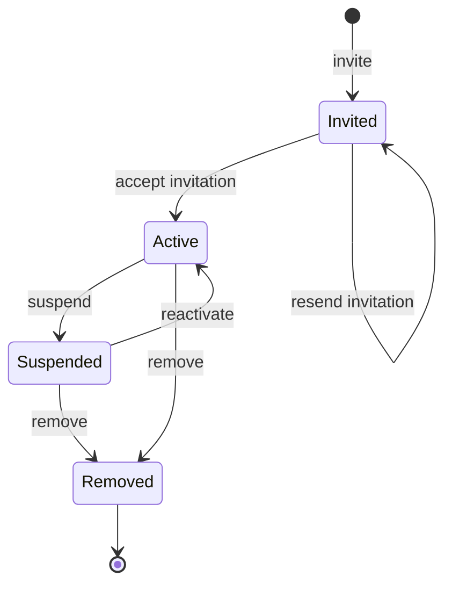
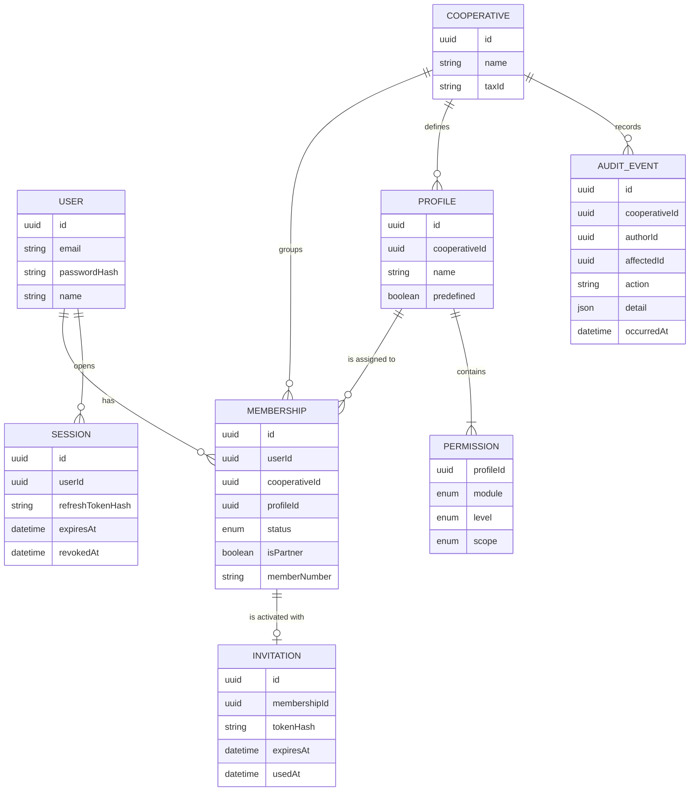

# Requirements · 01 · Access and profiles

**Date**: 2026-10-04 · **Status**: Accepted

Base module on which all the others depend: it identifies the user, determines which cooperative they are working in and resolves which modules and data they can access.

Related architecture decisions: [ADR-003](../adr/ADR-003-multi-cooperative.md) and [ADR-004](../adr/ADR-004-profile-based-access-control.md).

## 1. Glossary

| Term               | Definition                                                                                                                                     | In code       |
| ------------------ | ---------------------------------------------------------------------------------------------------------------------------------------------- | ------------- |
| User               | Person with credentials on the platform. Unique by email                                                                                       | `User`        |
| Cooperative        | Customer entity. Its data is isolated from the others                                                                                          | `Cooperative` |
| Membership         | Link between a user and a cooperative. Carries the profile, the status and the member status (whether the user is a member of the cooperative) | `Membership`  |
| Profile            | Named set of permissions, defined within a cooperative                                                                                         | `Profile`     |
| Permission         | Module + level + scope                                                                                                                         | `Permission`  |
| Level              | No access, read or manage. Manage includes read                                                                                                | `AccessLevel` |
| Scope              | Own (only the user's data) or all (the cooperative's data)                                                                                     | `Scope`       |
| Member status      | Indicates whether the user is a member (socio) of the cooperative. Independent of the profile                                                  | `isPartner`   |
| Active cooperative | The one the user is operating on at a given moment                                                                                             | —             |
| Invitation         | Single-use link for a new user to activate their access                                                                                        | `Invitation`  |

In this document, "member" means a member (socio) of the cooperative; the people who hold a membership, whether or not they are members, are referred to as "users".

## 2. Actors

- **Unauthenticated user**: has an invitation or credentials.
- **User with access**: authenticated user with an active membership in the active cooperative.
- **Administrator**: user whose profile has manage level on the "Users and profiles" module.

## 3. Predefined profiles matrix

Each cooperative is created with these four profiles.

| Module                      | Member     | Governing board | Manager      | Administrator |
| --------------------------- | ---------- | --------------- | ------------ | ------------- |
| Announcements               | Read       | Manage          | Read         | Manage        |
| Assemblies                  | Read       | Manage          | No access    | Manage        |
| Documents                   | Read       | Manage          | Read         | Manage        |
| Invoices and delivery notes | No access  | Read            | Manage       | Manage        |
| Member area                 | Read · own | Read · all      | Manage · all | Manage · all  |
| AI assistant                | Read       | Read            | Read         | Read          |
| Users and profiles          | No access  | No access       | No access    | Manage        |

The right to vote does not appear in the matrix: it depends on member status (BR-ACC-06).

## 4. User stories

### Must

#### US-ACC-01 · Activate access from an invitation

As an invited person, I want to set my password from the link I received, so that I can start using the app.

- **Given** a valid, unexpired invitation, **when** I open the link and set a password that meets the policy, **then** my membership becomes active and I am signed in.
- **Given** an expired or already used invitation, **when** I open the link, **then** I see a message saying I must request a new one and no access is created.
- **Given** that I already have an account because I belong to another cooperative, **when** I accept the invitation, **then** the new membership is added to my user without asking for another password.

#### US-ACC-02 · Sign in

As a user, I want to sign in with my email and password, so that I can access my cooperatives.

- **Given** correct credentials and at least one active membership, **when** I sign in, **then** I receive a valid session and access the app.
- **Given** incorrect credentials, **when** I sign in, **then** I see a generic error that does not reveal whether the email exists.
- **Given** five failed attempts in fifteen minutes, **when** I try again, **then** access is temporarily blocked even if the password is correct.
- **Given** correct credentials but no active membership, **when** I sign in, **then** I see that I do not have access to any cooperative.

#### US-ACC-03 · Keep and end the session

As a user, I want not to have to identify myself every time I open the app and to be able to sign out whenever I want.

- **Given** a session with an expired access token and a valid refresh token, **when** the app makes a request, **then** the session is renewed without my intervention.
- **Given** a refresh token that has already been used, **when** someone tries to use it again, **then** the whole session is revoked and identification is required again.
- **Given** a signed-in session, **when** I sign out, **then** the tokens are revoked on the server and deleted from the device.

#### US-ACC-04 · Biometric unlock

As a user, I want to unlock the app with Face ID or fingerprint, so that I can get in quickly without exposing my data.

- **Given** that I have enabled biometrics, **when** I open the app with a valid session, **then** biometrics are requested before any data is shown.
- **Given** that biometrics fail or I cancel, **when** the attempts run out, **then** I can sign in with my password.
- **Given** a device with no biometrics configured, **when** I go to settings, **then** the option is not offered.

#### US-ACC-05 · Choose and switch cooperative

As a user with several cooperatives, I want to choose which one I am working in, so that I only see its data.

- **Given** a single active membership, **when** I sign in, **then** I go directly into that cooperative.
- **Given** several active memberships, **when** I sign in for the first time, **then** I see a cooperative selector.
- **Given** an active cooperative, **when** I switch to another from the menu, **then** all the data and navigation reload with the profile I have in the new one, without identifying myself again.
- **Given** that I already chose a cooperative in a previous use, **when** I open the app again, **then** I enter the last one used.

#### US-ACC-06 · See only the permitted modules

As a user, I want the app to show me only the modules I have access to, so that I do not run into screens I cannot use.

- **Given** my profile in the active cooperative, **when** the app loads, **then** the navigation includes only the modules with read or manage level.
- **Given** a module with read level, **when** I enter it, **then** the create, edit or delete actions do not appear.
- **Given** that my profile changes while I use the app, **when** I make the next request, **then** the navigation updates with the new permissions.

#### US-ACC-07 · Deny by default on the server

As the person in charge of the cooperative, I want the server to reject any disallowed access, so that data is protected even if someone tampers with the app.

- **Given** a user without access to a module, **when** they call its API directly, **then** they receive 403 and no logic is executed.
- **Given** a user with "own" scope, **when** they request a resource of another member of their cooperative, **then** they receive 404.
- **Given** a user without a membership in a cooperative, **when** they request any resource of it, **then** they receive 404.
- **Given** a request without a valid session, **when** it reaches a protected endpoint, **then** it receives 401.

#### US-ACC-08 · Invite a user

As an administrator, I want to invite a person by assigning them a profile, so that I can give them access to the cooperative.

- **Given** an email without a membership in my cooperative, **when** I invite it indicating profile and whether they are a member, **then** a membership in invited status is created and the invitation is sent.
- **Given** an email that already has a membership in my cooperative, **when** I try to invite it, **then** I am informed and it is not duplicated.
- **Given** a pending invitation, **when** I resend it, **then** the previous one is invalidated and a new one is issued.

#### US-ACC-09 · Change a user's profile

As an administrator, I want to change a user's profile, so that I can adjust which modules they access.

- **Given** an active user, **when** I assign them another profile, **then** their permissions change on their next request, without them signing out.
- **Given** my own membership, **when** I try to change my profile, **then** the operation is rejected (so the cooperative never ends up without an administrator).
- **Given** a user of another cooperative, **when** I try to modify them, **then** I receive 404.

#### US-ACC-10 · Suspend, reactivate and remove a user

As an administrator, I want to suspend a user's access reversibly or remove them permanently, so that I can control who accesses the cooperative.

- **Given** an active user, **when** I suspend them, **then** they lose access to this cooperative on their next request and keep access to their other cooperatives.
- **Given** a suspended user, **when** I reactivate them, **then** they regain access with the profile they had.
- **Given** an active or suspended user, **when** I remove them and confirm the action, **then** they lose access permanently, stop appearing in the list of active users and keep access to their other cooperatives.
- **Given** a removed user, **when** I consult their historical records (votes, published announcements, capital movements, notes), **then** they still exist with their authorship.
- **Given** a removed user, **when** they need to be given access again, **then** a new invitation must be sent, which creates a new membership.
- **Given** my own membership, **when** I try to suspend or remove myself, **then** the operation is rejected.

### Should

#### US-ACC-11 · Recover the password

As a user, I want to reset my password if I forget it.

- **Given** any email, **when** I request recovery, **then** I always see the same message, whether or not the account exists.
- **Given** a valid recovery link, **when** I set a new password, **then** all my open sessions are revoked.

#### US-ACC-12 · Access change log

As an administrator, I want to see who changed which access and when, so that I can audit it.

- **Given** an invitation, a profile change, a suspension or a reactivation, **when** it completes, **then** it is recorded with author, affected user, previous and new values, and date.
- **Given** the log, **when** I consult it, **then** I only see the events of my cooperative.

#### US-ACC-14 · Cooperative branding

As an administrator, I want to set my cooperative's primary colour, so that the app looks like my cooperative to all its members.

- **Given** the Settings screen, **when** I am an administrator (Users and profiles · manage), **then** I see an "Appearance" section where I choose a colour (ready-made swatches or a `#RRGGBB` code, with a live preview of the buttons) or go back to the default colour.
- **Given** a colour whose white text does not reach a 4.5:1 contrast, **when** I save it, **then** it is refused with the computed ratio and nothing changes (BR-ACC-16).
- **Given** a saved colour, **when** any member of the cooperative opens the app, **then** buttons, links, header tint and selected states use the colour. Danger and warning colours do not change.
- **Given** a cooperative that configured nothing, **when** its members open the app, **then** they see the default theme.
- **Given** a user who is not an administrator, **when** they open Settings or call the write endpoints, **then** they do not see the section and the API answers 403; a user of another cooperative gets 404.
- **Given** any change of colour, **when** it completes, **then** it is recorded in the access change log as `cooperative.branding_changed` (US-ACC-12).

### Could

#### US-ACC-13 · Custom profiles

As an administrator, I want to create my own profiles choosing level and scope per module, so that I can adapt them to my cooperative.

- **Given** the modules matrix, **when** I save a new profile, **then** it becomes available to assign.
- **Given** a predefined profile, **when** I try to edit or delete it, **then** the operation is rejected.
- **Given** a custom profile with assigned users, **when** I try to delete it, **then** I am asked to reassign them first.

### Won't

- Free sign-up without an invitation.
- Sign-in with third parties (Apple, Google) and second factor.
- Creating and removing cooperatives from the app.
- More than one profile per user within the same cooperative.
- Physical deletion of users and their data (removal is a status; the right to erasure would be handled as a separate process).

## 5. Business rules

| Id        | Rule                                                                                                                                                                                                                                                                       |
| --------- | -------------------------------------------------------------------------------------------------------------------------------------------------------------------------------------------------------------------------------------------------------------------------- |
| BR-ACC-01 | The email uniquely identifies a user across the whole platform.                                                                                                                                                                                                            |
| BR-ACC-02 | A user has at most one membership per cooperative.                                                                                                                                                                                                                         |
| BR-ACC-03 | Every membership has exactly one profile from its own cooperative.                                                                                                                                                                                                         |
| BR-ACC-04 | A permission combines module, level and scope. Manage includes read. The absence of a permission is equivalent to no access.                                                                                                                                               |
| BR-ACC-05 | The "own" scope only makes sense in the Member area, which is the only module with per-member data. In all the others the scope is always "all".                                                                                                                           |
| BR-ACC-06 | Member status is independent of the profile. To vote, an active membership and member status are required.                                                                                                                                                                 |
| BR-ACC-07 | Every cooperative always has at least one active administrator.                                                                                                                                                                                                            |
| BR-ACC-08 | An administrator cannot modify or suspend their own membership.                                                                                                                                                                                                            |
| BR-ACC-09 | An invited, suspended or removed membership grants no access. The effect is immediate.                                                                                                                                                                                     |
| BR-ACC-10 | An invitation is single-use and expires after 7 days.                                                                                                                                                                                                                      |
| BR-ACC-11 | Five failed sign-in attempts in 15 minutes block access for 15 minutes.                                                                                                                                                                                                    |
| BR-ACC-12 | Changing or resetting the password revokes all of the user's sessions. **Deferred**: the MVP has no password change or reset flow (the password is only set when an invitation is accepted), so this rule applies when that flow is built.                                 |
| BR-ACC-13 | Predefined profiles cannot be edited or deleted.                                                                                                                                                                                                                           |
| BR-ACC-14 | Removal is permanent and deletes no data: the membership stays in removed status and its records keep their authorship. Coming back requires an invitation and a new membership.                                                                                           |
| BR-ACC-15 | A removed membership does not count in the census of new votings nor receive notifications.                                                                                                                                                                                |
| BR-ACC-16 | The cooperative's primary colour is `#RRGGBB` and white text over it must reach a WCAG AA contrast of at least 4.5:1 (relative luminance, WCAG 2.x); otherwise `422 insufficient_contrast` with the computed ratio. Only an administrator can change it and it is audited. |
| BR-ACC-17 | ~~The logo is a PNG or JPEG of at most 1 MB and 1024 × 1024 px, recognised by its content; SVG is always refused.~~ **Removed**: superseded by [ADR-021](../adr/ADR-021-remove-cooperative-logo.md) (the cooperative logo no longer exists).                               |

### Membership statuses



(In code and in the API the statuses are `invited`, `active`, `suspended` and `removed`.)

## 6. Non-functional requirements

| Id         | Requirement                                                                                                    |
| ---------- | -------------------------------------------------------------------------------------------------------------- |
| NFR-ACC-01 | Passwords are stored with Argon2id. Minimum 10 characters.                                                     |
| NFR-ACC-02 | 15-minute JWT access token. Rotating 30-day refresh token with reuse detection.                                |
| NFR-ACC-03 | Tokens are kept in the device's secure storage, never in plain storage.                                        |
| NFR-ACC-04 | Permissions are resolved on the server on every request and are not included in the token.                     |
| NFR-ACC-05 | Sign-in, invitation and recovery responses do not allow deducing whether an email exists.                      |
| NFR-ACC-06 | A resource from another cooperative or outside the scope answers 404; a module without permission answers 403. |
| NFR-ACC-07 | Permission resolution adds less than 50 ms at the 95th percentile of each request.                             |
| NFR-ACC-08 | Logs contain no passwords, tokens or personal data beyond the user identifier.                                 |
| NFR-ACC-09 | Authentication endpoints have a rate limit per IP and per email.                                               |

## 7. Domain model



## 8. API

Authentication (without cooperative):

| Method | Route                      | Use                                                                                                 |
| ------ | -------------------------- | --------------------------------------------------------------------------------------------------- |
| POST   | `/auth/login`              | Sign in                                                                                             |
| POST   | `/auth/refresh`            | Renew the session                                                                                   |
| POST   | `/auth/logout`             | Sign out                                                                                            |
| POST   | `/auth/invitations/accept` | Activate access from an invitation                                                                  |
| POST   | `/auth/password/forgot`    | Request recovery                                                                                    |
| POST   | `/auth/password/reset`     | Set a new password                                                                                  |
| GET    | `/me`                      | User data and their active memberships, each with its cooperative's `primaryColor` (null = default) |

Authentication contract (schemas in `packages/contracts/src/auth.ts`):

- Login, renewal and activation of a new user return `accessToken` (15-minute JWT with `sub` and `sid`, without permissions), `accessTokenExpiresIn` and `refreshToken`. The refresh token has the form `<sessionId>.<secret>`; only the SHA-256 of the secret is stored in the database. Each renewal rotates it and extends the session by 30 days.
- When accepting an invitation, a user who already had an account does not receive a session (`tokens: null`): the link alone does not open an existing account, so the app takes them to sign-in.
- Errors with body `{ error, message? }`: `400 invalid_request`, `400 password_required`, `400 weak_password`, `401 invalid_credentials`, `401 invalid_refresh_token` (unknown, expired, revoked or reused), `403 no_active_membership`, `410 invitation_not_usable` (also if the token does not exist), `429 login_locked` with a `Retry-After` header.
- Failed attempts are counted per email whether or not it exists, and a successful sign-in resets them to zero.

Within a cooperative:

| Method | Route                                                         | Use                                     | Permission                  |
| ------ | ------------------------------------------------------------- | --------------------------------------- | --------------------------- |
| GET    | `/cooperatives/{cooperativeId}/me/permissions`                | Effective permissions and member status | Active membership           |
| GET    | `/cooperatives/{cooperativeId}/profiles`                      | List profiles                           | Users and profiles · manage |
| GET    | `/cooperatives/{cooperativeId}/members`                       | List members (memberships)              | Users and profiles · manage |
| GET    | `/cooperatives/{cooperativeId}/members/{memberId}`            | One member that has not left            | Users and profiles · manage |
| POST   | `/cooperatives/{cooperativeId}/members`                       | Invite                                  | Users and profiles · manage |
| PATCH  | `/cooperatives/{cooperativeId}/members/{memberId}`            | Change profile, suspend or reactivate   | Users and profiles · manage |
| POST   | `/cooperatives/{cooperativeId}/members/{memberId}/removal`    | Remove (permanent)                      | Users and profiles · manage |
| POST   | `/cooperatives/{cooperativeId}/members/{memberId}/invitation` | Resend invitation                       | Users and profiles · manage |
| GET    | `/cooperatives/{cooperativeId}/audit`                         | Access change log                       | Users and profiles · manage |
| GET    | `/cooperatives/{cooperativeId}/branding`                      | Primary colour                          | Active membership           |
| PUT    | `/cooperatives/{cooperativeId}/branding/primary-color`        | Set or reset the primary colour         | Users and profiles · manage |

Response of `/cooperatives/{cooperativeId}/me/permissions`, with which the app builds the navigation:

```json
{
  "cooperativeId": "…",
  "profileName": "Member",
  "isPartner": true,
  "permissions": [
    { "module": "announcements", "level": "read", "scope": "all" },
    { "module": "member_area", "level": "read", "scope": "own" }
  ]
}
```

JSON keys are in English, like the rest of the identifiers; the values (modules, levels, scopes) are the domain ones: modules `announcements`, `assemblies`, `documents`, `invoicing`, `member_area`, `assistant`, `users`; levels `read` and `manage`; scopes `own` and `all`. Schemas in `packages/contracts/src/access.ts`; `GET /me` returns `id`, `email`, `name` and `memberships` (only the active ones, with `cooperativeId`, `cooperativeName`, `profileName` and `isPartner`).

`GET /members` is keyset-paginated (docs/02-stack-and-architecture.md, principle 8): `?limit=` (30 by default, 100 at most), `?before=<nextCursor>`, `?q=` (name or email, ignoring case and accents) and `?status=` (`invited`, `active` or `suspended`); it answers `{ items, nextCursor }` ordered by name and then id, never including removed members (US-ACC-10). The app searches on the server once the user stops typing; the detail screen reads `GET /members/{memberId}` (404 for a removed one or another cooperative's).

Context of each request:

- Protected routes require `Authorization: Bearer <accessToken>`. Besides the signature, the session (`sid`) is checked to still be open, so a sign-out or a detected reuse cuts access immediately. Without a valid session: `401 unauthenticated`.
- On `/cooperatives/{cooperativeId}/...` the user's active membership is loaded with its profile and permissions on every request. Without an active membership, a nonexistent cooperative or a malformed id: `404 not_found`. Without permission for the module: `403 forbidden`, before running any logic.
- The `/auth` endpoints have a rate limit per IP (100 every 15 minutes) and login, in addition, per email (20 every 15 minutes): `429 too_many_requests` (NFR-ACC-09). The counter lives in memory, valid as long as the API runs as a single instance.

Member management (schemas in `packages/contracts/src/access.ts`):

- All the member, profile and audit routes require "Users and profiles · manage". The list excludes removed memberships; the audit returns the last 100 events of the cooperative.
- `PATCH /members/{memberId}` accepts a single change per request: `{ "profileId": "…" }` or `{ "status": "active" | "suspended" }`. Removal goes through its own endpoint because it is permanent.
- Errors: `400 profile_not_found`, `404 not_found` (member of another cooperative or nonexistent), `409 member_already_exists`, `409 self_modification` (BR-ACC-08), `409 last_admin` (BR-ACC-07), `409 invalid_membership_transition`, `409 invitation_not_pending`, `503 invitation_delivery_unavailable`.
- Changes within a cooperative are serialized by locking its row, so that two administrators removing each other's profile at the same time cannot leave it with none.
- Every invitation, resend, profile change, suspension, reactivation and removal is recorded in the same transaction with author, affected user, previous and new values, and date (US-ACC-12).
- Delivery of the invitation link ([ADR-016](../adr/ADR-016-invitation-links-delivered-by-the-administrator.md)): there is no email provider. With `INVITATION_DELIVERY=link`, `POST /members` (`201 { membershipId, expiresAt, invitationUrl }`) and `POST /members/{memberId}/invitation` (`200 { expiresAt, invitationUrl }`) return the web link `${WEB_APP_URL}/invitation?token=<token>` to the inviting administrator, who passes it on (the route already requires "Users and profiles · manage"). The link is never returned by any other endpoint and the token is never logged (NFR-ACC-08). With `INVITATION_DELIVERY=console` the native link `multicooperativa://invitation?token=<token>` is written to the API console in development and in production inviting responds 503 (the membership is created and can be resent).

Branding (US-ACC-14, [ADR-018](../adr/ADR-018-per-cooperative-branding.md), logo removed by [ADR-021](../adr/ADR-021-remove-cooperative-logo.md); schemas in `packages/contracts/src/branding.ts`, owned by the `branding` module):

- `GET` returns `{ primaryColor: "#RRGGBB" | null, updatedAt: string | null }`. Everything `null` means the default theme.
- `PUT /branding/primary-color` takes `{ "primaryColor": "#RRGGBB" | null }` (`null` goes back to the default). Every write answers with the new branding.
- Errors: `400 invalid_request` (malformed body), `403 forbidden`, `404 not_found`, `422 insufficient_contrast` (`details: { ratio, minimum }`), `422 invalid_color`.
- Changes are audited as `cooperative.branding_changed` with `{ primaryColor: { from, to } }`; a write that changes nothing leaves no event.

## 9. App screens

1. Sign in.
2. Activation from an invitation.
3. Password recovery.
4. Cooperative selector.
5. Home, with permission-based navigation.
6. Settings: biometrics, cooperative switch, appearance (administrator: colour, US-ACC-14), sign out.
7. Members (administrator): list, invite, change profile, suspend, reactivate and remove with confirmation.

## 10. Test strategy

- **Domain with TDD**: permission resolution (level and scope), membership status transitions (including removal as the final state), last administrator rule, expiry and single use of the invitation, lockout after failed attempts.
- **Permission matrix**: parameterized test that runs the 4 profiles across the 7 modules and checks the expected response of each endpoint.
- **Isolation between cooperatives**: each endpoint is called with a user from another cooperative and must respond 404.
- **Integration**: complete flow of invitation, activation, sign-in, renewal and sign-out.
- **E2E in the app**: sign-in, cooperative switch and checking that the navigation changes with the profile.

## 11. Decisions

| #   | Decision                                                                                                                                                                                    | Status                | Affects                         |
| --- | ------------------------------------------------------------------------------------------------------------------------------------------------------------------------------------------- | --------------------- | ------------------------------- |
| 1   | Sign-up only by administrator invitation; no free registration                                                                                                                              | Closed (2026-10-04)   | US-ACC-01, US-ACC-08            |
| 2   | A single profile per user and cooperative                                                                                                                                                   | Closed (2026-10-04)   | BR-ACC-03, matrix               |
| 3   | Email and password as the only access method                                                                                                                                                | Closed (2026-10-04)   | US-ACC-02                       |
| 4   | Code identifiers in English, documentation in Spanish. Superseded: everything in English except the localized app UI texts ([ADR-008](../adr/ADR-008-english-codebase-and-localized-ui.md)) | Replaced (2026-10-04) | Glossary, CLAUDE.md             |
| 5   | Membership removal with an action on the members screen                                                                                                                                     | Closed (2026-10-04)   | US-ACC-10, BR-ACC-14, BR-ACC-15 |
