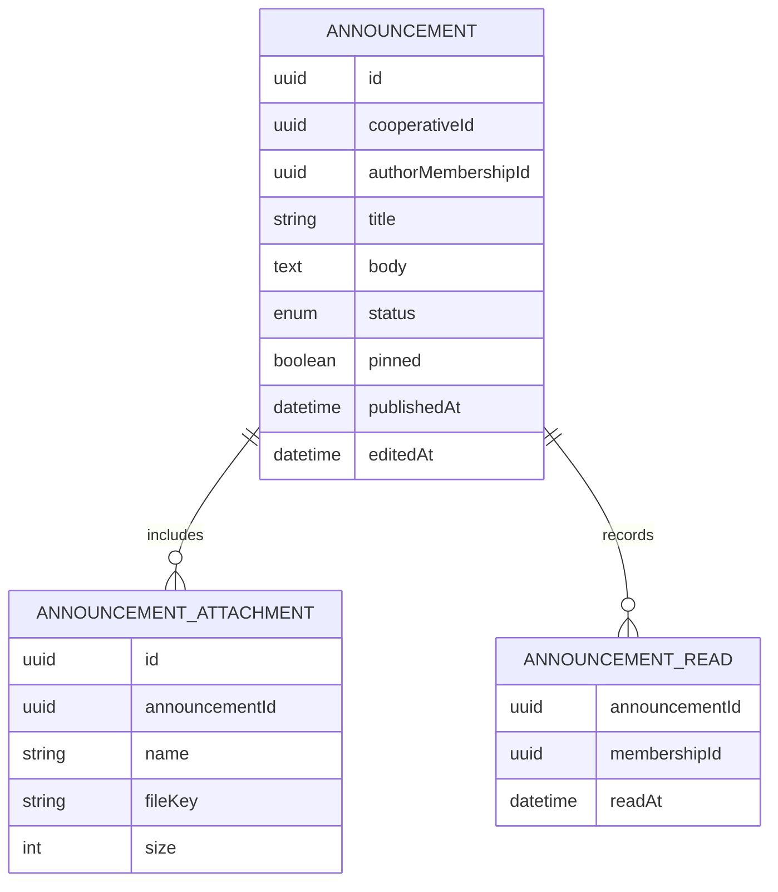

# Requirements · 02 · Announcements

**Date**: 2026-10-04 · **Status**: Draft to validate

Official channel from the cooperative to its users. Replaces the letter and the notice board.

Permissions according to [01-access-and-profiles.md](01-access-and-profiles.md): module `announcements`, read and manage levels, scope always "all".

## 1. User stories

### Must

#### US-ANN-01 · Publish an announcement

As a user with manage level, I want to write and publish an announcement, so that I can inform the whole cooperative.

- **Given** a valid title and body, **when** I save it without publishing, **then** it stays as a draft visible only to those with manage level.
- **Given** a draft, **when** I publish it, **then** it becomes published, appears in the list of all users and the `AnnouncementPublished` event is emitted.
- **Given** an announcement without a title or without a body, **when** I try to publish it, **then** I am told what is missing and it is not published.

#### US-ANN-02 · Browse announcements

As a user, I want to see my cooperative's announcements, so that I stay up to date.

- **Given** published announcements, **when** I open the module, **then** I see them ordered from newest to oldest, with pinned ones first.
- **Given** announcements I have not opened, **when** I view the list, **then** they appear marked as unread.
- **Given** more than 20 announcements, **when** I reach the end of the list, **then** the next ones are loaded.

#### US-ANN-03 · Read an announcement

As a user, I want to open an announcement and see its attachments.

- **Given** a published announcement, **when** I open it, **then** I see title, body, author, date and attachments, and it is marked as read for me.
- **Given** an attachment, **when** I open it, **then** it is downloaded through a short-lived signed URL.
- **Given** a withdrawn or draft announcement, **when** I try to open it without manage level, **then** I receive 404.

#### US-ANN-04 · Receive the notice

As a user, I want to receive a notification when an announcement is published.

- **Given** that I have notifications enabled, **when** an announcement is published, **then** I receive a push with its title.
- **Given** the push, **when** I tap it, **then** the app opens that announcement in the corresponding cooperative, switching the active cooperative if needed.

#### US-ANN-05 · Edit or withdraw an announcement

As a user with manage level, I want to correct or withdraw a published announcement.

- **Given** a published announcement, **when** I edit it, **then** it is shown as edited with the date of the last modification and the push is not resent.
- **Given** a published announcement, **when** I withdraw it, **then** it stops being visible to those who only have read level.

### Should

#### US-ANN-06 · Pin an announcement

- **Given** a published announcement, **when** I mark it as pinned, **then** it appears at the top of the list until I unmark it.

#### US-ANN-07 · See how many have read it

- **Given** a published announcement, **when** I view it with manage level, **then** I see how many users have read it out of the total of active memberships.

### Could

- Target an announcement only to certain profiles.
- Schedule publication for a date.

### Won't

- Comments or replies from users.
- Rich text beyond paragraphs and links.

## 2. Business rules

| Id        | Rule                                                                                             |
| --------- | ------------------------------------------------------------------------------------------------ |
| BR-ANN-01 | An announcement belongs to a single cooperative.                                                 |
| BR-ANN-02 | Statuses: draft, published, withdrawn. A published announcement is not deleted, it is withdrawn. |
| BR-ANN-03 | Only published announcements are visible with read level.                                        |
| BR-ANN-04 | Title of 1 to 120 characters. Body of 1 to 5000 characters.                                      |
| BR-ANN-05 | Up to 3 PDF attachments, 10 MB at most each.                                                     |
| BR-ANN-06 | The read is recorded once per user and announcement.                                             |
| BR-ANN-07 | The push is sent only once, on publication, and only to active memberships.                      |

## 3. Non-functional requirements

| Id         | Requirement                                                                       |
| ---------- | --------------------------------------------------------------------------------- |
| NFR-ANN-01 | The list responds in under 500 ms at the 95th percentile with 1000 announcements. |
| NFR-ANN-02 | The body is treated as plain text when displayed; HTML is not interpreted.        |
| NFR-ANN-03 | Attachments are served with signed URLs that expire after 5 minutes.              |

## 4. Model

(Statuses in code: `draft`, `published`, `withdrawn`.)

## 5. Events

| Event                   | When                              | Consumer      |
| ----------------------- | --------------------------------- | ------------- |
| `AnnouncementPublished` | On moving from draft to published | Notifications |

## 6. API

| Method | Route                                                                      | Use                      | Level  |
| ------ | -------------------------------------------------------------------------- | ------------------------ | ------ |
| GET    | `/cooperatives/{cooperativeId}/announcements`                              | Paginated list           | Read   |
| GET    | `/cooperatives/{cooperativeId}/announcements/{announcementId}`             | Detail; records the read | Read   |
| POST   | `/cooperatives/{cooperativeId}/announcements`                              | Create draft             | Manage |
| PATCH  | `/cooperatives/{cooperativeId}/announcements/{announcementId}`             | Edit, pin                | Manage |
| POST   | `/cooperatives/{cooperativeId}/announcements/{announcementId}/publish`     | Publish                  | Manage |
| POST   | `/cooperatives/{cooperativeId}/announcements/{announcementId}/withdraw`    | Withdraw                 | Manage |
| POST   | `/cooperatives/{cooperativeId}/announcements/{announcementId}/attachments` | Upload attachment        | Manage |

Contract (schemas in `packages/contracts/src/announcements.ts`):

- The list is paginated 20 at a time with `?offset=N`; the response carries `nextOffset`, null on the last page. With read level only published ones appear; with manage level, also drafts and withdrawn ones. Order: pinned, then by publication date descending, and drafts last.
- The detail includes the signed URLs of the attachments (5 minutes); the app requests the detail again when opening an attachment. Opening a published announcement records the read; opening a draft does not. With manage level, the detail carries `readStats` with reads and active memberships (US-ANN-07).
- `PATCH` accepts `title`, `body` and `pinned`. A draft can be saved incomplete; publishing requires title and body.
- Attachments are uploaded as `multipart/form-data` in the `file` field. The type is checked by content (`%PDF-` signature), not by name.
- Errors: `400 invalid_announcement` with `details.issues` (what is missing or excessive), `400 attachment_rejected` with `details.reason` (`too_many`, `not_pdf`, `too_large`), `404 not_found` (also drafts and withdrawn ones without manage level, and announcements of another cooperative) and `409 invalid_announcement_transition`.
- `AnnouncementPublished` carries `cooperativeId`, `announcementId` and `title`, and is emitted after saving.

## 7. Screens

1. Announcements list.
2. Announcement detail.
3. Editor (manage level): draft, attachments, publish.

## 8. Test strategy

- **Domain**: status transitions, length and attachment validations, single read.
- **Permissions**: drafts and withdrawn announcements invisible with read level; manage actions rejected with 403.
- **Isolation**: an announcement from another cooperative responds 404.
- **Integration**: publishing emits `AnnouncementPublished` exactly once.
