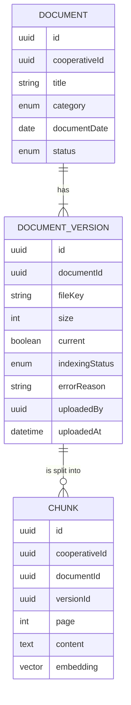

# Requirements · 03 · Documents

**Date**: 2026-10-04 · **Status**: Draft to validate

Repository of the cooperative's corporate documents. Besides being read directly, it is the knowledge base of the AI assistant ([07-ai-assistant.md](07-ai-assistant.md)).

Permissions: module `documents`, read and manage levels, scope always "all".

## 1. Glossary

| Term     | Definition                                                                                    |
| -------- | --------------------------------------------------------------------------------------------- |
| Document | PDF file with title, category and date, published for the users                               |
| Category | Bylaws, internal regulations, minutes, annual accounts or other                               |
| Version  | Each file uploaded for the same document. Only one is current                                 |
| Indexing | Process that extracts the text, splits it into chunks and computes its embeddings for the RAG |
| Chunk    | Piece of indexed text, with its source page                                                   |

## 2. User stories

### Must

#### US-DOC-01 · Upload a document

As a user with manage level, I want to upload a PDF indicating title, category and date, so that I can make it available to users.

- **Given** a valid PDF, **when** I upload it, **then** it is published and `DocumentPublished` is emitted for its indexing.
- **Given** a file that is not a PDF or exceeds 20 MB, **when** I upload it, **then** it is rejected stating the reason.

#### US-DOC-02 · Browse documents

As a user, I want to see documents by category and search them by title.

- **Given** published documents, **when** I open the module, **then** I see them grouped by category and ordered by date descending.
- **Given** a search text, **when** I type it, **then** the list is filtered by match in the title.

#### US-DOC-03 · Open a document

As a user, I want to view or download a document.

- **Given** a published document, **when** I open it, **then** its current version is shown through a short-lived signed URL.
- **Given** a withdrawn document, **when** I try to open it without manage level, **then** I receive 404.

#### US-DOC-04 · Publish a new version

As a user with manage level, I want to replace a document with its updated version, so that the current one is always consulted.

- **Given** a published document, **when** I upload a new version, **then** it becomes the current one, the previous one goes to the history and only the new one is indexed.
- **Given** the history, **when** I consult it with manage level, **then** I see all the versions with date and author.

#### US-DOC-05 · Withdraw a document

As a user with manage level, I want to withdraw a document that should no longer be available.

- **Given** a published document, **when** I withdraw it, **then** it stops being visible with read level and its chunks are removed from the index.

#### US-DOC-06 · Know the indexing status

As a user with manage level, I want to know whether a document is already available to the assistant.

- **Given** a freshly uploaded document, **when** I view its detail, **then** it appears as pending, indexed or failed.
- **Given** an indexing error, **when** I tap retry, **then** the process is launched again.
- **Given** a PDF with no extractable text, **when** indexing is attempted, **then** it is marked as not indexable and the reason is given.

### Should

#### US-DOC-07 · Search by content

- **Given** a natural-language query, **when** I search, **then** I get the documents whose chunks are most relevant, with the page where they appear.

#### US-DOC-08 · Republish a withdrawn document

As a user with manage level, I want to publish again a document I withdrew, so that it is available again without uploading it anew.

- **Given** a withdrawn document, **when** I republish it with manage level, **then** it is published again, visible with read level, with its latest version as the current one.
- **Given** a republished document, **then** its current version is indexed again (`DocumentPublished`) and until then it shows as pending; the assistant finds it once indexed.
- **Given** a withdrawn document, **then** it never shows as available for the assistant (no indexing status is reported).
- **Given** a published document, **when** I try to republish it, **then** I receive 409 `invalid_document_transition`.
- **Given** a user with read level only, **when** they try to republish, **then** they receive 403; a document of another cooperative or unknown gives 404.

### Could

- Restrict a document to certain profiles (for example, governing board minutes).
- Text recognition (OCR) for scanned PDFs.

### Won't

- Formats other than PDF.
- Editing the document inside the app.
- Electronic signature.

## 3. Business rules

| Id        | Rule                                                                                                  |
| --------- | ----------------------------------------------------------------------------------------------------- |
| BR-DOC-01 | A document belongs to a single cooperative.                                                           |
| BR-DOC-02 | Only PDFs of up to 20 MB are accepted.                                                                |
| BR-DOC-03 | A document has exactly one current version.                                                           |
| BR-DOC-04 | Only the current version of published documents is indexed.                                           |
| BR-DOC-05 | When a document is withdrawn or its version replaced, the previous chunks are removed from the index. |
| BR-DOC-06 | Every chunk carries `cooperativeId`, `documentId` and page number.                                    |
| BR-DOC-07 | A non-indexed document remains readable; the assistant simply does not know it.                       |
| BR-DOC-08 | A withdrawn document can be republished (only from withdrawn); its latest version is indexed again.   |

## 4. Indexing

1. Extraction of the PDF text, page by page.
2. Splitting into chunks of about 800 text units with overlap, respecting paragraphs.
3. Computation of the embedding of each chunk.
4. Storage in PostgreSQL with pgvector, together with `cooperativeId`, `documentId` and page.

Indexing is asynchronous with respect to upload: the document can be read immediately even if the index takes time.

## 5. Non-functional requirements

| Id         | Requirement                                                                            |
| ---------- | -------------------------------------------------------------------------------------- |
| NFR-DOC-01 | A 50-page document is indexed in under 60 seconds.                                     |
| NFR-DOC-02 | Files are served with signed URLs that expire after 5 minutes.                         |
| NFR-DOC-03 | Search over the index always filters by `cooperativeId` before ordering by similarity. |
| NFR-DOC-04 | Files are stored outside the database, with unguessable keys.                          |

## 6. Model

## 7. Events

| Event               | When                                                          | Consumer                  |
| ------------------- | ------------------------------------------------------------- | ------------------------- |
| `DocumentPublished` | On uploading a document or a new version, or republishing one | Indexing                  |
| `DocumentWithdrawn` | On withdrawing a document                                     | Indexing (deletes chunks) |

## 8. API

| Method | Route                                                            | Use                                          | Level  |
| ------ | ---------------------------------------------------------------- | -------------------------------------------- | ------ |
| GET    | `/cooperatives/{cooperativeId}/documents`                        | List with filter by category and title       | Read   |
| GET    | `/cooperatives/{cooperativeId}/documents/{documentId}`           | Detail and signed URL of the current version | Read   |
| GET    | `/cooperatives/{cooperativeId}/documents/search`                 | Search by content                            | Read   |
| POST   | `/cooperatives/{cooperativeId}/documents`                        | Upload document                              | Manage |
| POST   | `/cooperatives/{cooperativeId}/documents/{documentId}/versions`  | Upload new version                           | Manage |
| GET    | `/cooperatives/{cooperativeId}/documents/{documentId}/versions`  | History                                      | Manage |
| POST   | `/cooperatives/{cooperativeId}/documents/{documentId}/withdraw`  | Withdraw                                     | Manage |
| POST   | `/cooperatives/{cooperativeId}/documents/{documentId}/republish` | Republish a withdrawn document (204)         | Manage |
| POST   | `/cooperatives/{cooperativeId}/documents/{documentId}/reindex`   | Retry indexing                               | Manage |

Contract (schemas in `packages/contracts/src/documents.ts`):

- Categories: `bylaws`, `regulations`, `minutes`, `accounts`, `other`. Title of 1 to 150 characters; document date as a day (YYYY-MM-DD). Indexing statuses: `pending`, `indexed`, `error`, `not_indexable`.
- The list accepts `?category=` and `?q=` (case-insensitive match in the title) and orders by document date descending, then title and id. It is keyset-paginated (docs/02-stack-and-architecture.md, principle 8): `?limit=` (30 by default, 100 at most) and `?before=<nextCursor>`, answering `{ items, nextCursor }`. The app groups the loaded pages by category, loads the next page when the end is near and waits 300 ms after the last keystroke before searching (by title and by content), keeping the previous results on screen meanwhile.
- Uploading a document or a version is `multipart/form-data` with the PDF in the `file` field; when uploading the document, also `title`, `category` and `documentDate`. The type is checked by content.
- The detail carries the signed URL of the current version (5 minutes). The indexing status and its reason are only returned with manage level.
- A single current version is also guaranteed by the database (partial unique index), even with simultaneous uploads.
- Errors: `400 invalid_document`, `400 file_rejected` with `details.reason` (`not_pdf`, `too_large`, `empty`), `404 not_found` and `409 invalid_document_transition`.
- Events: `DocumentPublished` (`cooperativeId`, `documentId`, `versionId`) and `DocumentWithdrawn` (`cooperativeId`, `documentId`), emitted after saving. The module itself consumes them to index.
- Indexing (ADR-006): in-process queue, one version at a time; the upload does not wait for it. On startup, the API re-enqueues pending versions. Chunks of up to 800 characters plus 150 of overlap, without mixing pages. Embeddings with `bge-m3` (1024 dimensions) on Ollama. Measured: 50 pages in 16 s locally.
- `GET /documents/search?q=` (3 to 300 characters) returns up to 10 chunks with `documentId`, `title`, `category`, `page`, `excerpt` and `score`. It searches only published documents of the cooperative and filters before ordering. If the embeddings service does not respond: `503 search_unavailable`.
- `POST /documents/{documentId}/republish` responds `204`, sets the current version to pending and emits `DocumentPublished`; `409` if the document is not withdrawn. A withdrawn document reports `indexingStatus: null`.
- `POST /documents/{documentId}/reindex` responds `202` and leaves the current version as pending.

## 9. Screens

1. List by categories with search box.
2. Document viewer.
3. Upload and version management (manage level), with indexing status.

## 10. Test strategy

- **Domain**: a single current version, status transitions, format and size validation.
- **Indexing**: deterministic chunking on a sample PDF; deletion of chunks on withdrawal or versioning.
- **Isolation**: search never returns chunks from another cooperative, even if the text matches exactly.
- **Permissions**: upload, versions, withdrawal and republishing rejected with 403 without manage level.
