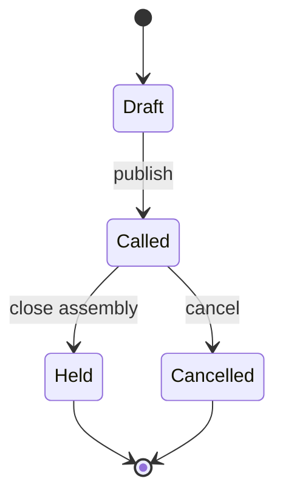
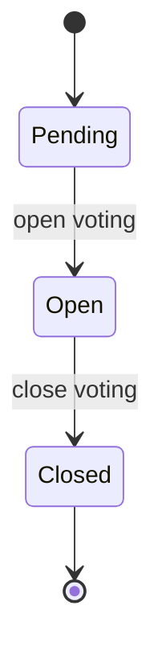
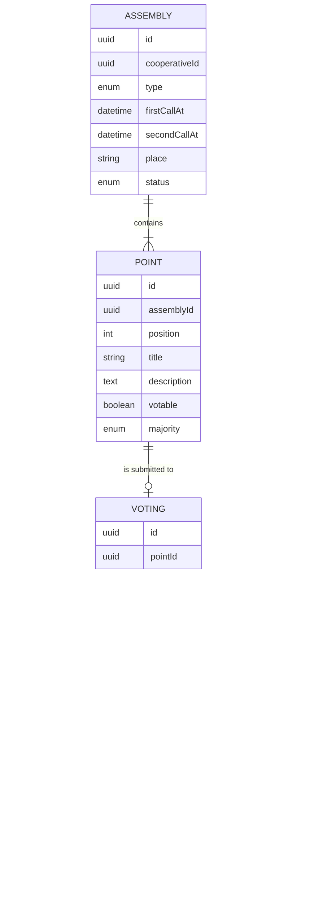

# Requirements · 04 · Assemblies

**Date**: 2026-10-04 · **Status**: Draft to validate

Calling of assemblies, consultation of the agenda and voting on each item. It is the business-rules core of the project: one member one vote, quorum and majorities.

Permissions: module `assemblies`, read and manage levels, scope always "all". Voting is not a profile permission: it requires an active membership and member status (BR-ACC-06).

> **Nature of the voting.** Voting is advisory or in support of the in-person assembly. Remote voting with full legal validity requires identification and custody guarantees that are outside the scope of the thesis.

## 1. Glossary

| Term                     | Definition                                                                         |
| ------------------------ | ---------------------------------------------------------------------------------- |
| Assembly                 | Meeting of the members: ordinary or extraordinary                                  |
| Call (notice of meeting) | Publication of the assembly with date, place, agenda and documentation             |
| Agenda item (point)      | Matter to be dealt with. It may be informative or submitted to a vote              |
| Voting                   | Period during which members vote on an item                                        |
| Census (voting roll)     | Members with the right to vote at the moment the voting is opened                  |
| Quorum                   | Minimum of the census members who must participate for the voting to be valid      |
| Simple majority          | More votes in favor than against                                                   |
| Qualified majority       | Votes in favor equal to or above a fraction of those cast (by default, two thirds) |

## 2. User stories

### Must

#### US-ASM-01 · Call an assembly

As a user with manage level, I want to create the call with date, place, type and agenda, so that members know about it in advance.

- **Given** a date later than today and at least one item, **when** I publish the call, **then** it becomes called, is visible to users and `AssemblyConvened` is emitted.
- **Given** a date with less notice than configured, **when** I try to publish, **then** it is rejected stating the minimum notice.
- **Given** a call in draft, **when** I edit it, **then** I can add, remove and reorder items.

#### US-ASM-02 · Configure the items

As a user with manage level, I want to indicate for each item whether it is voted on and with which majority.

- **Given** an item, **when** I mark it as votable, **then** I must choose simple or qualified majority (`simple`, `reinforced` in code).
- **Given** an item, **when** I attach documentation, **then** users see it next to the item.

#### US-ASM-03 · Browse assemblies

As a user, I want to see upcoming and past assemblies with their agenda.

- **Given** called assemblies, **when** I open the module, **then** I first see the upcoming ones and then the held ones.
- **Given** an assembly, **when** I open it, **then** I see date, place, type, agenda, documentation and the status of each voting.

#### US-ASM-04 · Open and close a voting

As a user with manage level, I want to open the voting of an item and close it, so that I control when voting takes place.

- **Given** a votable item of a called assembly, **when** I open the voting, **then** the census is fixed at that moment and `VotingOpened` is emitted.
- **Given** an open voting, **when** I close it, **then** the result is computed and votes are no longer accepted.

#### US-ASM-05 · Vote

As a member, I want to vote for, against or abstain on each open item.

- **Given** that I am in the census and have not voted, **when** I cast my vote, **then** it is recorded and I see a confirmation.
- **Given** that I have already voted, **when** I try to vote again, **then** it is rejected and the vote cast is shown to me.
- **Given** that I am not a member or was not in the census when it opened, **when** I try to vote, **then** it is rejected with 403.
- **Given** a closed voting, **when** I try to vote, **then** it is rejected.

#### US-ASM-06 · See the result

As a user, I want to see the result of each closed voting.

- **Given** a closed voting, **when** I consult it, **then** I see votes for, against and abstentions, participation over the census, whether the quorum was reached and whether the item is approved.
- **Given** an open voting, **when** I consult it without manage level, **then** I only see the participation, not the direction of the votes.

### Should

#### US-ASM-07 · Second call

- **Given** an assembly with a second call configured, **when** the quorum of the first is not reached, **then** the quorum of the second is applied.

#### US-ASM-08 · Reminder

- **Given** an open voting in which I have not voted, **when** 24 hours remain until its scheduled close, **then** I receive a reminder push.

### Could

- Delegating the vote to another member, with a limit on representations.
- Secret ballot: it is recorded that the member voted, but not the direction associated with their identity.

### Won't

- Vote with full legal validity.
- Vote weighted by contributions.
- Videoconference or broadcast.
- Drafting the minutes inside the app (the minutes are uploaded as a document).

## 3. Business rules

| Id        | Rule                                                                                                                                                                        |
| --------- | --------------------------------------------------------------------------------------------------------------------------------------------------------------------------- |
| BR-ASM-01 | One member, one vote, regardless of their contributions.                                                                                                                    |
| BR-ASM-02 | The census is fixed when the voting opens with the active memberships that have member status. Later changes do not alter it.                                               |
| BR-ASM-03 | Each member in the census votes at most once per item. The vote cannot be changed.                                                                                          |
| BR-ASM-04 | Participation = votes cast (for, against and abstentions) / members in the census.                                                                                          |
| BR-ASM-05 | There is quorum if participation is equal to or above the threshold. By default: 50 % of the census on first call; no minimum on second call. Configurable per cooperative. |
| BR-ASM-06 | If the quorum is not reached, the result is "no quorum" and the item is not approved.                                                                                       |
| BR-ASM-07 | Simple majority: approved if votes for > votes against. Abstentions do not count.                                                                                           |
| BR-ASM-08 | Qualified majority: approved if votes for ≥ 2/3 of votes for plus against. Fraction configurable per cooperative.                                                           |
| BR-ASM-09 | Default minimum notice between call and meeting: 15 days. Configurable per cooperative.                                                                                     |
| BR-ASM-10 | A held or cancelled assembly does not allow changes to its agenda.                                                                                                          |
| BR-ASM-11 | While the voting is open, the direction of the votes is only visible with manage level.                                                                                     |

### Statuses

(In code: assembly `draft`, `convened`, `held`, `cancelled`; voting `open`, `closed`.)

## 4. Non-functional requirements

| Id         | Requirement                                                                                                               |
| ---------- | ------------------------------------------------------------------------------------------------------------------------- |
| NFR-ASM-01 | The uniqueness of the vote is guaranteed in the database (unique constraint per voting and membership), not only in code. |
| NFR-ASM-02 | The result computation is a pure domain function, without access to infrastructure.                                       |
| NFR-ASM-03 | Each vote is recorded with the server date and time.                                                                      |

## 5. Model

## 6. Events

| Event              | When                             | Consumer      |
| ------------------ | -------------------------------- | ------------- |
| `AssemblyConvened` | On publishing the call           | Notifications |
| `VotingOpened`     | On opening the voting of an item | Notifications |
| `VotingClosed`     | On closing the voting            | Notifications |

## 7. API

| Method | Route                                                           | Use                                          | Requirement          |
| ------ | --------------------------------------------------------------- | -------------------------------------------- | -------------------- |
| GET    | `/cooperatives/{cooperativeId}/assemblies`                      | List                                         | Read                 |
| GET    | `/cooperatives/{cooperativeId}/assemblies/{assemblyId}`         | Detail with items and status                 | Read                 |
| POST   | `/cooperatives/{cooperativeId}/assemblies`                      | Create draft                                 | Manage               |
| PATCH  | `/cooperatives/{cooperativeId}/assemblies/{assemblyId}`         | Edit draft and items                         | Manage               |
| POST   | `/cooperatives/{cooperativeId}/assemblies/{assemblyId}/convene` | Publish                                      | Manage               |
| POST   | `/cooperatives/{cooperativeId}/assemblies/{assemblyId}/cancel`  | Cancel                                       | Manage               |
| POST   | `/cooperatives/{cooperativeId}/points/{pointId}/voting/open`    | Open voting                                  | Manage               |
| POST   | `/cooperatives/{cooperativeId}/points/{pointId}/voting/close`   | Close voting                                 | Manage               |
| POST   | `/cooperatives/{cooperativeId}/points/{pointId}/voting/votes`   | Vote                                         | Member in the census |
| GET    | `/cooperatives/{cooperativeId}/points/{pointId}/voting`         | Status and result                            | Read                 |
| POST   | `/cooperatives/{cooperativeId}/assemblies/{assemblyId}/close`   | Move to held (with no open votings)          | Manage               |
| POST   | `/cooperatives/{cooperativeId}/points/{pointId}/documents`      | Attach documentation to an item (PDF, 10 MB) | Manage               |

Contract (schemas in `packages/contracts/src/assemblies.ts`):

- Creating and editing send the complete draft: `type`, `firstCallAt`, `secondCallAt`, `place` and `points` in their order. Each item carries `id` to be preserved; those that are missing are deleted along with their documentation. Only in draft (BR-ASM-10). Documentation can also be added with the assembly already called.
- The "pending" voting does not exist in the database: it is born when opened, with the census and the rules in force (quorum, qualified fraction, second call) copied at that moment.
- Each voting returns `status`, `censusSize`, `votesCast`, `tally` (null while open without manage level), `result`, `myVote` and `canVote`.
- Voting requires no module permission, only being in the census (BR-ACC-06). The vote has a unique key per voting and membership and a foreign key to the census.
- Errors: `400 invalid_assembly`, `400 insufficient_notice` with `details.minNoticeDays`, `403 not_in_census`, `404 not_found` (also drafts without manage level), `409 already_voted` with `details.choice`, `409 voting_not_open`, `409 invalid_assembly_transition` and `409 invalid_voting_transition`.
- Per-cooperative settings in the `AssemblySettings` table; without a row the default values apply. They have no screen in the MVP.

## 8. Screens

1. Assemblies list.
2. Detail with agenda and documentation.
3. Voting on an item, with confirmation.
4. Result.
5. Call editor and voting control (manage level).

## 9. Test strategy

TDD on the result computation with case tables:

| Census | For | Against | Abst. | Majority  | Call   | Expected                      |
| ------ | --- | ------- | ----- | --------- | ------ | ----------------------------- |
| 10     | 4   | 1       | 0     | Simple    | First  | Approved (50 % participation) |
| 10     | 3   | 1       | 0     | Simple    | First  | No quorum                     |
| 10     | 3   | 1       | 0     | Simple    | Second | Approved                      |
| 10     | 3   | 3       | 2     | Simple    | First  | Rejected (tie)                |
| 9      | 4   | 2       | 0     | Qualified | Second | Approved (4/6 = 2/3)          |
| 9      | 3   | 2       | 1     | Qualified | Second | Rejected (3/5 < 2/3)          |
| 10     | 0   | 0       | 6     | Simple    | First  | Rejected (no votes in favor)  |

In addition:

- Duplicate vote rejected also under concurrent races.
- A member added after the voting opened cannot vote.
- A manager without member status cannot vote.
- Direction of votes hidden with read level while the voting is open.
