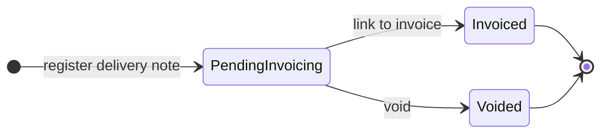
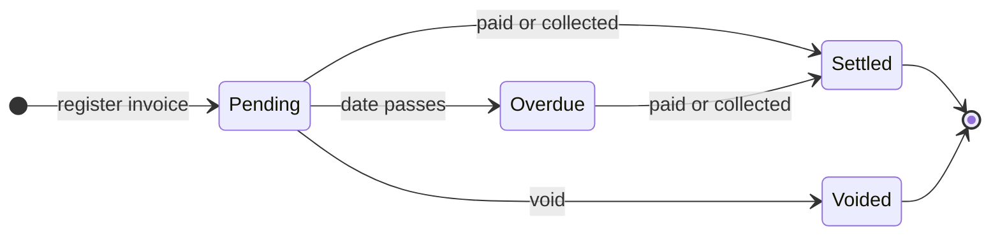
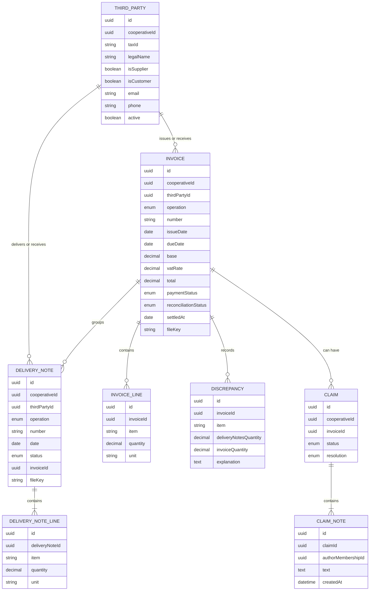

# Requirements · 05 · Invoices and delivery notes

**Date**: 2026-10-04 · **Status**: Accepted in essence; details to validate

Control of the cooperative's delivery notes and invoices with its **suppliers** (purchases) and its **customers** (sales): registration, reconciliation between delivery notes and invoices, due dates of payments and collections, and capture from the camera using a vision model.

Permissions: module `invoicing`, scope always "all". Members do not have access by default: it is management information of the cooperative. The governing board reads, and the manager and the administrator manage.

> **Module boundary.** The app **tracks and reads, it does not issue**. Sales invoices are issued elsewhere (ERP or invoicing software) and registered here, just like those received from suppliers. Issuing with tax validity (series, legal numbering, Verifactu) is out of scope.
>
> **Third parties do not use the app.** Suppliers and customers are cooperative data, not users.

## 1. Glossary

| Term                   | Definition                                                                                          |
| ---------------------- | --------------------------------------------------------------------------------------------------- |
| Third party            | Company or person with whom the cooperative buys or sells. It can be a supplier, a customer or both |
| Operation              | Purchase (with a supplier) or sale (to a customer)                                                  |
| Purchase delivery note | Delivery received from a supplier                                                                   |
| Sales delivery note    | Delivery made to a customer                                                                         |
| Received invoice       | Invoice from a supplier. Generates a pending payment                                                |
| Issued invoice         | Invoice to a customer, issued outside the app. Generates a pending collection                       |
| Reconciliation         | Comparison between what the delivery notes say and what the invoice bills                           |
| Discrepancy            | Difference between delivery notes and invoice that exceeds the tolerance                            |
| Tolerance              | Difference admitted without flagging a discrepancy. Configurable per cooperative                    |
| Claim                  | Internal follow-up of a discrepancy or a problem with a third party                                 |
| Extraction             | Reading the data of a photo or PDF using a vision model                                             |

## 2. User stories

### Must

#### US-INV-01 · Manage third parties

As a manager, I want to register suppliers and customers with their tax ID (NIF) and contact details, so that I can associate delivery notes and invoices with them.

- **Given** a valid tax ID not registered in my cooperative, **when** I save the third party indicating whether it is a supplier, a customer or both, **then** it becomes available to operate with.
- **Given** a tax ID already registered in my cooperative, **when** I try to register it, **then** the existing one is offered to me and it is not duplicated.
- **Given** a third party with documents, **when** I try to delete it, **then** I can only deactivate it.

#### US-INV-02 · Register a delivery note

As a manager, I want to register a purchase or sales delivery note with its third party, date and lines.

- **Given** an active third party of the right type (supplier for purchase, customer for sale) and at least one line with item, quantity and unit, **when** I save the delivery note, **then** it is pending invoicing and `DeliveryNoteRegistered` is emitted.
- **Given** a delivery note number already registered for that third party, **when** I try to save it, **then** it is rejected as a duplicate.
- **Given** a line with zero or negative quantity, **when** I try to save, **then** it is rejected.

#### US-INV-03 · Register an invoice

As a manager, I want to register a received or issued invoice, linking it to its delivery notes and attaching the PDF.

- **Given** number, issue and due dates, base, VAT rate, total, PDF and pending delivery notes of the same third party and operation, **when** I save it, **then** it is pending, the delivery notes become invoiced and reconciliation runs.
- **Given** a delivery note of another third party, of another operation or already invoiced, **when** I try to link it, **then** it is rejected.
- **Given** a total that does not match base plus VAT, **when** I try to save, **then** it is rejected stating the difference.
- **Given** an invoice without delivery notes (for example, a service), **when** I save it, **then** it is accepted and stays as "no delivery notes", unreconciled.

#### US-INV-04 · Reconcile automatically

As a manager, I want the system to compare the invoice with its delivery notes and warn me of the differences.

- **Given** an invoice whose quantities per item match those of its delivery notes within the tolerance, **when** it is reconciled, **then** it is reconciled.
- **Given** a difference above the tolerance in some item, **when** it is reconciled, **then** it is left with a discrepancy, the detail per item is recorded and `DiscrepancyDetected` is emitted.
- **Given** a discrepancy, **when** I consult it, **then** I see an AI-generated plain-language explanation next to the numeric detail, which is the one that governs.

#### US-INV-05 · Capture with the camera

As a manager, I want to photograph a paper delivery note or invoice, or choose a PDF, so that I do not have to type its data.

- **Given** a photo or a PDF, **when** I send it, **then** the system proposes document type, operation, third party and data, flagging the low-confidence fields.
- **Given** an extracted tax ID that matches a third party of my cooperative, **when** I see the proposal, **then** the third party appears preselected; if it does not exist, I am offered to register it with the extracted data.
- **Given** the proposal, **when** I review and confirm it, **then** it is saved as a normal record, with the original file attached.
- **Given** that the model fails to extract data, **when** it finishes, **then** I am told so and I can fill in the form by hand.

#### US-INV-06 · Browse delivery notes and invoices

As a user with access to the module, I want to see delivery notes and invoices filtering by operation, third party, status and dates.

- **Given** the module, **when** I open it, **then** I see purchases and sales separately, each with its delivery notes and invoices.
- **Given** an invoice, **when** I open it, **then** I see third party, amounts, due date, status, reconciliation, linked delivery notes and the PDF.
- **Given** a third party, **when** I open its record, **then** I see its delivery notes, its invoices and the outstanding balance.

#### US-INV-07 · Control payments and collections

As a manager, I want to know which invoices are pending payment or collection and which are overdue.

- **Given** a pending invoice whose due date has passed, **when** the daily process runs, **then** it becomes overdue and `InvoiceOverdue` is emitted.
- **Given** a pending invoice that falls due within the cooperative's invoice notice (N days, BR-INV-15; on and 15 days by default), **when** the daily process runs, **then** `InvoiceDueSoon` is emitted once. **Given** the administrator switched that notice off, **when** the process runs, **then** no `InvoiceDueSoon` is emitted for that cooperative (overdue handling is unchanged).
- **Given** invoices that are overdue or, with the invoice notice on, due within the next N days, **when** I see the home, **then** the Invoices tile shows a red badge with how many they are (BR-INV-16), and the list highlights them with "Due in X days" or "Overdue X days ago". With the notice off the badge counts only the overdue ones and the rows only show "Overdue".
- **Given** a pending or overdue received invoice, **when** I mark it as paid with its date, **then** it becomes paid. On an issued invoice the action is "collected".
- **Given** the summary, **when** I consult it, **then** I see the total pending to pay and to collect, and the overdue amount of each.

### Should

#### US-INV-08 · Claim follow-up

- **Given** a discrepancy or a problem with a third party, **when** I open a claim, **then** it stays open with internal notes and date.
- **Given** an open claim, **when** I record the solution (credit note, new invoice, accepted), **then** it is resolved and the invoice shows the history.

#### US-INV-09 · Uninvoiced delivery notes

- **Given** delivery notes pending invoicing past the cooperative's deadline to invoice (D days from their date, BR-INV-15; 30 by default), **when** I consult the dashboard, **then** they appear highlighted by third party. With the deadline switched off there is no such warning at all.
- **Given** delivery notes pending invoicing that are past the deadline (D days) or, with the deadline's notice on, will reach it within the next N days (BR-INV-15, BR-INV-16), **when** I see the home, **then** the Delivery notes tile shows a red badge with how many they are, and the list marks them "Not invoiced X days". With the notice off only the notes already past the deadline count; with the deadline off the badge is 0 (hidden) and no row is marked.

### Could

- Bulk import of third parties or documents from CSV.
- CSV export of what is filtered.
- Give read access to members with a custom profile.

### Won't

- Issuing invoices with tax validity.
- Real payments or bank connection.
- Accounting, VAT books and tax returns.
- Access of suppliers or customers to the app.
- Corrective invoices as their own type (the new one is registered and the previous one voided).
- Orders and quotes.

## 3. Business rules

| Id        | Rule                                                                                                                                                                                                                                                                                                                                                                                                                                                                                                                                                                                                                                                                                                                                                                                                                                                                                                                                                                                                                                                                                                                                                                                                                                                                                                                                                                                                                                                                                                                            |
| --------- | ------------------------------------------------------------------------------------------------------------------------------------------------------------------------------------------------------------------------------------------------------------------------------------------------------------------------------------------------------------------------------------------------------------------------------------------------------------------------------------------------------------------------------------------------------------------------------------------------------------------------------------------------------------------------------------------------------------------------------------------------------------------------------------------------------------------------------------------------------------------------------------------------------------------------------------------------------------------------------------------------------------------------------------------------------------------------------------------------------------------------------------------------------------------------------------------------------------------------------------------------------------------------------------------------------------------------------------------------------------------------------------------------------------------------------------------------------------------------------------------------------------------------------- |
| BR-INV-01 | Third parties, delivery notes and invoices belong to a single cooperative.                                                                                                                                                                                                                                                                                                                                                                                                                                                                                                                                                                                                                                                                                                                                                                                                                                                                                                                                                                                                                                                                                                                                                                                                                                                                                                                                                                                                                                                      |
| BR-INV-02 | The tax ID of a third party is unique within each cooperative. The same tax ID can exist in other cooperatives as a different third party.                                                                                                                                                                                                                                                                                                                                                                                                                                                                                                                                                                                                                                                                                                                                                                                                                                                                                                                                                                                                                                                                                                                                                                                                                                                                                                                                                                                      |
| BR-INV-03 | A purchase delivery note only admits suppliers; a sales one, only customers.                                                                                                                                                                                                                                                                                                                                                                                                                                                                                                                                                                                                                                                                                                                                                                                                                                                                                                                                                                                                                                                                                                                                                                                                                                                                                                                                                                                                                                                    |
| BR-INV-04 | The delivery note number is unique per third party. The invoice number is unique per third party for received invoices and per cooperative for issued ones.                                                                                                                                                                                                                                                                                                                                                                                                                                                                                                                                                                                                                                                                                                                                                                                                                                                                                                                                                                                                                                                                                                                                                                                                                                                                                                                                                                     |
| BR-INV-05 | A delivery note can only be invoiced once.                                                                                                                                                                                                                                                                                                                                                                                                                                                                                                                                                                                                                                                                                                                                                                                                                                                                                                                                                                                                                                                                                                                                                                                                                                                                                                                                                                                                                                                                                      |
| BR-INV-06 | An invoice only groups pending delivery notes of the same third party and the same operation.                                                                                                                                                                                                                                                                                                                                                                                                                                                                                                                                                                                                                                                                                                                                                                                                                                                                                                                                                                                                                                                                                                                                                                                                                                                                                                                                                                                                                                   |
| BR-INV-07 | Total = base + VAT, rounded to 2 decimals with a tolerance of €0.01.                                                                                                                                                                                                                                                                                                                                                                                                                                                                                                                                                                                                                                                                                                                                                                                                                                                                                                                                                                                                                                                                                                                                                                                                                                                                                                                                                                                                                                                            |
| BR-INV-08 | Quantities are compared per item and unit. There is a discrepancy if the relative difference exceeds the tolerance (by default 1 %) or if an item appears on one side only.                                                                                                                                                                                                                                                                                                                                                                                                                                                                                                                                                                                                                                                                                                                                                                                                                                                                                                                                                                                                                                                                                                                                                                                                                                                                                                                                                     |
| BR-INV-09 | A pending invoice becomes overdue when its due date is earlier than today.                                                                                                                                                                                                                                                                                                                                                                                                                                                                                                                                                                                                                                                                                                                                                                                                                                                                                                                                                                                                                                                                                                                                                                                                                                                                                                                                                                                                                                                      |
| BR-INV-10 | A paid or collected invoice does not return to pending or overdue.                                                                                                                                                                                                                                                                                                                                                                                                                                                                                                                                                                                                                                                                                                                                                                                                                                                                                                                                                                                                                                                                                                                                                                                                                                                                                                                                                                                                                                                              |
| BR-INV-11 | No data extracted by AI is saved without human confirmation.                                                                                                                                                                                                                                                                                                                                                                                                                                                                                                                                                                                                                                                                                                                                                                                                                                                                                                                                                                                                                                                                                                                                                                                                                                                                                                                                                                                                                                                                    |
| BR-INV-12 | The reconciliation result is decided by the numeric rule. The AI only drafts the explanation.                                                                                                                                                                                                                                                                                                                                                                                                                                                                                                                                                                                                                                                                                                                                                                                                                                                                                                                                                                                                                                                                                                                                                                                                                                                                                                                                                                                                                                   |
| BR-INV-13 | Amounts in euros with exact decimals; never in floating point.                                                                                                                                                                                                                                                                                                                                                                                                                                                                                                                                                                                                                                                                                                                                                                                                                                                                                                                                                                                                                                                                                                                                                                                                                                                                                                                                                                                                                                                                  |
| BR-INV-14 | A third party with documents is not deleted; it is deactivated and is no longer offered for new records.                                                                                                                                                                                                                                                                                                                                                                                                                                                                                                                                                                                                                                                                                                                                                                                                                                                                                                                                                                                                                                                                                                                                                                                                                                                                                                                                                                                                                        |
| BR-INV-15 | Each cooperative has **three independent alerts**, each one with its own switch and number of days, which only its administrator (users module, manage level) changes in Settings > Billing; changes are audited as `cooperative.invoicing_settings_changed` with the previous and new value of each changed field. (1) **Invoices, notice before the due date**: `invoiceNoticeEnabled` (on by default) and `invoiceNoticeDays` (1 to 90, 15 by default); off, there is no "due soon": the badge counts only overdue invoices, the rows only show "Overdue" and the daily process emits no `InvoiceDueSoon` (overdue handling is unchanged). (2) **Delivery notes, deadline to invoice**: `noteDeadlineEnabled` (on) and `noteDeadlineDays` (1 to 365, 30 by default), counted from the note date; off, the stale-notes concept disappears (no badge, no "Not invoiced X days" warning, no highlighted rows, the summary counts 0). (3) **Delivery notes, notice before that deadline**: `noteNoticeEnabled` (on) and `noteNoticeDays` (1 to 365, 15 by default), which must be **shorter than `noteDeadlineDays`** when both are on (otherwise 400 with `details.field = noteNoticeDays`); off, only the notes already past the deadline count; with the deadline off it is irrelevant (its number is kept and the app shows it disabled). Switching an alert off keeps its number. Cooperatives that existed before keep their behaviour: invoice notice = their former single N, deadline 30, note notice = their former N. |
| BR-INV-16 | Attention counts of the home badges: **invoices** = pending or overdue (never settled or voided) invoices, purchases and sales, whose due date is on or before today + `invoiceNoticeDays` (overdue ones included), or before today when the invoice notice is off; **delivery notes** = pending invoicing (never invoiced or voided) dated on or before today − (`noteDeadlineDays` − `noteNoticeDays`) (past the deadline or reaching it within the notice), on or before today − `noteDeadlineDays` when the notice is off, and none when the deadline is off. A stored notice not shorter than the deadline (data from before the rule) counts every pending note.                                                                                                                                                                                                                                                                                                                                                                                                                                                                                                                                                                                                                                                                                                                                                                                                                                                          |

### Statuses

(In code: delivery note `pending_invoicing`, `invoiced`, `voided`; invoice payment status `pending`, `overdue`, `settled`, `voided`; reconciliation status `no_delivery_notes`, `reconciled`, `with_discrepancy`; operation `purchase`, `sale`.)

The reconciliation status (no delivery notes, reconciled, with discrepancy) is independent of the payment or collection status.

**Invoice lines.** To reconcile per item and unit (BR-INV-08), the invoice carries its lines (item, quantity, unit). They are mandatory if it groups delivery notes and optional if not (a service). Items are compared ignoring case, accents and extra spaces.

**Amount representation (BR-INV-13).** In the domain, cents, thousandths of quantity and hundredths of a VAT percentage point as integers (`bigint`); in the database, `Decimal`; in the API, decimal strings (`"1234.56"`). VAT is rounded to cents, half up.

**Voiding an invoice** returns its delivery notes to "pending invoicing", so that the invoice that replaces it can group them.

## 4. Vision extraction

1. The app sends the image or PDF to the backend, never directly to the AI provider.
2. The backend asks the model for structured output validated with the same Zod schema as manual registration.
3. The operation is deduced from the tax ID: if the issuer is the cooperative itself, it is a sale; if it is a third party, it is a purchase.
4. The third party is looked up by tax ID **only within the active cooperative**.
5. The proposal is returned with a confidence level per field.

**Free tier warning (ADR-009).** The Gemini API free tier may use what is sent to improve Google products. In demos and tests, do not upload real invoices or delivery notes of third parties; use fictitious documents. With a paid key this does not apply.

**Personal data.** Most third parties are companies, but there may be self-employed people with a tax ID and personal address. The thesis report must justify the chosen AI provider, its retention policy and sending the minimum necessary.

## 5. Non-functional requirements

| Id         | Requirement                                                                                |
| ---------- | ------------------------------------------------------------------------------------------ |
| NFR-INV-01 | Extraction responds in under 15 seconds at the 95th percentile.                            |
| NFR-INV-02 | PDFs are stored with unguessable keys and served with 5-minute signed URLs.                |
| NFR-INV-03 | Images are reduced on the device before being sent (longest side of 2000 px at most).      |
| NFR-INV-04 | The daily due-date process is idempotent: running it twice does not emit duplicate events. |
| NFR-INV-05 | The AI provider's keys live only in the backend.                                           |
| NFR-INV-06 | The tax ID is validated with its check digit before saving.                                |

## 6. Model

## 7. Events

| Event                    | When                                   | Consumer                                       |
| ------------------------ | -------------------------------------- | ---------------------------------------------- |
| `DeliveryNoteRegistered` | On registering a delivery note         | Audit                                          |
| `InvoiceRegistered`      | On registering an invoice              | Audit                                          |
| `DiscrepancyDetected`    | On reconciling with differences        | Notifications (to those who manage the module) |
| `InvoiceDueSoon`         | N days before the due date (BR-INV-15) | Notifications (to those who manage the module) |
| `InvoiceOverdue`         | On becoming overdue                    | Notifications (to those who manage the module) |

## 8. API

| Method | Route                                                                | Use                                                                                                                                 | Level                          |
| ------ | -------------------------------------------------------------------- | ----------------------------------------------------------------------------------------------------------------------------------- | ------------------------------ |
| GET    | `/cooperatives/{cooperativeId}/third-parties`                        | List with filter by type                                                                                                            | Read                           |
| GET    | `/cooperatives/{cooperativeId}/third-parties/{thirdPartyId}`         | Record with documents and balance                                                                                                   | Read                           |
| POST   | `/cooperatives/{cooperativeId}/third-parties`                        | Create                                                                                                                              | Manage                         |
| PATCH  | `/cooperatives/{cooperativeId}/third-parties/{thirdPartyId}`         | Edit or deactivate                                                                                                                  | Manage                         |
| GET    | `/cooperatives/{cooperativeId}/delivery-notes`                       | Filterable list, paginated                                                                                                          | Read                           |
| GET    | `/cooperatives/{cooperativeId}/delivery-notes/{deliveryNoteId}`      | Detail                                                                                                                              | Read                           |
| POST   | `/cooperatives/{cooperativeId}/delivery-notes`                       | Register                                                                                                                            | Manage                         |
| GET    | `/cooperatives/{cooperativeId}/invoices`                             | Filterable list, paginated                                                                                                          | Read                           |
| GET    | `/cooperatives/{cooperativeId}/invoices/summary`                     | Pending and overdue payments and collections                                                                                        | Read                           |
| GET    | `/cooperatives/{cooperativeId}/invoicing/attention`                  | `{ invoices, deliveryNotes, settings }`: counts of the home badges and the effective settings (BR-INV-16)                           | Read                           |
| GET    | `/cooperatives/{cooperativeId}/invoicing/settings`                   | `{ invoiceNoticeEnabled, invoiceNoticeDays, noteDeadlineEnabled, noteDeadlineDays, noteNoticeEnabled, noteNoticeDays }` (BR-INV-15) | Read, or administrator         |
| PUT    | `/cooperatives/{cooperativeId}/invoicing/settings`                   | Change the six fields (all required); 400 with `details.field` per invalid field; audited with from/to per changed field            | Administrator (`users:manage`) |
| GET    | `/cooperatives/{cooperativeId}/invoices/{invoiceId}`                 | Detail with reconciliation                                                                                                          | Read                           |
| POST   | `/cooperatives/{cooperativeId}/invoices`                             | Register and reconcile                                                                                                              | Manage                         |
| POST   | `/cooperatives/{cooperativeId}/invoices/{invoiceId}/settle`          | Mark as paid or collected                                                                                                           | Manage                         |
| POST   | `/cooperatives/{cooperativeId}/invoices/{invoiceId}/explanations`    | Draft (AI) the plain-language explanation of the discrepancies                                                                      | Read                           |
| POST   | `/cooperatives/{cooperativeId}/extractions`                          | Extract data from image or PDF                                                                                                      | Manage                         |
| GET    | `/cooperatives/{cooperativeId}/claims`                               | List                                                                                                                                | Read                           |
| POST   | `/cooperatives/{cooperativeId}/claims`                               | Open                                                                                                                                | Manage                         |
| POST   | `/cooperatives/{cooperativeId}/claims/{claimId}/notes`               | Add note                                                                                                                            | Manage                         |
| POST   | `/cooperatives/{cooperativeId}/claims/{claimId}/resolve`             | Resolve                                                                                                                             | Manage                         |
| POST   | `/cooperatives/{cooperativeId}/delivery-notes/{deliveryNoteId}/void` | Void a delivery note pending invoicing                                                                                              | Manage                         |
| POST   | `/cooperatives/{cooperativeId}/invoices/{invoiceId}/void`            | Void a pending or overdue invoice (its delivery notes return to pending)                                                            | Manage                         |

Contract (schemas in `packages/contracts/src/invoicing.ts`):

- Amounts and quantities travel as decimal strings (`"1210.00"`, `"1250.5"`), never as numbers.
- Registering a delivery note or an invoice is `multipart/form-data`: the record as JSON in the `data` field and, optionally, the original (PDF, JPEG or PNG, 10 MB at most) in `file`. The type is checked by content. This way, camera capture stores the original together with the confirmed record (BR-INV-11).
- The invoice carries `lines` (mandatory if it groups delivery notes) and `deliveryNoteIds`. It is registered, grouped and reconciled in one transaction that locks the delivery notes: two simultaneous invoices cannot invoice the same delivery note.
- `GET /delivery-notes` and `GET /invoices` are keyset-paginated (docs/02-stack-and-architecture.md, principle 8): `?limit=` (30 by default, 100 at most) and `?before=<nextCursor>` next to the filters (`operation`, `thirdParty`, `from`, `to`, `status`, and `reconciliation` for invoices); they answer `{ items, nextCursor }`, newest first by `(date, number, id)` (`issueDate` for invoices). The summary tiles and the home badges come from `GET /invoices/summary` and `GET /invoicing/attention`, which count over all the rows, never over the page the app has loaded. The assistant's `invoices` and `delivery_notes` tools read the whole set and filter in memory, then cap what the model sees; the third-party sheet below lists all the documents of that one party. Registering an invoice loads every page of the pending delivery notes of the chosen third party.
- `GET /third-parties/{thirdPartyId}` is the record: data, delivery notes, invoices and the outstanding balance to pay and to collect.
- `GET /invoices/summary` returns, for payments (`toPay`) and collections (`toCollect`), the pending amount (includes overdue) and the overdue amount, with amount and number of invoices; also open-discrepancy invoices and delivery notes pending invoicing past the cooperative's deadline (`noteDeadlineDays`, 30 by default; 0 when the deadline is off, US-INV-09).
- Daily due-date process (US-INV-07): the API runs it on startup and every hour, and it also exists as a script (`jobs:due-dates`) for a cron. It marks as overdue the pending invoices with a due date before today (Spanish time) and warns of those falling due within each cooperative's own invoice notice (BR-INV-15, on and 15 days by default, stored in `InvoicingSettings.invoiceNoticeEnabled`/`invoiceNoticeDays`; no warning when it is off); with a window instead of an exact day, a day without running does not lose warnings. Each warning is recorded in `InvoiceReminder` and is only emitted if it was recorded now: repeating it, even simultaneously, duplicates nothing (NFR-INV-04).
- Errors: `400 invalid_document`, `400 invalid_third_party`, `400 invalid_amount`, `400 total_mismatch` with `details.expected` and `details.difference`, `404 not_found`, `409 third_party_exists` with `details.thirdPartyId`, `409 duplicate_number` and `409 invalid_invoice_transition`.

## 9. Screens

1. Summary: pending and overdue payments and collections, open discrepancies.
2. Purchases and sales, each with delivery notes and invoices, and filters. The home has two tiles on it: **Invoices** (summary of payments and collections, open discrepancies, register and scan an invoice) and **Delivery notes** (delivery notes, the warning of delivery notes past the deadline without invoicing, US-INV-09, register and scan a delivery note); both need the invoicing permission (BR-INV-01), carry a red count badge (BR-INV-16, "99+" above 99, only when greater than zero) and the list is fixed to its kind, highlighting the counted rows with their reason ("Due in X days", "Overdue", "Not invoiced X days"; the app uses the effective settings returned by the API, never a fixed number of days). The combined view (without `kind`) stays reachable by route.
3. Delivery note detail.
4. Invoice detail, with delivery notes, reconciliation and PDF.
5. Third parties: list and record.
6. Camera capture and proposal review.
7. Manual registration forms.
8. Claims (if there is margin).
9. Settings > Billing (administrator only): three blocks, one per alert (invoice notice 1 to 90 days, delivery note deadline 1 to 365, notice before it 1 to 365 and shorter than the deadline), each with an "Activated" checkbox and a number field disabled when it is off, helper texts, field validation and the API's `details.field` errors; the note notice shows disabled with a hint when the deadline is off.

## 10. Test strategy

- **Domain with TDD**: third-party type by operation, totals balancing, invoicing uniqueness, grouping by third party and operation, reconciliation with tolerance, statuses, due date by date, tax ID validation.
- **Extraction**: tests with sample photos and PDFs and the AI provider simulated; operation deduction by tax ID; nothing is ever persisted without confirmation.
- **Permissions and isolation**: a member without access receives 403; the governing board reads but does not register; a third party of another cooperative responds 404 even if the tax ID matches; extraction never resolves third parties of another cooperative.
- **Daily process**: idempotency of due dates and warnings; the window is each cooperative's N.
- **Attention counts**: window edge dates, N of 30 or more, settled/voided/invoiced excluded, isolation between cooperatives, settings 403 for non-administrators and audit.
