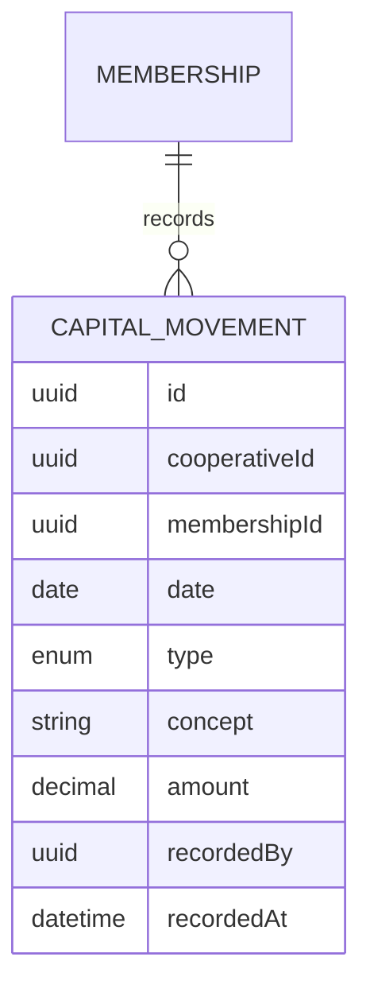

# Requirements · 06 · Member area

**Date**: 2026-10-04 · **Status**: Draft to validate

Member record and their contributions to the share capital. In the MVP it is **read-only** for the member; the data is loaded by the cooperative.

Permissions: module `member_area`. The member reads their own data; the governing board reads everything; manager and administrator manage everything.

## 1. User stories

### Must

#### US-MEM-01 · See my record

As a member, I want to see my data in the cooperative.

- **Given** my membership, **when** I open the member area, **then** I see member number, joining date, profile and contact details.

#### US-MEM-02 · See my contributions

As a member, I want to see how much I have contributed to the share capital and the detail of each movement.

- **Given** my capital movements, **when** I consult them, **then** I see the total capital and the list of movements with date, type, concept and amount.
- **Given** that I have no movements, **when** I consult, **then** I see zero capital and an explanatory message.

#### US-MEM-03 · Register capital movements

As a manager, I want to register a member's contributions and refunds.

- **Given** a member of my cooperative, **when** I register a movement with date, type, concept and positive amount, **then** it is added to their history and their capital is recalculated.
- **Given** a refund greater than the member's available capital, **when** I try to register it, **then** it is rejected.

### Should

#### US-MEM-04 · See the capital of all members

- **Given** read permission with "all" scope, **when** I open the list, **then** I see each member's capital and the cooperative's total.

### Could

- Export the contributions statement to PDF.
- Let the member request an update of their contact details.

### Won't

- Editing of their data by the member.
- Calculation of interest or cooperative returns.
- Process of joining or leaving as a member.

## 2. Business rules

| Id        | Rule                                                                                      |
| --------- | ----------------------------------------------------------------------------------------- |
| BR-MEM-01 | Capital movements are immutable. A mistake is corrected with a movement of opposite sign. |
| BR-MEM-02 | Types: mandatory contribution, voluntary contribution, refund, correction.                |
| BR-MEM-03 | Member's capital = sum of contributions − refunds ± corrections. Never negative.          |
| BR-MEM-04 | Amounts in euros with exact decimals.                                                     |
| BR-MEM-05 | Contributions do not influence the right to vote (BR-ASM-01).                             |

## 3. Model

(Types in code: `mandatory_contribution`, `voluntary_contribution`, `refund`, `correction`.)

The member number, joining date and member status live in the membership (see [01-access-and-profiles.md](01-access-and-profiles.md)).

## 4. API

| Method | Route                                                                        | Use                   | Level    |
| ------ | ---------------------------------------------------------------------------- | --------------------- | -------- |
| GET    | `/cooperatives/{cooperativeId}/member-area/me`                               | My record and capital | Read own |
| GET    | `/cooperatives/{cooperativeId}/member-area/me/movements`                     | My movements          | Read own |
| GET    | `/cooperatives/{cooperativeId}/member-area/members`                          | List with capital     | Read all |
| GET    | `/cooperatives/{cooperativeId}/member-area/members/{membershipId}/movements` | A member's movements  | Read all |
| POST   | `/cooperatives/{cooperativeId}/member-area/members/{membershipId}/movements` | Register movement     | Manage   |

(The routes live under `member-area` so as not to collide with the user management routes `/members` of [01-access-and-profiles.md](01-access-and-profiles.md).)

## 5. Screens

1. My record with total capital.
2. Capital movements.
3. Members list and movement registration (manage level).

## 6. Test strategy

- **Domain**: capital calculation, rejection of refunds that leave negative capital, immutability.
- **Permissions**: a member does not see another member's record (404); the governing board reads but does not register (403).
