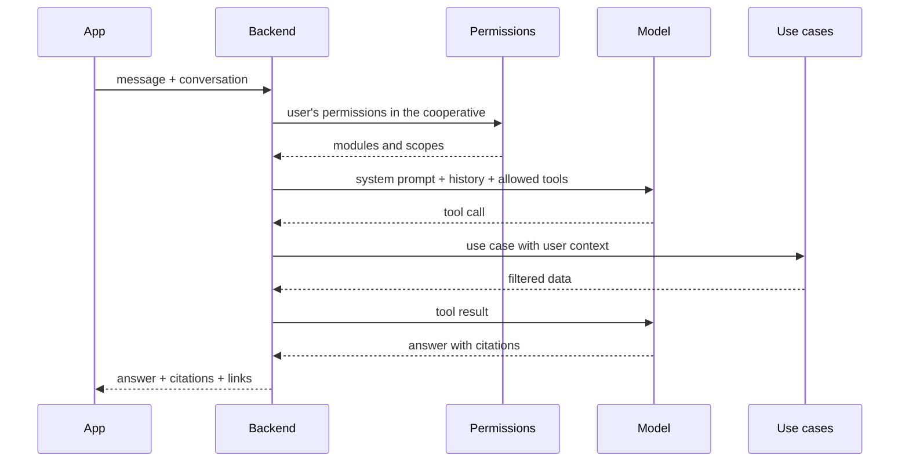
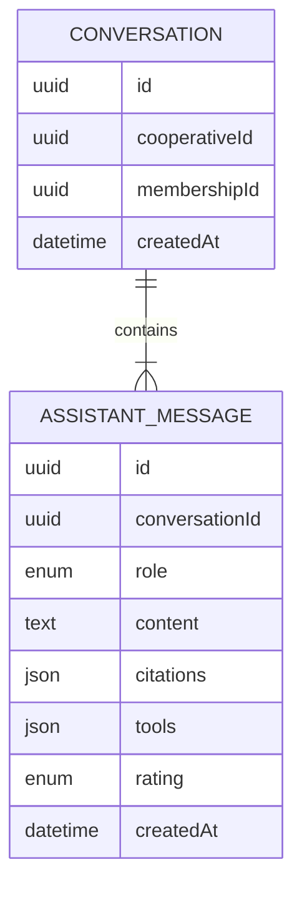

# Requirements · 07 · AI assistant

**Date**: 2026-10-04 · **Status**: Accepted in essence. Implemented except the conversation history screen.

Conversational assistant that answers the user's questions about their cooperative by combining two sources:

- **RAG** over the cooperative's documents ([03-documents.md](03-documents.md)): bylaws, regulations, minutes, accounts.
- **Tool calling** over the cooperative data the user has access to: assemblies, announcements, contributions and, for those who manage, delivery notes, invoices and third parties.

Permissions: module `assistant`, read level for all predefined profiles. **The assistant inherits the user's permissions**: it cannot tell anything that the user could not see in the app (ADR-004).

## 1. User stories

### Must

#### US-AI-01 · Ask about the documents

As a user, I want to ask in natural language about the bylaws, the regulations or the minutes.

- **Given** a question whose answer is in my cooperative's indexed documents, **when** I send it, **then** I receive an answer in Spanish with citations to the document and page.
- **Given** a question whose answer is not in the documents, **when** I send it, **then** the assistant says it cannot find it in the documentation, without making things up.
- **Given** a citation, **when** I tap it, **then** the document opens at the cited page.

#### US-AI-02 · Ask about my data

As a user, I want to ask about assemblies, my contributions or, if I manage, invoices and delivery notes.

- **Given** a manager who asks "which supplier invoices fall due this week?", **when** they send it, **then** the assistant queries the invoices and answers with the real data and links to each one.
- **Given** the question "when is the next assembly and what is voted on?", **when** I send it, **then** it answers with the date and the votable items.
- **Given** a manager who asks "which is the newest supplier?" or "which suppliers did we register this week?", **when** they send it, **then** the assistant lists the third parties newest first (by creation date) with a link to each one, instead of searching by name.
- **Given** that the tool returns no results, **when** it answers, **then** it states so clearly.

#### US-AI-03 · Respect my permissions

As the person in charge of the cooperative, I want the assistant not to reveal information to those who do not have access.

- **Given** a member with "own" scope, **when** they ask about another member's contributions, **then** the assistant answers that it cannot access that information.
- **Given** a member without access to invoices, **when** they ask how much is owed to a supplier, **then** the assistant answers that it does not have access to that information.
- **Given** a profile without access to a module, **when** they ask about that module, **then** the corresponding tool is not available and the assistant states so.
- **Given** documents of another cooperative with similar text, **when** I ask, **then** they are never retrieved or cited.

#### US-AI-04 · Conversation with context

As a user, I want to ask follow-up questions without repeating the context.

- **Given** an open conversation, **when** I ask a follow-up question ("and the previous one?"), **then** the assistant uses the previous turns.
- **Given** that I switch active cooperative, **when** I return to the assistant, **then** a new conversation starts.

### Should

#### US-AI-05 · Rate the answers

- **Given** an answer, **when** I mark it as helpful or not helpful, **then** it is recorded to evaluate quality.

#### US-AI-06 · Suggested questions

- **Given** an empty conversation, **when** I open the assistant, **then** I see suggested questions according to the modules I have access to.

#### US-AI-07 · Choose the assistant's local model

- **Given** I administer the cooperative (module `users`, manage level) and the server runs the assistant on local models, **when** I open Settings, **then** I see the "AI assistant" section with the models I can choose (allowlisted by the operator and installed), the one in use marked, and I can save another one.
- **Given** I saved a model, **when** any member of my cooperative asks the assistant, **then** the answer comes from that model; other cooperatives keep theirs.
- **Given** the saved model is no longer allowed or installed, **when** someone asks, **then** the server default answers and nothing fails.
- **Given** I do not administer the cooperative, **then** I do not see the section and the API answers 403; a user of another cooperative gets 404.
- **Given** the assistant runs on Gemini, **then** the section only says that no local model is in use.
- The change is recorded in the audit log, and the app warns that the first answer after a change may take longer (the model is loaded).

### Could

- Streaming response.
- Automatic summary of minutes.

### Won't

- Actions with effects (register, vote, pay) from the assistant. Read-only.
- Legal or tax advice.
- Voice input.

## 2. Business rules

| Id       | Rule                                                                                                                                                                                                                                                                                                                                                                                                           |
| -------- | -------------------------------------------------------------------------------------------------------------------------------------------------------------------------------------------------------------------------------------------------------------------------------------------------------------------------------------------------------------------------------------------------------------- |
| BR-AI-01 | The tools available in each request are computed from the user's permissions in the active cooperative.                                                                                                                                                                                                                                                                                                        |
| BR-AI-02 | Each tool reuses the use cases of its module, with the same user and cooperative context. It does not access the database on its own.                                                                                                                                                                                                                                                                          |
| BR-AI-03 | All tools are read-only.                                                                                                                                                                                                                                                                                                                                                                                       |
| BR-AI-04 | The RAG search always filters by `cooperativeId` before ordering by similarity.                                                                                                                                                                                                                                                                                                                                |
| BR-AI-05 | Answers based on documents include at least one citation. Without relevant chunks, the assistant says so.                                                                                                                                                                                                                                                                                                      |
| BR-AI-06 | Content retrieved from documents is treated as data, not as instructions.                                                                                                                                                                                                                                                                                                                                      |
| BR-AI-07 | Conversations are stored per user and cooperative, and only their author sees them.                                                                                                                                                                                                                                                                                                                            |
| BR-AI-08 | Limit of 30 messages per user and hour (per membership: user and cooperative), configurable with `ASSISTANT_MESSAGE_LIMIT_PER_HOUR`.                                                                                                                                                                                                                                                                           |
| BR-AI-09 | With the Ollama provider each request runs on the model chosen by its cooperative (US-AI-07). Only models in `ASSISTANT_OLLAMA_MODELS` that are installed in Ollama can be chosen; the API never downloads models. If the saved model is no longer offered, the server default (`ASSISTANT_OLLAMA_MODEL`) answers. Only whoever manages the `users` module can read or change it, and every change is audited. |

## 3. Tools

| Tool                                                                               | Required module      | Returns                                                                                               |
| ---------------------------------------------------------------------------------- | -------------------- | ----------------------------------------------------------------------------------------------------- |
| `search_documents(query)`                                                          | Documents · read     | Chunks with document and page                                                                         |
| `list_invoices(operation?, status?, third_party?, from?, to?)`                     | Invoices · read      | Received or issued invoices                                                                           |
| `list_delivery_notes(operation?, status?, third_party?, from?, to?)`               | Invoices · read      | Purchase or sales delivery notes                                                                      |
| `payments_and_collections_summary()`                                               | Invoices · read      | Pending and overdue payments and collections                                                          |
| `find_third_party(text)`                                                           | Invoices · read      | Suppliers and customers by name or tax ID (NIF)                                                       |
| `list_third_parties(type?, created_from?, created_to?, include_inactive?, limit?)` | Invoices · read      | Suppliers and customers, newest first (default 10, max 50); inactive ones only if the user can manage |
| `upcoming_assemblies()`                                                            | Assemblies · read    | Called assemblies and votable items                                                                   |
| `voting_result(assembly?)`                                                         | Assemblies · read    | Results of closed votings                                                                             |
| `my_contributions(n?)`                                                             | Member area · read   | The user's own capital and latest movements (`n` up to 20, default 10), whatever their scope          |
| `latest_announcements(n?)`                                                         | Announcements · read | Recent published announcements                                                                        |

## 4. Flow

## 5. Non-functional requirements

| Id        | Requirement                                                                                         |
| --------- | --------------------------------------------------------------------------------------------------- |
| NFR-AI-01 | First response in under 8 seconds at the 95th percentile.                                           |
| NFR-AI-02 | The model provider sits behind an interface (port) so it can be replaced.                           |
| NFR-AI-03 | The provider's keys live only in the backend.                                                       |
| NFR-AI-04 | Latency, tokens and tools used per request are logged, without the personal content.                |
| NFR-AI-05 | An evaluation set exists with at least 20 questions and expected answers, runnable in CI.           |
| NFR-AI-06 | A client cannot make the server download or run a model outside the operator's allowlist (ADR-014). |

## 6. Specific security

- **Prompt injection**: an uploaded document may contain text aimed at the model. It is mitigated by delimiting the retrieved content, stating so in the system prompt and, above all, with BR-AI-02 and BR-AI-03: even if the model strays, it can only call read tools that already filter by permissions.
- **Leakage between cooperatives**: the cooperative filter is in the query, not in the prompt.
- **Model choice abuse**: the per-cooperative model comes from an allowlist and must be installed already; nothing the client sends is passed to Ollama as a model name unless it passed both checks (NFR-AI-06, ADR-014).
- **Hallucinations**: answers anchored to citations and tool data; if there is no basis, it says so.

## 7. Model

## 8. API

| Method | Route                                                                             | Use                 |
| ------ | --------------------------------------------------------------------------------- | ------------------- |
| POST   | `/cooperatives/{cooperativeId}/assistant/conversations`                           | Create conversation |
| GET    | `/cooperatives/{cooperativeId}/assistant/conversations`                           | My conversations    |
| POST   | `/cooperatives/{cooperativeId}/assistant/conversations/{conversationId}/messages` | Send message        |
| POST   | `/cooperatives/{cooperativeId}/assistant/messages/{messageId}/rating`             | Rate answer         |
| GET    | `/cooperatives/{cooperativeId}/assistant/conversations/{conversationId}`          | Messages of one     |

The last route is not in the first draft: the app needs it to reopen a conversation. Over the limit the API answers 429 with `Retry-After`; without `GEMINI_API_KEY`, 503 `assistant_unavailable` ([ADR-009](../adr/ADR-009-gemini-language-and-vision-model.md)).

## 9. Screens

1. Chat with suggested questions, tappable citations and links to invoices, assemblies and documents.
2. Conversation history.

## 10. Test strategy

- **Unit**: tool selection according to permissions for the 4 profiles.
- **Integration with a simulated model**: each tool invokes its use case with the correct context.
- **Isolation**: two cooperatives with almost identical documents; no question retrieves chunks from the other.
- **Evaluation**: 23 questions with expected tools, citations and facts (`modules/assistant/evaluation`). They run in CI through the production use case with fixed data and a rule-based model, and against the real model with `pnpm --filter @multicooperativa/api ai:eval`.
- **Injection**: test document with malicious instructions; the assistant neither follows them nor widens its access.
