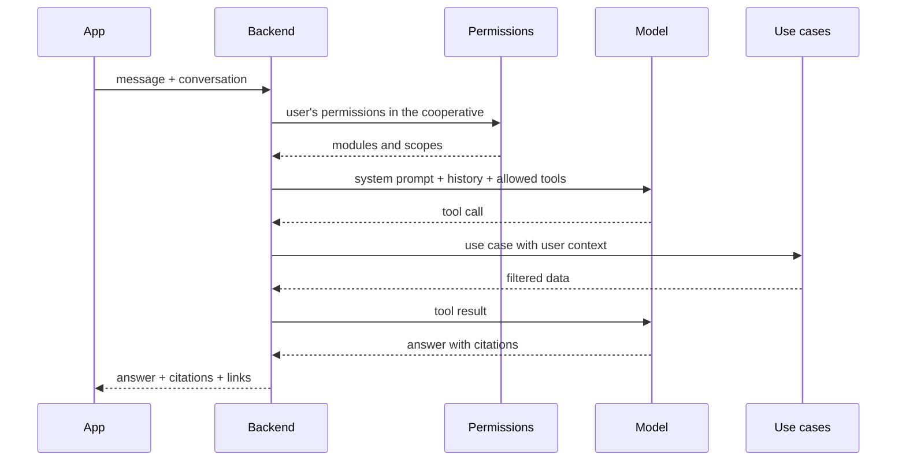
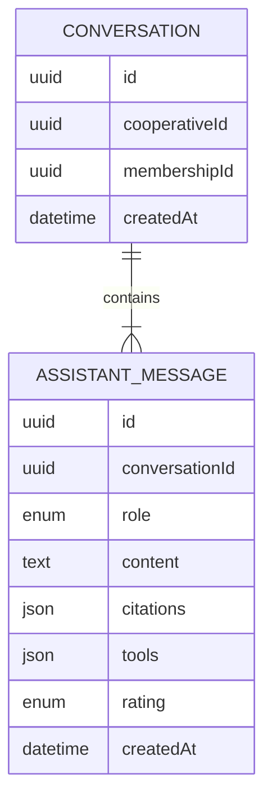

# Requirements · 07 · AI assistant

**Date**: 2026-10-04 · **Status**: Accepted in essence. Implemented except the conversation history screen.

Conversational assistant that answers the user's questions about their cooperative by combining two sources:

- **RAG** over the cooperative's documents ([03-documents.md](03-documents.md)): bylaws, regulations, minutes, accounts.
- **Tool calling** over the cooperative data the user has access to: assemblies, announcements, contributions and, for those who manage, delivery notes, invoices and third parties.

Permissions: module `assistant`, read level for all predefined profiles. **The assistant inherits the user's permissions**: it cannot tell anything that the user could not see in the app (ADR-004).

## 1. User stories

### Must

#### US-AI-01 · Ask about the documents

As a user, I want to ask in natural language about the bylaws, the regulations or the minutes.

- **Given** a question whose answer is in my cooperative's indexed documents, **when** I send it, **then** I receive an answer in Spanish with citations to the document and page.
- **Given** a question whose answer is not in the documents, **when** I send it, **then** the assistant says it cannot find it in the documentation, without making things up.
- **Given** a citation, **when** I tap it, **then** the document opens at the cited page.

#### US-AI-02 · Ask about my data

As a user, I want to ask about assemblies, my contributions or, if I manage, invoices and delivery notes.

- **Given** a manager who asks "which supplier invoices fall due this week?", **when** they send it, **then** the assistant queries the invoices and answers with the real data and links to each one.
- **Given** the question "when is the next assembly and what is voted on?", **when** I send it, **then** it answers with the date and the votable items.
- **Given** a manager who asks "which is the newest supplier?" or "which suppliers did we register this week?", **when** they send it, **then** the assistant lists the third parties newest first (by creation date) with a link to each one, instead of searching by name.
- **Given** that the tool returns no results, **when** it answers, **then** it states so clearly.

#### US-AI-03 · Respect my permissions

As the person in charge of the cooperative, I want the assistant not to reveal information to those who do not have access.

- **Given** a member with "own" scope, **when** they ask about another member's contributions, **then** the assistant answers that it cannot access that information.
- **Given** a member without access to invoices, **when** they ask how much is owed to a supplier, **then** the assistant answers that it does not have access to that information.
- **Given** a profile without access to a module, **when** they ask about that module, **then** the corresponding tool is not available and the assistant states so.
- **Given** documents of another cooperative with similar text, **when** I ask, **then** they are never retrieved or cited.

#### US-AI-04 · Conversation with context

As a user, I want to ask follow-up questions without repeating the context.

- **Given** an open conversation, **when** I ask a follow-up question ("and the previous one?"), **then** the assistant uses the previous turns.
- **Given** that I switch active cooperative, **when** I return to the assistant, **then** a new conversation starts.
- **Given** I have asked before, **when** I open "History" from the assistant, **then** I see my conversations (the first question as title and the date of the last activity), newest first, loaded in pages, with pull to refresh and an empty state if there are none. Conversations that never received an answer are not listed.
- **Given** the history, **when** I tap a conversation, **then** the chat reopens with all its messages (answers keep their citations and ratings) and I can keep asking in it with its context; "New conversation" starts an empty one.
- **Given** a conversation of mine, **when** I delete it and confirm, **then** it disappears from the history with all its messages and ratings (privacy: the user decides how long their questions are kept). If it was open, the chat empties.
- **Given** a conversation of another user or of another cooperative, **when** I list, read, write to or delete it, **then** the API answers 404 and nothing changes (BR-AI-07). Deleting writes nothing sensitive to the logs.

### Should

#### US-AI-05 · Rate the answers

- **Given** an answer, **when** I mark it as helpful or not helpful, **then** it is recorded to evaluate quality.

#### US-AI-06 · Suggested questions

- **Given** an empty conversation, **when** I open the assistant, **then** I see suggested questions according to the modules I have access to.

#### US-AI-07 · Choose the assistant's local model

- **Given** I administer the cooperative (module `users`, manage level) and the server runs the assistant on local models, **when** I open Settings, **then** I see the "AI assistant" sub-page with the models I can choose (allowlisted by the operator and installed), the one in use marked, and I can save another one.
- **Given** I saved a model, **when** any member of my cooperative asks the assistant, **then** the answer comes from that model; other cooperatives keep theirs.
- **Given** the saved model is no longer allowed or installed, **when** someone asks, **then** the server default answers and nothing fails.
- **Given** I do not administer the cooperative, **then** I do not see the section and the API answers 403; a user of another cooperative gets 404.
- **Given** the assistant runs on Gemini, **then** the section only says that no local model is in use.
- The change is recorded in the audit log, and the app warns that the first answer after a change may take longer (the model is loaded).
- **Given** the server has `ASSISTANT_SECRETS_KEY` and I administer the cooperative, **when** I choose "External provider", pick Groq, Mistral, NVIDIA NIM or OpenRouter, type a model id and the cooperative's own API key and save, **then** the server checks the key and the model with the provider, stores the key encrypted and every question of the cooperative is answered by that provider; the key is never shown again (only its last four characters) and leaving the field empty later keeps it. The app warns that the cooperative's questions and data are sent to that provider.
- **Given** the provider rejects the key, **then** nothing is saved and the API answers 422 `assistant_provider_key_invalid`; if it does not list the model, 422 `assistant_model_not_available`; if it cannot be reached, 502 `assistant_provider_unreachable`. Without `ASSISTANT_SECRETS_KEY` the section does not offer it and the API answers 409 `hosted_provider_unavailable`.
- **Given** the cooperative uses an external provider and it fails (key revoked, quota, overload, timeout), **when** someone asks, **then** the server's own model answers and nothing fails. Going back to the local model erases the stored key.

#### US-AI-08 · Ask about figures, rankings and what is pending

As a manager, I want the assistant to give me totals, rankings and forecasts of invoicing that it computes exactly, instead of reading long lists.

- **Given** the question "who are our top 5 suppliers this year?", **when** I send it, **then** the totals are added up by the database per supplier and the answer lists them highest first with exact amounts, never added by the model.
- **Given** a list with more rows than the cap, **when** the assistant answers, **then** it says "muestro X de N" because the tool returned `total` and `truncated`.
- **Given** an invoice number, **when** I ask for its detail, **then** I get its lines, delivery notes and differences with the numeric detail first; the AI explanation is presented as indicative (BR-INV-12).
- **Given** the question "what do we have to pay in the coming weeks?", **when** I send it, **then** the pending and overdue invoices appear bucketed by due week or month.
- **Given** the question "what do we buy most?" or "how has oil evolved by month?", **when** I send it, **then** quantities are added per concept and unit ignoring case, accents and extra spaces.
- **Given** the question "which suppliers have we not traded with since June?" or "which are the oldest delivery notes pending invoicing?", **when** I send it, **then** the assistant answers from the activity dates and the age in days.
- **Given** a relative period ("este trimestre", "el mes pasado", "la semana que viene", "últimos 30 días"), **when** I ask, **then** the assistant passes `period` and the server resolves the dates (weeks Monday to Sunday, Europe/Madrid calendar day); the result carries `period: {from, to}` and the answer states those dates, so a small model never does date arithmetic.
- **Given** the answer to "¿cuánto hemos facturado este trimestre?", **when** it is shown, **then** it carries "Fuentes": up to 5 of the invoices behind the figure, each opening its detail (BR-AI-05); the same for the cash forecast, the top items (delivery notes), the partner trade (third parties) and the ranking of suppliers (the suppliers).
- **Given** a member without access to invoices, **when** they ask for any of this, **then** the tools are not available and the assistant states so (US-AI-03).

#### US-AI-09 · Ask about partners, capital and who is also a supplier

As the board or a manager, I want the assistant to answer about the partners and their capital, and to cross partners with suppliers.

- **Given** the question "¿Cuánto capital social tiene la cooperativa?", **when** I have the member area with "all" scope, **then** `partners_summary` answers with the exact total and number of partners; "¿cuánto se aportó este año?" adds the period's contributions and refunds.
- **Given** "¿Cuántos socios activos hay y cuántas altas ha habido?", **then** `partners_summary` answers with the head counts and the joins and leaves of the period.
- **Given** "¿Cuánto capital tiene el socio Luis Martín?", **then** `member_detail` finds the partner by name or number and gives record, NIF, capital and latest movements; if several match, it gives their summary and the assistant asks which one.
- **Given** "¿Cuánto le compramos a nuestros socios?" or "¿Qué socios son también proveedores?", **when** I also have invoicing read, **then** `partner_trade` crosses the partners' NIFs with the third parties and totals purchases and sales per partner (exact decimals).
- **Given** a member with "own" scope, **when** they ask for another member's capital, the cooperative's capital or any of the above, **then** the tools are not available and the assistant says "No tengo acceso a esa información" (US-AI-03, BR-MEM-06).

### Could

- Streaming response.
- Automatic summary of minutes.

### Won't

- Actions with effects (register, vote, pay) from the assistant. Read-only.
- Legal or tax advice.
- Voice input.

## 2. Business rules

| Id       | Rule                                                                                                                                                                                                                                                                                                                                                                                                                                                                                                                                                                                                                   |
| -------- | ---------------------------------------------------------------------------------------------------------------------------------------------------------------------------------------------------------------------------------------------------------------------------------------------------------------------------------------------------------------------------------------------------------------------------------------------------------------------------------------------------------------------------------------------------------------------------------------------------------------------- |
| BR-AI-01 | The tools available in each request are computed from the user's permissions in the active cooperative.                                                                                                                                                                                                                                                                                                                                                                                                                                                                                                                |
| BR-AI-02 | Each tool reuses the use cases of its module, with the same user and cooperative context. It does not access the database on its own.                                                                                                                                                                                                                                                                                                                                                                                                                                                                                  |
| BR-AI-03 | All tools are read-only.                                                                                                                                                                                                                                                                                                                                                                                                                                                                                                                                                                                               |
| BR-AI-04 | The RAG search (hybrid: vector plus accent-insensitive full-text, ADR-022, ADR-023) always filters by `cooperativeId` before ranking.                                                                                                                                                                                                                                                                                                                                                                                                                                                                                  |
| BR-AI-05 | Answers based on documents include at least one citation. Without relevant chunks, the assistant says so. Computed figures (totals, rankings, forecasts) are traceable too: the tool returns up to 5 sources per figure (`sources`, plus `moreSources` when there are others) and the answer cites them like a document.                                                                                                                                                                                                                                                                                               |
| BR-AI-06 | Content retrieved from documents is treated as data, not as instructions.                                                                                                                                                                                                                                                                                                                                                                                                                                                                                                                                              |
| BR-AI-07 | Conversations are stored per user and cooperative, and only their author sees them.                                                                                                                                                                                                                                                                                                                                                                                                                                                                                                                                    |
| BR-AI-08 | Limit of 30 messages per user and hour (per membership: user and cooperative), configurable with `ASSISTANT_MESSAGE_LIMIT_PER_HOUR`.                                                                                                                                                                                                                                                                                                                                                                                                                                                                                   |
| BR-AI-09 | With the Ollama provider each request runs on the model chosen by its cooperative (US-AI-07). Only models in `ASSISTANT_OLLAMA_MODELS` that are installed in Ollama can be chosen; the API never downloads models. If the saved model is no longer offered, the server default (`ASSISTANT_OLLAMA_MODEL`) answers. Only whoever manages the `users` module can read or change it, and every change is audited.                                                                                                                                                                                                         |
| BR-AI-10 | A cooperative may use a hosted OpenAI-compatible provider (`groq`, `mistral`, `nvidia`, `openrouter`: a fixed catalog, never a client-supplied URL) with its own API key (ADR-019). The key is encrypted with AES-256-GCM under `ASSISTANT_SECRETS_KEY`, checked against the provider's `/models` on save, and never returned, logged or audited (only its last four characters). It overrides `ASSISTANT_LLM_PROVIDER` for that cooperative; when the provider fails the server's model answers. Same permission and audit event as BR-AI-09, with the choice written `hosted:<provider>/<model>` or `local:<model>`. |

## 3. Tools

The catalog goes into every model call, and the local model reads it on CPU, so descriptions are short and say when to use a tool. Rules that apply to every tool (periods, citations, "muestro X de N") are written once, in the system prompt, and the system prompt only carries the rules and denial examples that fit the user's tools (`domain/system-prompt.ts`); denials still rest on the tools the profile gets, not on the prompt (BR-AI-01). Results that a small model tends to summarize badly carry a ready-to-quote Spanish `text` (a total with its dates and invoices, a discrepancy with delivered, invoiced and difference, a partner with NIF and capital).

| Tool                                                                                               | Required module                                | Returns                                                                                                                                                                                                                                                                                                         |
| -------------------------------------------------------------------------------------------------- | ---------------------------------------------- | --------------------------------------------------------------------------------------------------------------------------------------------------------------------------------------------------------------------------------------------------------------------------------------------------------------- |
| `search_documents(query)`                                                                          | Documents · read                               | Chunks with document and page                                                                                                                                                                                                                                                                                   |
| `list_invoices(operation?, status?, third_party?, from?, to?, period?, date?)`                     | Invoices · read                                | Received or issued invoices with base, VAT rate, total, due date, status and settlement date; `date` (`issued`, `due`, `settled`) is the date that `from`/`to`/`period` filter (default `settled` when `status=settled`, otherwise `issued`); at most 25 rows plus `total` and `truncated`                      |
| `invoice_totals(operation?, status?, third_party?, from?, to?, period?, date?, group_by?, limit?)` | Invoices · read                                | Count, base, VAT amount and total computed by the database as exact decimals, plus `text`; `date` = `issued` or `settled`; `group_by` = `none`, `third_party` (ranking by total, highest first: "top 5 suppliers this year") or `month`; voided invoices excluded unless asked                                  |
| `invoice_detail(number, operation?, third_party?)`                                                 | Invoices · read                                | One invoice by number: header, base, VAT, total, payment, lines, linked delivery notes and differences (numbers and their `text` first, then the AI explanation, which is only indicative)                                                                                                                      |
| `open_discrepancies(operation?)`                                                                   | Invoices · read                                | Invoices still to pay or collect whose delivery notes do not match, with the per-concept differences and their explanation, most urgent first                                                                                                                                                                   |
| `payments_and_collections_summary()`                                                               | Invoices · read                                | Pending and overdue payments and collections now, open discrepancies and stale delivery notes                                                                                                                                                                                                                   |
| `cash_forecast(from?, to?, period?, group_by?)`                                                    | Invoices · read                                | Pending and overdue invoices bucketed by due date (`from`/`to`/`period` are due dates; `week` Monday to Sunday, or `month`): total, count and overdue part to pay and to collect, plus `text` with the soonest invoices                                                                                         |
| `list_delivery_notes(operation?, status?, third_party?, from?, to?, period?, sort?)`               | Invoices · read                                | Purchase or sales delivery notes with their lines; those pending invoicing carry `ageDays`; `sort=oldest_first` for the oldest pending; at most 25 rows plus `total` and `truncated`                                                                                                                            |
| `top_items(source?, operation?, from?, to?, period?, concept?, group_by?, limit?)`                 | Invoices · read                                | Quantities of delivery note (or invoice) lines added per normalized concept (trim, lowercase, collapsed spaces, no accents) and unit, highest first; with `concept` and `group_by=month`, the monthly evolution                                                                                                 |
| `find_third_party(text)`                                                                           | Invoices · read                                | A supplier or customer by name or tax ID (NIF): with one match, its data, pending and overdue to pay or collect, last delivery note and invoice, counts and totals of the current year; with several, the list to choose from                                                                                   |
| `list_third_parties(type?, from?, to?, period?, include_inactive?, inactive_since?, limit?)`       | Invoices · read                                | Suppliers and customers, newest first (`from`/`to`/`period` are registration dates; default 10, max 50, plus `total` and `truncated`); inactive ones only if the user can manage; with `inactive_since`, the active ones with no delivery note or invoice since that date (`lastActivity`, longest quiet first) |
| `upcoming_assemblies()`                                                                            | Assemblies · read                              | Called assemblies and votable items                                                                                                                                                                                                                                                                             |
| `voting_result(assembly?)`                                                                         | Assemblies · read                              | Results of closed votings                                                                                                                                                                                                                                                                                       |
| `my_contributions(n?)`                                                                             | Member area · read                             | The user's own capital and latest movements (`n` up to 20, default 10), whatever their scope                                                                                                                                                                                                                    |
| `partners_summary(from?, to?, period?)`                                                            | Member area · read, "all" scope                | Total share capital and number of partners; active, suspended and invited-not-activated partners now; in the period, contributions, refunds, net corrections, joins and leaves (exact decimals)                                                                                                                 |
| `member_detail(query, n?)`                                                                         | Member area · read, "all" scope                | Partners matching a name, email or partner number (at most 5): record with NIF and capital; with a single match, also its latest `n` movements                                                                                                                                                                  |
| `partner_trade(from?, to?, period?)`                                                               | Member area · read ("all") and Invoices · read | Partners whose NIF equals that of a supplier or customer: purchases and sales of the period per partner and in total, voided invoices excluded (ADR-025)                                                                                                                                                        |
| `latest_announcements(n?)`                                                                         | Announcements · read                           | Recent published announcements                                                                                                                                                                                                                                                                                  |

`partners_summary` replaces the `capital_summary` and `member_census` of ADR-025 (same permission, one call), and `find_third_party` absorbs the former `third_party_summary`.

### 3.1 Relative periods (`period`)

Every tool that takes a date range accepts `period`, resolved on the server by a pure domain function (`domain/period.ts`) against the cooperative's calendar day (Europe/Madrid): `today`, `this_week`, `last_week`, `next_week` (Monday to Sunday, like `cash_forecast`), `this_month`, `last_month`, `next_month`, `this_quarter`, `last_quarter`, `this_year`, `last_year`, `last_30_days` and `next_30_days` (both count today as one of the 30 days); also a month by name in English or Spanish (`september`, `septiembre`: that month of the current year), `YYYY-MM` and `YYYY`. Case, spaces and hyphens are ignored. The values are listed once in the system prompt instead of as an enum in every tool.

- **Which date**: `period` fills the tool's main range: the issue date (`from`/`to`) for `list_invoices`, `list_delivery_notes`, `invoice_totals`, `top_items` and `partner_trade`; the due date for `cash_forecast`; the registration date for `list_third_parties`; the period of `partners_summary`. `list_invoices` and `invoice_totals` take `date` (`issued`, `due` only for `list_invoices`, `settled`) to apply `from`/`to`/`period` to another date; it defaults to `settled` when `status=settled` ("facturas pagadas en septiembre") and to `issued` otherwise.
- **Explicit dates win**: if `from` or `to` (of the date chosen) is given, `period` is ignored instead of rejected, so a model that sends both still gets an answer. A named month or "from March to May" is sent as explicit `YYYY-MM-DD`.
- **Echo**: when a period was used the result carries `period: {from, to}` with the resolved dates, and any dated result carries `periodText` ("del 2026-10-01 al 2026-12-31") that the answer repeats.
- An unknown value is rejected as invalid input so the model can retry (BR-AI-06).

### 3.2 Citations of computed figures

Tools that return records cite them one by one (`ref`). Tools that return a computed figure also return the records behind it as `sources` (`ref` and title), at most 5 per figure, and `moreSources: N` when there are more; the app shows them as "Fuentes" like documents and the answer must not present them as the complete list.

| Tool                                                    | Sources                                                                                                                                      |
| ------------------------------------------------------- | -------------------------------------------------------------------------------------------------------------------------------------------- |
| `invoice_totals`                                        | `group_by=third_party`: the ranked third parties (one per row). `none` or `month`: up to 5 invoices of the filter (voided ones excluded)     |
| `cash_forecast`                                         | Up to 5 pending or overdue invoices of the range, the soonest to fall due first                                                              |
| `top_items`                                             | Up to 5 delivery notes (or invoices) of the range; with `concept` only the delivery notes that have it; none for invoices with `concept`     |
| `partner_trade`                                         | Up to 5 of the third parties that are also partners                                                                                          |
| `find_third_party`                                      | The third party                                                                                                                              |
| `partners_summary`, `member_detail`, `my_contributions` | None: the member record opens under the `users` permission, which these tools do not require, so it is not a source the user may always open |

Permissions are inherited: sources come from the same reads, with the user's context, so only records the user can open appear (BR-AI-02).

## 4. Flow

## 5. Non-functional requirements

| Id        | Requirement                                                                                         |
| --------- | --------------------------------------------------------------------------------------------------- |
| NFR-AI-01 | First response in under 8 seconds at the 95th percentile.                                           |
| NFR-AI-02 | The model provider sits behind an interface (port) so it can be replaced.                           |
| NFR-AI-03 | The provider's keys live only in the backend.                                                       |
| NFR-AI-04 | Latency, tokens and tools used per request are logged, without the personal content.                |
| NFR-AI-05 | An evaluation set exists with at least 20 questions and expected answers, runnable in CI.           |
| NFR-AI-06 | A client cannot make the server download or run a model outside the operator's allowlist (ADR-014). |

## 6. Specific security

- **Prompt injection**: an uploaded document may contain text aimed at the model. It is mitigated by delimiting the retrieved content, stating so in the system prompt and, above all, with BR-AI-02 and BR-AI-03: even if the model strays, it can only call read tools that already filter by permissions.
- **Leakage between cooperatives**: the cooperative filter is in the query, not in the prompt.
- **Model choice abuse**: the per-cooperative model comes from an allowlist and must be installed already; nothing the client sends is passed to Ollama as a model name unless it passed both checks (NFR-AI-06, ADR-014).
- **Hallucinations**: answers anchored to citations and tool data; if there is no basis, it says so.

## 7. Model

## 8. API

| Method | Route                                                                             | Use                 |
| ------ | --------------------------------------------------------------------------------- | ------------------- |
| POST   | `/cooperatives/{cooperativeId}/assistant/conversations`                           | Create conversation |
| GET    | `/cooperatives/{cooperativeId}/assistant/conversations?limit=&before=`            | My conversations    |
| DELETE | `/cooperatives/{cooperativeId}/assistant/conversations/{conversationId}`          | Delete conversation |
| POST   | `/cooperatives/{cooperativeId}/assistant/conversations/{conversationId}/messages` | Send message        |
| POST   | `/cooperatives/{cooperativeId}/assistant/messages/{messageId}/rating`             | Rate answer         |
| GET    | `/cooperatives/{cooperativeId}/assistant/conversations/{conversationId}`          | Messages of one     |

The listing returns `{ items, nextCursor }` (default 20, up to 100, newest activity first; `before` is the `nextCursor` of the previous page); deleting answers 204 and also removes the messages and their ratings. The `GET` of one conversation is not in the first draft: the app needs it to reopen a conversation. Over the limit the API answers 429 with `Retry-After`; without `GEMINI_API_KEY`, 503 `assistant_unavailable` ([ADR-009](../adr/ADR-009-gemini-language-and-vision-model.md)).

## 9. Screens

1. Chat with suggested questions, tappable citations and links to invoices, assemblies and documents.
2. Conversation history (reopen, new conversation, delete with confirmation), reached from the assistant's header.

## 10. Test strategy

- **Unit**: tool selection according to permissions for the 4 profiles.
- **Integration with a simulated model**: each tool invokes its use case with the correct context.
- **Isolation**: two cooperatives with almost identical documents; no question retrieves chunks from the other.
- **Evaluation**: 60 questions with expected tools, citations and facts (`modules/assistant/evaluation`). They run in CI through the production use case with fixed data and a rule-based model, and against the real model with `pnpm --filter @multicooperativa/api ai:eval`. Relative periods (`period`), cited figures and a denial for every tool a profile may lack are covered (a test fails if a tool has no positive case or no denial case); three of them are multi-turn follow-ups (`history` plus a check that the `search_documents` query is standalone, ADR-023). Retrieval itself is measured separately by the retrieval benchmark (NFR-DOC-05, `rag:eval`).
- **Injection**: test document with malicious instructions; the assistant neither follows them nor widens its access.
